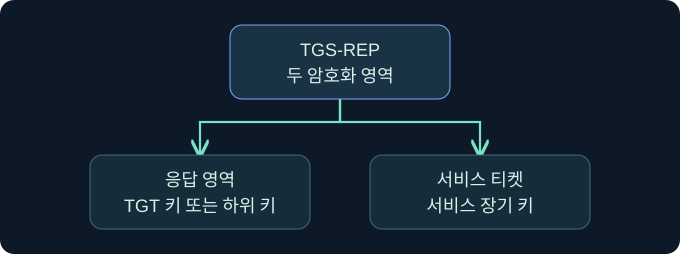
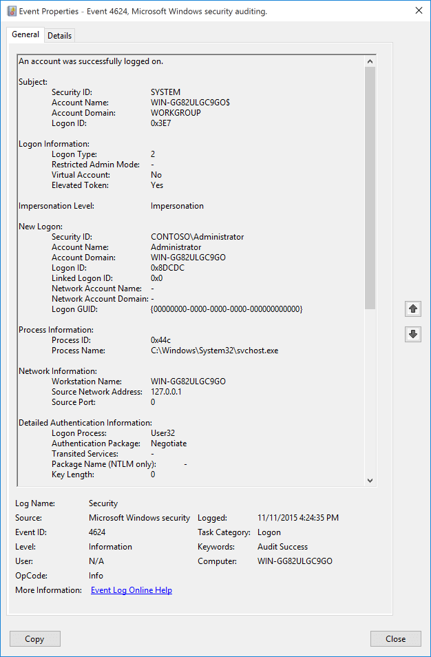

## 1. 발급받은 티켓은 어디에서 검사하나요?

가상의 문서 서비스가 새 서비스 티켓을 받은 사용자의 접속은 인정했지만, 제한된 문서는 열지 못하게 했습니다. 이유를 찾으려면 KDC가 티켓을 내준 단계와 서비스가 티켓을 받은 단계, 서비스가 권한을 적용한 단계를 구별해야 합니다. 앞 강의의 TGT와 대응 세션 키를 이미 갖고 있다고 가정합니다. 설명과 화면은 읽기 전용이며 실제 연결이나 티켓 처리는 미실행입니다.

## 2. TGS 요청에 들어가는 세 가지 요소를 읽습니다

일반적인 TGS-REQ에서 클라이언트는 원하는 서비스 주체 이름을 지정하고 TGT와 이를 뒷받침하는 인증자(authenticator)를 보냅니다. 인증자는 현재 교환에 필요한 증명을 포함하며 TGT 세션 키로 보호됩니다. KDC는 자신의 TGS 키로 TGT를 열어 세션 키를 얻고 인증자와 요청을 검사합니다. 티켓만 이전에 관찰했다는 사실이 대응 키를 가지고 있다는 뜻은 아닙니다.

서비스 이름은 예를 들어 `HTTP/library.training.example`입니다. 서버가 하나여도 호스트 별칭과 서비스 종류에 따라 앱이 요청하는 이름은 달라질 수 있습니다. 이름이 없거나 등록이 모호한 경우, 앱이 다른 인증 방식으로 바뀌었는지까지 확인합니다. 어느 방식이 적용됐는지는 대상 기록과 정책에 근거합니다.

## 3. TGS 응답의 두 키 영역을 구별합니다

| 영역 | 보호하는 키 | 역할 |
|---|---|---|
| 클라이언트용 TGS 응답 영역 | TGT 세션 키 또는 해당 교환의 하위 키 | 클라이언트에 서비스 세션 키 전달 |
| 일반 서비스 티켓 내부 | 대상 서비스 주체의 장기 키 | 대상 서비스에 서비스 세션 키와 티켓 정보 전달 |
| AP 요청의 인증자 | 서비스 세션 키 | 티켓을 제시한 요청의 문맥과 키 보유 확인 |

서비스 계정의 암호 추측 위험을 설명할 때, 오프라인 추측의 대상은 일반적으로 서비스 티켓의 서비스 키로 보호된 부분입니다. 클라이언트가 읽는 TGS 응답 영역과 혼동하지 않습니다. 감사에서는 티켓의 암호 형식과 세션 키의 암호 형식, 사용한 서비스 계정과 발급 양상을 별도로 확인합니다. 분석에 필요한 비밀이나 티켓 본문을 수집하지 않습니다.

## 4. AP 교환을 서비스 프로토콜 안에서 찾습니다

AP-REQ는 서비스 티켓과 새 인증자를 전달합니다. 예를 들어 SMB의 인증 교환에서는 Kerberos 토큰이 협상 구조 안에 나타날 수 있으므로 독립된 패킷 이름만 찾으면 놓칠 수 있습니다. 서비스는 티켓에서 세션 키를 얻고 인증자의 시간·일치 여부 등을 검증합니다. 재전송을 관찰할 때는 요청 재시도와 실제 재사용 판단도 구별합니다.

상호 인증을 요청하는 경우 AP-REP는 인증자에서 받은 시간 필드 등을 서비스 세션 키로 보호해 돌려줍니다. 클라이언트는 자신이 보낸 값과 대조합니다. 이 검증은 키를 가진 서비스와 통신하는지 확인하는 절차입니다. 문서의 접근 권한이나 이후 애플리케이션 트래픽의 보호 방식은 별도 판단입니다.

## 5. PAC와 권한 결정의 위치를 확인합니다

PAC는 Windows Kerberos가 사용하는 권한 데이터 구조입니다. 사용자·그룹 관련 정보가 포함될 수 있고 서명 및 검증 방식은 구현과 패치 수준의 영향을 받습니다. 모든 서비스가 매번 같은 원격 검증을 한다고 가정하지 않습니다. PAC의 그룹 정보는 서비스 판단의 재료입니다. 실제 자원은 요청 동작과 ACL 등 자체 정책을 적용합니다.

| 관측 지점 | 확인하는 내용 | 남은 질문 |
|---|---|---|
| DC 4769 | 서비스 티켓 요청과 결과 | 서비스에 실제 제시됐는가 |
| 대상 4624 | 대상의 성공 로그온 문맥 | 같은 티켓과 요청에 해당하는가 |
| 서비스 감사 | 요청 경로와 작업 결과 | 권한 정책과 어떤 조건이 적용됐는가 |

## 6. 공식 콘솔에서 서비스 요청과 로컬 문맥을 구별합니다

### 실제 화면 133: Fortra Beacon Console

출처는 [Fortra Post Exploitation](https://hstechdocs.helpsystems.com/manuals/cobaltstrike/current/userguide/content/topics/post-exploitation_main.htm)입니다. 현행 안내서를 2026년 11월 9일 확인했습니다. 버전에 따라 메뉴나 배치가 달라질 수 있습니다. 공식 사진은 일반 콘솔이며 아래 조회 결과와 별개입니다.

**Cobalt Strike → Visualization → Session Table → 승인된 가상 LAB-AUTH07 행 우클릭 → Interact**를 선택하는 미실행 절차입니다. 하단 입력 줄에 `getuid`를 넣고 **Enter**를 누르는 위치를 읽습니다. 로컬 보고 문맥을 비교하기 위한 값이며 저장 버튼은 없습니다. 위쪽 반환 영역을 선택한 세션과 대조합니다. 콘솔의 가상 반환 및 실제 AP 교환 화면은 확보하지 못했습니다.

## 7. 공식 대상 로그에서 인증과 자원 감사를 연결합니다

### 실제 화면 134: Microsoft 이벤트 4624

출처는 [Microsoft 이벤트 4624](https://learn.microsoft.com/en-us/previous-versions/windows/it-pro/windows-10/security/threat-protection/auditing/event-4624)입니다. Used with permission from Microsoft. 이 공식 화면은 유형 2의 예시입니다. 가상의 네트워크 로그온 결과가 아니며 Windows 버전에 따라 필드가 다릅니다.

**Event Viewer → Action → Open Saved Log**에서 가상 `lab-library-security.evtx`를 골라 **Open**을 누르는 미실행 예입니다. 대상 호스트의 자료라는 뜻입니다. **Filter Current Log**의 ID 칸에 `4624`를 입력한 뒤 **OK**를 누르는 위치를 확인합니다. 원본은 별도로 저장하지 않습니다. **Details → XML View**에서 로그온 유형·인증 패키지·계정과 시각을 대조합니다. 네트워크 로그온을 검토할 때는 실제 서비스 기록까지 연결합니다. 필터와 가상 유형 3 결과 사진은 확보하지 못했습니다.

## 8. 가상 사건의 첫 미확인 지점을 찾습니다

| 조건 | 설명 가능한 범위 | 다음 확인 |
|---|---|---|
| 4769 성공, 대상 접속 실패 | 발급이 관측됐지만 제시는 미확인 | 도달성과 실제 서비스 이름 |
| 4769 성공, 대상에서 티켓 검증 오류 | 제시 이후 실패가 후보 | 서비스 키 일치, 실제 대상, 시간 |
| 새 4769 없음, 대상 인증 성공 | 캐시 사용이나 다른 DC가 후보 | 캐시 수명, 수집 범위와 인증 방식 |
| 대상 인증 성공, 문서 접근 거절 | 신원과 자원 권한은 별개 | 요청의 권한과 서비스 감사 |

## 9. 같은 시각의 기록을 무조건 연결하지 않습니다

가상 DC에서 11시 03분에 서비스 티켓을 발급했고 대상에서 11시 04분에 문서 읽기가 거부됐습니다. 앱 로그가 다른 서비스 이름을 기록했다면 같은 요청이라는 가설은 약해집니다. DC·대상 호스트, 시각 보정, 계정과 서비스 주체, 앱의 요청 ID를 메모합니다. 누락된 항목은 확인하지 못한 이유와 함께 적습니다. 다음 강의에서는 서비스가 사용자 대신 다른 서비스에 접근할 때 신뢰 범위가 어떻게 달라지는지 확인합니다.

## 10. 복습과 즉시 해설

### 복습 1. TGS에 서비스용 티켓을 요구할 때 무엇을 제출하나요?
**해설:** 일반 흐름에서는 목적 서비스 이름과 TGT, 대응 세션 키로 보호한 인증자를 사용합니다.

### 복습 2. TGS 응답의 모든 부분을 서비스 키로 여나요?
**해설:** 클라이언트용 응답 영역과 서비스 티켓은 서로 다른 키로 보호됩니다.

### 복습 3. 서비스 티켓의 암호 형식과 세션 키의 형식은 동일한 항목인가요?
**해설:** 하나는 티켓 내부를 보호하고 다른 하나는 교환 이후에 쓰이는 키를 설명합니다.

### 복습 4. AP-REQ는 항상 독립된 패킷으로 보이나요?
**해설:** 서비스 프로토콜의 인증 메시지 안에 들어갈 수 있습니다.

### 복습 5. AP-REP를 검증하면 문서를 열 수 있나요?
**해설:** 상호 인증에서 상대의 키 보유를 확인합니다. 문서 권한은 별도입니다.

### 복습 6. PAC의 그룹 정보로 최종 허용을 확정하나요?
**해설:** 서비스가 참고하는 정보입니다. 대상 자원의 접근 제어와 작업 결과를 확인합니다.

### 복습 7. 4769는 서비스가 티켓을 받았다는 뜻인가요?
**해설:** DC의 발급 단계 관측입니다. 제시 여부는 대상 자료에서 확인합니다.

### 복습 8. 4624만으로 실제 문서 읽기를 확인하나요?
**해설:** 성공 로그온 관측입니다. 문서 서비스의 작업과 인가 결과가 필요합니다.

## 11. 공식 자료와 확인 범위

- [IETF RFC 4120 · TGS 및 클라이언트와 서버의 교환](https://www.rfc-editor.org/rfc/rfc4120.html)
- [IETF RFC 4178 · SPNEGO](https://www.rfc-editor.org/rfc/rfc4178.html)
- [Microsoft · Windows PAC 구조](https://learn.microsoft.com/en-us/openspecs/windows_protocols/ms-pac/)
- [Microsoft · 서비스 티켓 요청 4769](https://learn.microsoft.com/en-us/previous-versions/windows/it-pro/windows-10/security/threat-protection/auditing/event-4769)

공식 자료 확인일은 2026년 11월 9일입니다. 실제 Windows·Cobalt Strike, 티켓 요청·가져오기·검증, 자격 증명 처리와 대상 접속은 미실행입니다.
