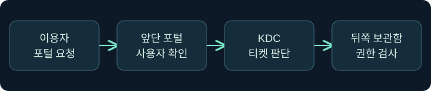
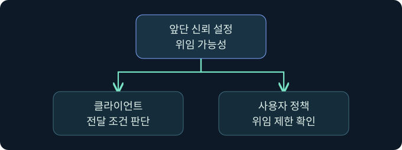
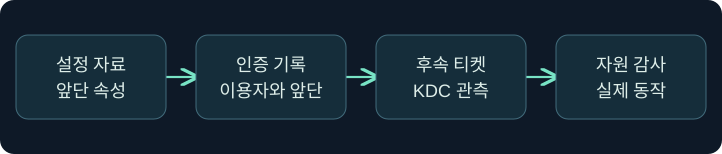
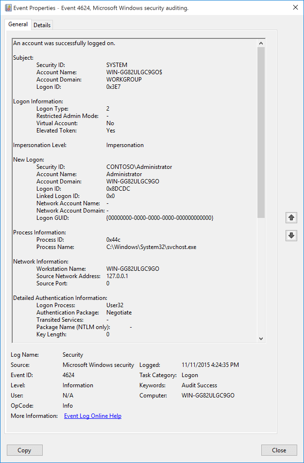

## 1. 앞단 서비스가 왜 두 번째 서비스에 접근하나요?

가상의 문서 포털은 이용자의 요청을 받아 뒤쪽 보관함에서 문서를 읽습니다. 포털 자체의 계정으로 모든 문서를 읽으면 보관함에서 이용자별 권한을 적용하기 어렵습니다. 포털이 이용자 대신 인증하게 하는 위임은 이 문제를 해결할 수 있지만, 맡기는 자격 자료의 범위에 따라 위험이 달라집니다. 이 강의는 비제한 위임의 조건과 방어 관측을 다룹니다. 가상의 서비스·계정·시각을 사용하며 실제 위임이나 자격 증명 수집은 미실행입니다.

## 2. 첫 로그온과 뒤쪽 접근을 구별합니다

앞단의 성공 로그온은 이용자가 포털에 인증했다는 관측입니다. 앞단이 뒤쪽 서비스에 어떤 신원을 제시했는지는 별도의 질문입니다. 앞단 자신의 서비스 계정, 이용자에 대한 위임, 별도로 구성된 애플리케이션 신원이 모두 후보입니다. 네트워크 기록에는 앞단이 연결을 시작한 것으로 보여도, 뒤쪽 서비스가 검증한 사용자 신원은 따로 기록될 수 있습니다.

| 관측 위치 | 확인할 질문 | 예시 근거 |
|---|---|---|
| 앞단 포털 | 누가 처음 인증했나요? | 서비스 감사와 요청 식별자 |
| KDC | 어느 주체와 서비스에 티켓을 발급했나요? | 보안 감사의 요청·상태 |
| 뒤쪽 보관함 | 어떤 신원으로 무엇을 요청했나요? | 대상 로그온, 자원별 감사 |

## 3. 비제한 위임은 어떤 자격 자료를 맡기나요?

일반 Kerberos 로그인에서 클라이언트는 앞단용 서비스 티켓을 제시합니다. 전달된 TGT 방식에서는 조건이 충족되면 앞단이 사용자를 대신해 추가 서비스 티켓을 요청할 수 있는 자격 자료를 받습니다. 이 자료는 앞단에서 사용할 수 있는 전달된 TGT와 관련 세션 키를 포함합니다. 앞단용 티켓 한 장보다 범위가 넓습니다. KDC 정책, 티켓 수명, 신뢰 관계 및 뒤쪽 서비스의 권한 검사는 여전히 적용됩니다.

앞단 서비스 계정의 `TRUSTED_FOR_DELEGATION`은 디렉터리 설정의 근거입니다. 서비스 티켓의 `OK-AS-DELEGATE`는 클라이언트 판단에 쓰이는 신호입니다. 클라이언트나 사용자 정책이 전달을 제한할 수 있으므로 신호 하나로 TGT 전달이나 사용을 확정하지 않습니다.

## 4. 티켓 플래그와 계정 속성을 구별합니다

| 표식 | 어디에 있나요? | 해석 |
|---|---|---|
| TRUSTED_FOR_DELEGATION | 서비스 주체의 계정 속성 | 서비스에 대한 비제한 위임 신뢰 설정 |
| OK-AS-DELEGATE | 티켓 플래그 | 서비스가 위임에 적합하다는 KDC의 신호 |
| FORWARDABLE | 티켓 플래그 | 정책에 따라 전달 가능한 티켓인지 나타냄 |
| FORWARDED | 티켓 플래그 | 전달 과정과 관련해 발급된 티켓인지 나타냄 |
| Account is sensitive and cannot be delegated | 사용자 계정의 설정 | 해당 사용자의 위임 제한을 검토할 단서 |

Protected Users와 계정의 위임 제한은 민감 계정에 대한 방어 검토 대상입니다. 적용 가능성과 운영 호환성은 별도로 확인합니다. 승인된 검토에서는 정책과 기존 기록을 읽으며 설정을 변경하지 않습니다.

## 5. 설정·노출 가능성·사용을 단계별로 기록합니다

가상의 포털 계정에 위임 플래그가 있고, 민감 계정이 해당 호스트에 인증한 로그가 있습니다. 두 관측은 노출 가능성을 조사할 근거입니다. 전달된 자료가 앞단에 도착했거나 제3자가 사용했다는 결론에는 추가 증거가 필요합니다. 뒤쪽 티켓 요청이 앞단 주소에서 나왔더라도 승인된 업무 흐름인지, 다른 앱이 같은 주소를 쓰는지, 시각과 사용자·서비스가 맞는지 확인합니다.

## 6. 공식 콘솔에서 앞단 호스트와 보고 문맥을 확인합니다

### 실제 화면 135: Fortra Beacon Console

출처는 [Fortra Post Exploitation](https://hstechdocs.helpsystems.com/manuals/cobaltstrike/current/userguide/content/topics/post-exploitation_main.htm)입니다. 2026년 11월 9일 현행 안내서를 확인했습니다. 메뉴와 배치는 설치 버전에 따라 달라질 수 있습니다. 공식 화면은 일반 콘솔 예시입니다.

**Cobalt Strike → Visualization → Session Table → 가상 LAB-PORTAL04 행 우클릭 → Interact**로 들어가는 미실행 절차입니다. 하단 입력 줄에 `getuid`를 넣고 **Enter**를 누르는 위치를 확인합니다. 값은 앞단 세션이 보고하는 사용자 문맥을 구분하기 위한 조회이며 별도 저장은 없습니다. 위쪽 반환에서 세션과 호스트를 맞추고, 계정 표시를 위임이나 티켓 보유 증거로 해석하지 않습니다. 이번 반환 및 위임 상태의 실제 사진은 확보하지 못했습니다.

## 7. 공식 보안 이벤트 화면에서 조사 지점을 확인합니다

### 실제 화면 136: Microsoft 이벤트 4624

출처는 [Microsoft 이벤트 4624](https://learn.microsoft.com/en-us/previous-versions/windows/it-pro/windows-10/security/threat-protection/auditing/event-4624)입니다. Used with permission from Microsoft. 공식 그림은 유형 2의 예시이며 버전에 따라 필드가 다릅니다.

**Event Viewer → Action → Open Saved Log**에서 가상 `lab-vault-security.evtx`를 골라 **Open**을 누릅니다. **Filter Current Log**의 이벤트 ID 칸에 `4624`를 넣고 **OK**를 누르는 미실행 예입니다. 원본 저장은 필요하지 않습니다. **Details → XML View**에서 대상 계정·인증 패키지·주소·시각을 읽습니다. 값은 뒤쪽 호스트에서 관찰할 성공 로그온을 고르는 기준입니다. 가상 로그의 필터 창, 네트워크 로그온 및 실제 위임 사용 결과 사진은 확보하지 못했습니다.

## 8. 조건 변경 사례를 비교합니다

| 가상 조건 | 판단 | 다음 확인 |
|---|---|---|
| 앞단의 위임 설정만 확인 | 구성 상태를 확인함 | 업무 의존성, 적용 시각, 변경 승인 |
| 민감 계정이 앞단에 로그인 | 위임 노출 조사 후보 | 위임 제한, 실제 인증 방식 |
| 앞단에서 뒤쪽 티켓 발급 기록 | 추가 요청의 후보 | 승인된 작업, 대상 SPN, 기존 기준선 |
| 뒤쪽 로그인 성공 뒤 문서 거부 | 인증이 됐어도 자원 인가 실패 가능 | 자원 감사와 요청 동작 |

## 9. 감사 자료를 같은 요청으로 묶는 기준

앞단과 뒤쪽의 시각을 보정하고 실제 SPN 및 대상 서비스, 사용자와 요청 식별자를 적습니다. 5136 등 디렉터리 변경 기록은 관련 감사 정책과 SACL 조건을 확인한 뒤 활용합니다. 이벤트가 없다는 사실을 변경 부재로 확대하지 않습니다. 앞단에서 캐시나 자격 자료를 수집하지 않고도 어떤 신뢰 설정이 허용됐고 어떤 업무 흐름이 관측됐는지 구분할 수 있습니다.

## 10. 복습과 즉시 해설

### 복습 1. 앞단에 인증하면 뒤쪽 자원에 자동으로 접근하나요?
**해설:** 뒤쪽 연결에서 사용한 신원과 자원 권한을 따로 확인합니다.

### 복습 2. 비제한 위임에서 앞단이 이용자 암호를 받나요?
**해설:** 전달된 TGT 방식은 사용자 암호 대신 위임 자격 자료를 사용합니다.

### 복습 3. OK-AS-DELEGATE가 실제 전달을 입증하나요?
**해설:** KDC의 신호입니다. 사용자 정책과 실제 전달 여부는 별도입니다.

### 복습 4. FORWARDABLE과 FORWARDED는 같은 의미인가요?
**해설:** 전자는 전달 가능성, 후자는 전달된 발급 상태를 나타냅니다.

### 복습 5. 설정된 호스트의 로그인 한 건으로 침해를 확정하나요?
**해설:** 노출 조사 후보입니다. 업무 경로와 후속 사용 근거를 대조합니다.

### 복습 6. 대상 로그온이 성공하면 파일 읽기도 성공했나요?
**해설:** 파일의 요청과 권한 판정을 별도로 확인합니다.

### 복습 7. 5136이 없으면 디렉터리 설정이 그대로인가요?
**해설:** 감사 범위와 수집 조건을 먼저 확인합니다.

### 복습 8. 콘솔의 계정 표시로 앞단의 위임 여부를 알 수 있나요?
**해설:** 조회 문맥입니다. 디렉터리 정책과 KDC·대상 자료를 대조합니다.

## 11. 공식 자료와 확인 범위

- [Microsoft MS-SFU · 위임 및 S4U 개요](https://learn.microsoft.com/en-us/openspecs/windows_protocols/ms-sfu/36d103d2-61a6-42d5-a725-74de3205cdaf)
- [IETF RFC 4120 · 티켓 플래그](https://www.rfc-editor.org/rfc/rfc4120.html)
- [Microsoft Defender for Identity · 계정 보안 상태](https://learn.microsoft.com/en-us/defender-for-identity/security-posture-assessments/accounts)
- [Microsoft · 디렉터리 객체 변경 5136](https://learn.microsoft.com/en-us/previous-versions/windows/it-pro/windows-10/security/threat-protection/auditing/event-5136)

2026년 11월 9일 공식 자료를 확인했습니다. Windows·Cobalt Strike·인증·위임 변경·티켓 조회 및 수집은 미실행입니다.
