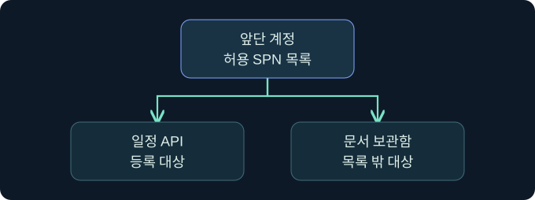
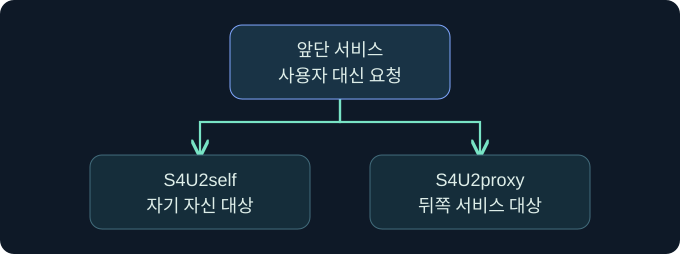
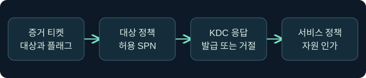

## 1. 앞단에 맡길 수 있는 목적지를 정합니다

가상의 예약 포털은 이용자를 대신해 일정 API를 호출하지만 문서 보관함까지 대신 이용할 업무상 이유는 없습니다. 전통적인 Kerberos 제한 위임에서는 앞단 서비스 주체에 허용 대상 서비스 이름을 기록합니다. 사용자의 TGT를 앞단에 전달하는 구조와 달리, 앞단이 특정 뒤쪽 서비스용 티켓을 요청하는 구조입니다. 승인된 설정과 기존 증거를 해석하는 가상 사례이며 위임 설정, 티켓 요청·가져오기, 원격 접근은 미실행입니다.

## 2. 허용 대상의 이름과 주체를 확인합니다

전통적인 제한 위임의 `msDS-AllowedToDelegateTo`에는 앞단 서비스 주체가 위임할 대상 SPN이 들어갑니다. 가상의 `HTTP/calendar.training.example`은 일정 API를 가리킵니다. 같은 IP를 가리키는 별칭이나 다른 서비스 종류를 동등하다고 취급하지 않습니다. 대상 이름이 어떤 계정에 연결됐는지와 서비스 실행 신원도 확인합니다.

| 모델 | 정책을 읽는 위치 | 의미 |
|---|---|---|
| 비제한 위임 | 앞단 서비스의 신뢰 설정 | 조건에 따라 전달된 TGT 사용 가능 |
| 전통적인 제한 위임 | 앞단 서비스 계정의 허용 대상 SPN | 특정 서비스로 위임을 제한 |
| 리소스 기반 제한 위임 | 뒤쪽 리소스의 디렉터리 정책 | 리소스가 위임을 받을 앞단을 결정 |

리소스 기반 모델의 별도 정책과 티켓 조건을 전통적인 방식에 그대로 적용하지 않습니다.

## 3. S4U2self와 S4U2proxy를 구별합니다

S4U2self는 서비스가 사용자 이름을 근거로 자기 자신 앞으로 사용자에 대한 서비스 티켓을 요청하는 교환입니다. 발급을 확인했다는 사실만으로 사용자가 그 서비스에 Kerberos로 직접 로그인했다고 볼 수 없습니다. S4U2proxy는 앞단이 사용자 대신 다른 서비스용 티켓을 요청하는 교환입니다. 기존의 앞단용 사용자 서비스 티켓을 증거로 제시할 수 있습니다. 뒤쪽 서비스는 티켓 검증 후 자원 인가를 별도로 처리합니다.

## 4. Kerberos 전용 흐름과 프로토콜 전환을 비교합니다

| 항목 | Kerberos 전용 | 프로토콜 전환을 사용하는 경우 |
|---|---|---|
| 앞단에서 확인한 사용자 | 사용자가 Kerberos 티켓을 제시 | 앱이 다른 승인된 방식으로 사용자를 확인할 수 있음 |
| 앞단용 증거 티켓 | 사용자가 제시한 앞단 서비스 티켓 | S4U2self로 얻은 앞단용 티켓이 후보 |
| 뒤쪽 티켓 요청 | 적격한 증거 티켓을 사용한 S4U2proxy | 적격한 증거 티켓을 사용한 S4U2proxy |
| 중요한 제약 | 티켓 플래그와 대상 정책 | 전환 신뢰, 사용자 정책, 티켓 플래그와 대상 정책 |

전통적인 제한 위임에서 `TRUSTED_TO_AUTH_FOR_DELEGATION`은 S4U2self 응답의 전달 가능성 판단에 관여합니다. 플래그가 없다는 이유로 S4U2self 요청 자체가 언제나 실패한다고 단정하지 않습니다. 전달 불가능한 앞단용 티켓을 받았어도 뒤쪽 요청은 거절될 수 있습니다. 사용자 위임 제한과 KDC 판단도 적용되므로 플래그 하나로 결과를 예측하지 않습니다.

## 5. 정책 확인·티켓 발급·서비스 결과를 연결합니다

가상 점검에서 일정 API의 SPN이 앞단 허용 목록에 있습니다. 그러나 증거 티켓을 검토하면 전통적인 위임 흐름에서 필요한 전달 가능 플래그를 확인하지 못했습니다. 이 경우 설정 하나만 보고 뒤쪽 티켓이 발급될 것이라고 쓰지 않습니다. 반대로 티켓이 발급됐다 해도 이용자가 일정 정보를 변경할 권한은 뒤쪽 API가 결정합니다.

## 6. 공식 콘솔의 조회 위치에서 실행 문맥을 구별합니다

### 실제 화면 137: Fortra Beacon Console

출처는 [Fortra Post Exploitation](https://hstechdocs.helpsystems.com/manuals/cobaltstrike/current/userguide/content/topics/post-exploitation_main.htm)입니다. 2026년 11월 9일 현행 문서를 대조했습니다. 일반 콘솔의 공식 예시이며 메뉴와 배치는 버전에 따라 달라질 수 있습니다.

**Cobalt Strike → Visualization → Session Table → 가상 LAB-PORTAL04 행 우클릭 → Interact**로 이동하는 미실행 절차입니다. 하단에 `getuid`를 입력하고 **Enter**를 누르는 위치를 확인합니다. 이 값은 콘솔 보고 문맥을 읽기 위해 선택했으며 별도 저장은 없습니다. 위쪽 반환에서 선택한 세션을 대조하고 그 신원 표시를 뒤쪽 티켓의 사용자 신원으로 바꿔 해석하지 않습니다. 가상 조회 출력과 S4U 응답의 실제 사진은 확보하지 못했습니다.

## 7. 공식 이벤트 화면의 필드를 읽고 4769로 이어갑니다

### 실제 화면 138: Microsoft 이벤트 4768

출처는 [Microsoft Kerberos RC4 조사 안내](https://learn.microsoft.com/en-us/windows-server/security/kerberos/detect-remediate-rc4-kerberos)입니다. Used with permission from Microsoft. 공식 4768 예시는 초기 발급 이벤트로, 아래 4769의 결과 화면과 별개입니다. DC의 버전과 업데이트에 따라 필드 구성이 달라집니다.

**Event Viewer → Action → Open Saved Log**에서 가상 `lab-delegation-dc.evtx`를 선택하고 **Open**을 누르는 예입니다. **Filter Current Log**의 이벤트 ID 칸에 `4769`를 넣고 **OK**를 누르는 위치를 확인합니다. 이 값은 DC의 서비스 티켓 요청을 선택합니다. 별도 저장은 필요하지 않습니다. **Details → XML View**에서 계정·서비스·상태를 읽고 Transited Services 필드가 있는 경우 함께 검토합니다. 가상 결과, 필터 창, 4769의 S4U 사례 사진은 확보하지 못했습니다.

## 8. 조건을 바꾸어 결과를 판별합니다

| 가상 관측 | 확인 가능한 범위 | 다음 확인 |
|---|---|---|
| S4U2self 성공, 뒤쪽 요청 거절 | 앞단용 티켓 발급과 뒤쪽 발급의 결과가 다름 | 전달 가능성, 사용자 제한, 대상 정책 |
| 대상 SPN이 허용 목록에 없음 | 요청과 등록된 정책의 차이 | 실제 SPN과 적용 시점 |
| 4769에 중간 서비스가 기록됨 | 제한 위임을 조사할 근거 | 대상 로그온과 업무 흐름 |
| 뒤쪽 티켓 발급 뒤 API 거절 | 발급 이후의 문제도 가능 | 대상 인증, 요청 권한과 감사 |

## 9. 설정 변경과 실행 관측을 구별해 기록합니다

가상 사례에서 오전 11시 10분 정책 비교 기록에는 일정 서비스만 허용돼 있고 11시 12분에 뒤쪽 요청이 실패했습니다. 실패 코드 하나로 정책이 직접 원인이었다고 쓰기 전에 요청 SPN, 증거 티켓 조건, 응답 DC 및 적용 시각을 맞춥니다. 별칭이 바뀌었거나 다른 DC를 보았다면 가설을 다시 확인합니다. 티켓 바이트와 키 대신 시각·서비스·계정·결과 등의 조사 메타데이터를 기록합니다.

## 10. 복습과 즉시 해설

### 복습 1. 전통적인 제한 위임은 어느 계정에서 허용 대상을 읽나요?
**해설:** 앞단 서비스 주체의 속성을 읽습니다.

### 복습 2. S4U2self의 티켓 대상은 누구인가요?
**해설:** 요청한 서비스 자신입니다. 뒤쪽 서비스용 티켓은 다른 교환입니다.

### 복습 3. S4U2proxy에서는 어떤 티켓을 근거로 쓰나요?
**해설:** 전통적인 흐름에서는 적격한 앞단용 사용자 서비스 티켓을 근거로 사용합니다.

### 복습 4. 전환 신뢰가 없으면 S4U2self는 언제나 실패하나요?
**해설:** 발급될 수 있어도 전달 가능 여부와 뒤쪽 위임 사용 가능 여부는 별도입니다.

### 복습 5. 서비스 이름이 다른데 IP가 같으면 허용 대상으로 보나요?
**해설:** 실제 요청 SPN과 등록 주체·정책을 대조합니다.

### 복습 6. 4769 성공으로 API 사용을 입증하나요?
**해설:** KDC 발급 관측입니다. 대상 인증과 응용 프로그램 감사를 확인합니다.

### 복습 7. 콘솔의 로컬 신원과 뒤쪽이 보는 사용자는 항상 같은가요?
**해설:** 문맥이 다를 수 있습니다. 뒤쪽 로그온의 계정과 요청을 직접 대조합니다.

### 복습 8. 리소스 기반 모델의 정책은 전통적인 방식과 같은 위치에 있나요?
**해설:** 리소스 기반 모델에서는 뒤쪽 리소스가 허용할 앞단을 정합니다.

## 11. 공식 자료와 확인 범위

- [Microsoft MS-SFU · S4U2proxy와 전달 조건](https://learn.microsoft.com/en-us/openspecs/windows_protocols/ms-sfu/bde93b0e-f3c9-4ddf-9f44-e1453be7af5a)
- [Microsoft MS-SFU · S4U 개요](https://learn.microsoft.com/en-us/openspecs/windows_protocols/ms-sfu/36d103d2-61a6-42d5-a725-74de3205cdaf)
- [Microsoft · Windows Server 제한 위임 개요](https://learn.microsoft.com/en-us/windows-server/security/kerberos/kerberos-constrained-delegation-overview)
- [Microsoft · 이벤트 4769](https://learn.microsoft.com/en-us/previous-versions/windows/it-pro/windows-10/security/threat-protection/auditing/event-4769)

2026년 11월 9일 공식 자료를 확인했습니다. Windows·Cobalt Strike·티켓·자격 증명 처리·대상 접근·정책 변경은 미실행입니다.
