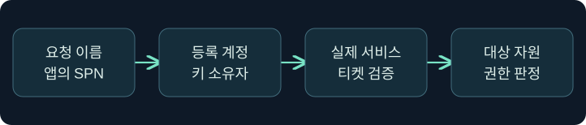
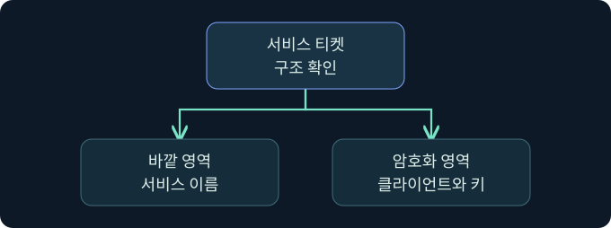
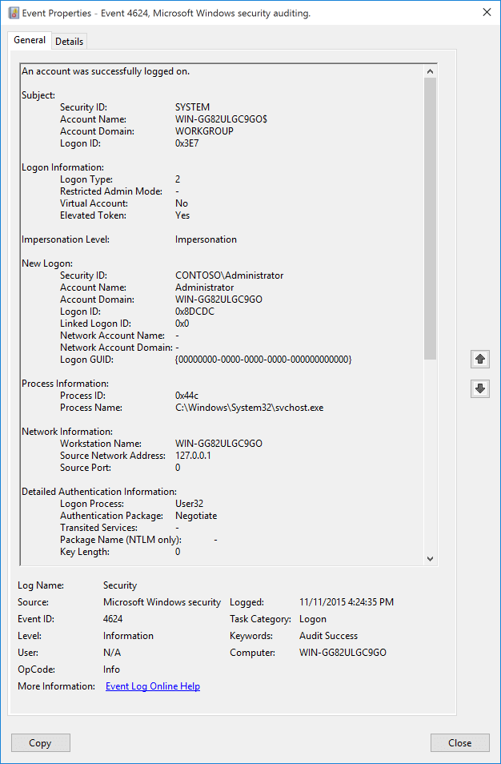
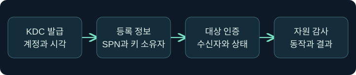

## 1. 같은 호스트와 같은 서비스는 다른 질문입니다

가상의 문서 포털과 파일 서비스가 같은 컴퓨터에 있습니다. 포털에 로그인한 사실은 파일 서비스를 인증했거나 파일을 읽었다는 증거가 아닙니다. 두 서비스의 이름, 실행 신원, 티켓을 여는 키, 자원 권한을 따로 확인합니다. 이 강의는 서비스 이름이 다르게 기록된 상황을 분석합니다. 모든 주소와 서비스 이름은 가상이며 실제 인증과 티켓 처리는 미실행입니다.

## 2. 요청한 이름과 티켓을 여는 계정을 구별합니다

SPN은 Kerberos 서비스 인스턴스를 가리킵니다. 앱은 서비스 종류와 호스트를 조합한 이름을 KDC에 요청할 수 있습니다. KDC가 그 이름을 디렉터리 계정에 연결하면 일반적인 서비스 티켓은 그 계정의 키를 사용합니다. 같은 호스트의 서비스가 서로 다른 계정으로 동작할 수 있고, 다른 이름이 같은 계정에 연결될 수도 있습니다. DNS 결과만으로 어느 키를 사용했는지 알 수 없습니다.

| 확인할 항목 | 가상 사례 | 증거가 답하는 질문 |
|---|---|---|
| 앱의 요청 이름 | HTTP/docs.training.example | 앱이 어떤 서비스를 인증하려 했나요? |
| 디렉터리 연결 | 문서 서비스의 전용 계정 | KDC가 어느 키의 소유자를 선택했나요? |
| 실제 수신자 | 문서 애플리케이션 | 요청을 처리한 실행 문맥은 무엇인가요? |
| 최종 자원 | 제한된 문서 | 신원 확인 뒤 어떤 권한이 적용됐나요? |

## 3. 티켓의 바깥 이름과 내부 암호 영역을 읽습니다

RFC 4120의 Ticket 구조에는 바깥의 서비스 이름과 암호화된 영역이 있습니다. 내부에는 클라이언트 주체, 서비스 세션 키, 유효 기간 등 보호된 정보가 있습니다. TGS 응답의 클라이언트용 암호 영역도 별도로 존재합니다. 각 영역을 구분해야 로그의 표시 이름과 실제 티켓 검증 결과를 혼동하지 않습니다.

서비스가 같은 계정의 키를 쓴다면 복호화 조건이 겹칠 수 있습니다. 그래서 발급 때 관측한 서비스와 실제 수신 서비스가 다른 경우 검토할 가치가 있습니다. 복호화 가능성만으로 수신자의 서비스 이름 검사, PAC 검증, 앱 권한 검사까지 통과한다고 가정하지 않습니다. 티켓 변경이나 재사용은 수행하지 않습니다.

## 4. 컴퓨터 신원과 사용자 신원을 구별합니다

컴퓨터 계정도 Kerberos 주체입니다. 서비스가 컴퓨터 계정 문맥의 키를 사용하는지, 전용 계정을 사용하는지에 따라 같은 호스트에서도 결과가 다릅니다. 컴퓨터가 자기 이름으로 인증됐다는 사실은 그 컴퓨터의 관리 자원 접근 권한을 자동으로 부여하지 않습니다.

앞 강의의 S4U2self는 서비스가 사용자에 대한 티켓을 자기 자신 앞으로 요청하는 교환입니다. 그 자체는 다른 서비스 앞으로 발급된 티켓이나 실제 사용자 로그온의 증거가 아닙니다. 예상 밖의 컴퓨터 계정 인증을 보면 요청을 시작한 앱과 네트워크 경로를 확인합니다. 원격 인증을 유도하거나 자격 자료를 수집하는 대신 기존 감사와 흐름 기록을 사용합니다.

## 5. 서비스 이름은 조사 출발점입니다

| 서비스 유형 | 검토할 이름의 예 | 추가 증거 |
|---|---|---|
| 웹·일부 WinRM 환경 | HTTP | 실제 앱의 SPN 선택과 대상 서비스 기록 |
| SMB | CIFS | 공유·파일별 권한 및 동작 감사 |
| 원격 데스크톱 | TERMSRV | 연결·로그온 유형과 세션 기록 |
| SQL Server | MSSQLSvc | 인스턴스 또는 포트와 SQL 로그인 감사 |
| RPC 기반 관리 | 실제 앱이 선택한 서비스 이름 | 엔드포인트·인증 패키지·실행 결과 |

구성에 따라 이름과 인증 협상이 달라집니다. 파일 서비스에 인증했다는 이유로 다른 관리 기능이 실행됐다고 해석하지 않습니다.

## 6. 공식 콘솔에서 조회 문맥을 읽습니다

### 실제 화면 139: Fortra Beacon Console

출처는 [Fortra Post Exploitation](https://hstechdocs.helpsystems.com/manuals/cobaltstrike/current/userguide/content/topics/post-exploitation_main.htm)입니다. 2026년 11월 9일 현행 안내서를 대조했습니다. 사진은 일반 콘솔 예시이며 버전에 따라 메뉴나 배치가 달라질 수 있습니다.

**Cobalt Strike → Visualization → Session Table → 가상 LAB-DOCS04 행 우클릭 → Interact**로 여는 미실행 절차입니다. 하단 입력 줄에 `getuid`를 넣고 **Enter**를 누르는 위치를 확인합니다. 값은 선택한 세션의 보고 문맥을 읽기 위해 사용하며 별도 저장은 없습니다. 위쪽 반환 영역에서 호스트와 세션을 대조합니다. 반환 값이 대상 서비스 키의 소유자나 티켓 제시를 증명하지는 않습니다. 이번 조회 및 서비스 이름 불일치 반환 사진은 확보하지 못했습니다.

## 7. 공식 대상 로그의 필드를 확인합니다

### 실제 화면 140: Microsoft 이벤트 4624

출처는 [Microsoft 이벤트 4624](https://learn.microsoft.com/en-us/previous-versions/windows/it-pro/windows-10/security/threat-protection/auditing/event-4624)입니다. Used with permission from Microsoft. 공식 사진은 유형 2의 예시이며 이번 가상 서비스 인증 결과와 별개입니다.

**Event Viewer → Action → Open Saved Log**에서 가상 `lab-docs-security.evtx`를 골라 **Open**을 누르는 미실행 예입니다. **Filter Current Log**의 ID 칸에 `4624`를 입력한 뒤 **OK**를 누릅니다. 대상의 성공 로그온을 고르는 값입니다. 원본 저장은 필요하지 않습니다. **Details → XML View**에서 계정·인증 패키지·호스트·시각을 대조하고 서비스 감사에서 실제 요청을 확인합니다. 필터 창과 가상 네트워크 로그온 사진은 확보하지 못했습니다.

## 8. 이름 불일치의 다른 설명을 비교합니다

| 가상 조건 | 가능한 해석 | 다음 확인 |
|---|---|---|
| 별칭만 다르고 발급 계정이 같음 | 승인된 이름 매핑일 수 있음 | 앱 설정과 등록 내역 |
| 동일 호스트인데 티켓을 열지 못함 | 실행 계정이나 키 상태가 다를 수 있음 | SPN 소유자, 실행 신원, 키 버전 |
| KRB_AP_ERR_MODIFIED 관측 | 대상 검증 실패 | 잘못된 SPN, 키 불일치, 실제 수신자 |
| 서비스 인증 성공 뒤 자원 거절 | 인가 조건에서 실패 | 요청 동작과 자원별 감사 |

## 9. 조사 결론의 근거를 남깁니다

가상의 DC 기록에는 웹 서비스 계정이 나오고, 같은 분에 파일 서비스 로그인도 관찰됐습니다. 이벤트의 서비스 계정 표시가 정확한 요청 SPN과 같은 문자열인지 먼저 확인합니다. 시간대, 대상 주소, 요청 식별자, 앱의 실제 인증 방식으로 두 기록의 연결 근거를 보강합니다. 같은 분에 발생했다는 이유만으로 이름 변경을 단정하지 않습니다.

## 10. 복습과 즉시 해설

### 복습 1. 같은 IP는 같은 SPN을 뜻하나요?
**해설:** 주소와 서비스 이름은 서로 다른 식별자입니다.

### 복습 2. 같은 호스트의 서비스는 같은 키를 쓰나요?
**해설:** 실행 신원과 디렉터리 등록을 확인해야 합니다.

### 복습 3. 바깥 이름이 다르면 내부의 사용자도 바뀌나요?
**해설:** 바깥 이름과 보호된 클라이언트 정보는 다른 영역입니다.

### 복습 4. 티켓을 열 수 있으면 자원 인가도 통과하나요?
**해설:** 서비스와 자원의 권한 검사를 별도로 적용합니다.

### 복습 5. S4U2self는 뒤쪽 서비스 발급인가요?
**해설:** 요청 서비스 자신 앞으로 발급되는 교환입니다.

### 복습 6. 컴퓨터 인증은 관리자 권한을 뜻하나요?
**해설:** 인증된 주체와 관리 자원의 권한은 별개입니다.

### 복습 7. KRB_AP_ERR_MODIFIED는 공격의 확정 증거인가요?
**해설:** 검증 실패입니다. 등록과 키, 서비스 수신자를 대조합니다.

### 복습 8. 콘솔에 보인 계정이 서비스 키의 소유자인가요?
**해설:** 콘솔의 조회 문맥입니다. 서비스 실행 신원과 등록을 확인합니다.

## 11. 공식 자료와 확인 범위

- [IETF RFC 4120 · Kerberos Ticket과 AP 교환](https://www.rfc-editor.org/rfc/rfc4120.html)
- [Microsoft MS-KILE · 이름과 SPN](https://learn.microsoft.com/en-us/openspecs/windows_protocols/ms-kile/04033bd5-913c-4c78-a398-b549b09e65d9)
- [Microsoft · IIS의 Kerberos 실패 조사](https://learn.microsoft.com/en-us/troubleshoot/developer/webapps/iis/www-authentication-authorization/troubleshoot-kerberos-failures-ie)
- [Microsoft MS-SFU · S4U 개요](https://learn.microsoft.com/en-us/openspecs/windows_protocols/ms-sfu/36d103d2-61a6-42d5-a725-74de3205cdaf)

공식 자료 확인일은 2026년 11월 9일입니다. Windows·Cobalt Strike·티켓 작업·원격 인증·자격 증명 수집은 미실행입니다.
