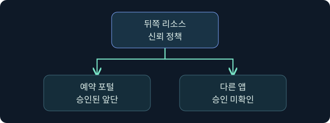
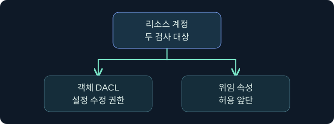

## 1. 뒤쪽 서비스가 위임을 받을 앞단을 정합니다

가상의 일정 API는 승인된 예약 포털만 이용자를 대신해 접근하도록 허용합니다. 다른 앱이 같은 회사 도메인에 있다는 사실만으로 그 앱을 신뢰하지 않습니다. 리소스 기반 제한 위임(RBCD)은 뒤쪽 서비스의 디렉터리 정책에서 이 관계를 관리합니다. 이 강의는 허용 관계와 변경 권한, 실제 티켓과 자원 관측을 구분합니다. 가상 사례이며 제품, 디렉터리 수정, 티켓 요청 및 대상 접근은 미실행입니다.

## 2. 정책 위치와 신뢰 방향을 비교합니다

| 모델 | 신뢰 설정을 읽는 위치 | 핵심 질문 |
|---|---|---|
| 비제한 위임 | 앞단 서비스 계정 | 전달 자격 자료를 사용할 조건이 있는가 |
| 전통적인 제한 위임 | 앞단 계정의 허용 대상 SPN | 앞단이 어느 뒤쪽 서비스로 위임할 수 있는가 |
| 리소스 기반 제한 위임 | 뒤쪽 서비스 계정의 보안 설명자 | 뒤쪽 서비스가 어느 앞단의 위임을 받을 것인가 |

RBCD에서 AD 속성 `msDS-AllowedToActOnBehalfOfOtherIdentity`는 뒤쪽 서비스 계정에 있는 보안 설명자입니다. 이 속성의 접근 제어 정보는 어떤 주체가 이용자를 대신해 해당 리소스에 대해 동작할 수 있는지 판단하는 데 쓰입니다. 이 값과, 뒤쪽 계정 객체 자체의 속성을 누가 편집할 수 있는지 정하는 객체 DACL은 서로 다른 검사 대상입니다.

## 3. 권한을 가진 사람과 허용된 앞단을 구분합니다

예를 들어 가상의 디렉터리 운영 그룹이 해당 속성을 쓰도록 위임받았고, 실제 위임 허용 목록에는 예약 포털 주체만 들어 있다고 가정합니다. 운영 그룹은 설정을 바꿀 수 있는 후보이고, 예약 포털은 현재 설정에서 허용된 앞단입니다. 두 목록의 역할은 다릅니다.

유효 쓰기 권한을 판단할 때는 속성에 대한 직접 권한, 객체 범위의 광범위한 쓰기, ACL 변경 권한, 그룹 중첩, 상속 및 거부 항목을 고려합니다. ACL 변경 권한은 해당 속성을 이미 쓸 수 있다는 증거와 구별합니다. 승인된 변경 이력과 비교할 때는 문자열 이름 외에 객체 식별자와 SID도 검토합니다.

## 4. 앞단 주체와 KDC의 판단을 확인합니다

앞단 서비스의 등록 이름, 계정과 실제 서비스 실행 신원이 일치하는지 봅니다. 컴퓨터 계정 생성 정책이나 새 계정의 존재는 해당 앞단이 승인됐다는 증거가 아닙니다. 도메인의 컴퓨터 계정 할당량과 조직 단위의 유효 권한은 다른 조건이며 값을 추정하지 않습니다.

KDC는 RBCD 요청의 증거 티켓, 사용자와 서비스 정책을 검토합니다. Windows의 RBCD 경로에는 조건에 따라 민감하지 않은 사용자의 전달 불가능한 S4U2self 티켓을 처리하는 규칙이 있습니다. 이 규칙을 전통적인 제한 위임에 그대로 적용하지 않습니다. 반대로 RBCD 정책에 앞단이 있어도 모든 사용자와 티켓이 허용된다는 결론을 내리지 않습니다.

## 5. 변경·발급·접근 증거를 연결합니다

| 근거 | 확인 내용 | 해석의 한계 |
|---|---|---|
| 승인된 디렉터리 스냅샷 | 대상 속성·허용 SID·객체 ACL | 정책 상태이며 사용 여부는 별도 |
| DC 5136 | 감사 조건을 충족한 속성 변경 | 승인 여부나 발급 결과는 별도 |
| DC 4769 | 서비스 티켓 요청과 상태 | 대상 사용과 자원 권한은 별도 |
| 대상 서비스 감사 | 인증 신원·요청 동작·결과 | 설정 변경의 주체를 직접 보여주지는 않음 |

5136은 적절한 감사 정책과 객체의 SACL이 필요합니다. 같은 변경에서 삭제와 추가가 별도 이벤트로 보일 수 있습니다. Correlation ID가 있으면 관련 변경을 묶고 객체 이름·속성·시각과 함께 확인합니다. 기록에 나타난 주체가 승인 티켓의 담당자와 일치하는지도 검토합니다.

## 6. 공식 콘솔에서 실행 문맥을 확인합니다

### 실제 화면 141: Fortra Beacon Console

출처는 [Fortra Post Exploitation](https://hstechdocs.helpsystems.com/manuals/cobaltstrike/current/userguide/content/topics/post-exploitation_main.htm)입니다. 2026년 11월 9일 현행 안내서를 대조했습니다. 공식 일반 콘솔 예시이며 설치 버전에 따라 메뉴가 달라질 수 있습니다.

**Cobalt Strike → Visualization → Session Table → 가상 LAB-BOOKING04 행 우클릭 → Interact**로 들어가는 미실행 절차입니다. 하단 입력 줄에 `getuid`를 넣고 **Enter**를 누르는 위치를 확인합니다. 앞단 세션의 보고 문맥을 읽는 값이며 별도 저장은 없습니다. 위쪽 반환 영역에서 세션과 호스트를 대조합니다. 반환값으로 디렉터리의 유효 쓰기 권한이나 RBCD 허용 여부를 판정하지 않습니다. 이번 반환과 RBCD 결과의 실제 사진은 확보하지 못했습니다.

## 7. 공식 이벤트 화면에서 필터와 확인 위치를 읽습니다

### 실제 화면 142: Microsoft 이벤트 뷰어의 DC 예시

출처는 [Microsoft Kerberos RC4 조사 안내](https://learn.microsoft.com/en-us/windows-server/security/kerberos/detect-remediate-rc4-kerberos)입니다. Used with permission from Microsoft. 공식 사진은 4768이며 아래 가상 5136·4769 결과와 별개입니다. 이벤트 필드는 Windows 버전과 업데이트에 따라 달라집니다.

**Event Viewer → Action → Open Saved Log**에서 가상 `lab-resource-dc.evtx`를 선택하고 **Open**을 누르는 예입니다. **Filter Current Log**의 이벤트 ID 칸에 `5136,4769`를 넣고 **OK**를 누르는 위치를 확인합니다. 변경과 티켓 요청을 나눠 찾기 위한 값입니다. 별도 저장은 없습니다. **Details → XML View**에서 변경 이벤트는 대상 객체와 속성, 요청 이벤트는 서비스와 상태를 확인합니다. 필터 창과 실제 RBCD 변경·발급 결과 사진은 확보하지 못했습니다.

## 8. 조건이 바뀌면 판단을 업데이트합니다

| 가상 관측 | 의미 | 다음 확인 |
|---|---|---|
| 허용 SID는 같고 객체 ACL만 바뀜 | 앞으로 정책을 바꿀 수 있는 주체가 달라졌을 수 있음 | 유효 권한과 승인 |
| 5136에서 허용 정보 변경, 새 4769 미확인 | 구성 변경만 확인 | 다른 DC, 수집 범위와 후속 기록 |
| 티켓 요청 성공, 자원 접근 거절 | 발급과 자원 인가가 다름 | 대상 인증과 요청 권한 |
| 승인 기간 뒤 허용 항목이 계속 존재 | 구성의 원복 여부를 확인할 필요 | 승인된 기준선과 복제 시점 |

## 9. 변경 전후와 원복 검증을 기록합니다

가상 점검에서 변경 전후 스냅샷의 대상 객체, 승인 목록, 관측 DC와 시각을 맞춥니다. 승인 항목을 보존하고 예기치 않은 변경만 구분했는지 확인합니다. 원복 요청이 접수됐다는 기록과 원하는 상태가 다시 관측됐다는 기록은 별개입니다. 다음 승인된 읽기 시점에 스냅샷과 변경 이력을 대조합니다. 이 강의의 절차는 자료 검토로 한정합니다.

## 10. 복습과 즉시 해설

### 복습 1. RBCD 허용 관계는 어느 쪽에 있나요?
**해설:** 뒤쪽 리소스 계정의 정책을 읽습니다.

### 복습 2. 객체를 수정하는 그룹은 위임 허용 목록과 같은가요?
**해설:** 변경 권한과 현재 신뢰 정책은 서로 다른 검사 대상입니다.

### 복습 3. 컴퓨터 계정이 생겼다면 앞단으로 허용됐나요?
**해설:** 생성과 승인된 위임 정책은 별도입니다.

### 복습 4. RBCD와 전통 위임은 증거 티켓 규칙이 같은가요?
**해설:** 적용되는 KDC 경로와 정책에 따라 다릅니다.

### 복습 5. 5136은 대상 서비스 사용을 입증하나요?
**해설:** 감사 조건을 충족한 디렉터리 변경의 근거입니다.

### 복습 6. 5136이 없으면 변경은 없었나요?
**해설:** 감사 설정과 SACL, DC 및 수집 범위를 먼저 확인합니다.

### 복습 7. 4769 성공이면 이용자의 요청이 허용됐나요?
**해설:** 발급을 확인한 것입니다. 서비스의 실제 권한 판정이 필요합니다.

### 복습 8. 원복 요청이 접수되면 검증이 끝나나요?
**해설:** 기준선과 변경 후 상태를 다시 대조해야 합니다.

## 11. 공식 자료와 확인 범위

- [Microsoft · Windows Server 제한 위임 개요](https://learn.microsoft.com/en-us/windows-server/security/kerberos/kerberos-constrained-delegation-overview)
- [Microsoft MS-SFU · 위임 정책의 데이터 모델](https://learn.microsoft.com/en-us/openspecs/windows_protocols/ms-sfu/0b4d13c4-d459-4598-8f08-1584ca1e24c9)
- [Microsoft MS-SFU · S4U2proxy](https://learn.microsoft.com/en-us/openspecs/windows_protocols/ms-sfu/bde93b0e-f3c9-4ddf-9f44-e1453be7af5a)
- [Microsoft · 디렉터리 변경 5136](https://learn.microsoft.com/en-us/previous-versions/windows/it-pro/windows-10/security/threat-protection/auditing/event-5136)
- [Microsoft · 서비스 티켓 요청 4769](https://learn.microsoft.com/en-us/previous-versions/windows/it-pro/windows-10/security/threat-protection/auditing/event-4769)

공식 자료 확인일은 2026년 11월 9일입니다. Windows·Cobalt Strike·정책 변경·티켓 사용·인증 및 자격 증명 작업은 미실행입니다.
