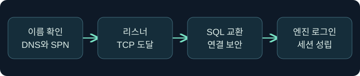
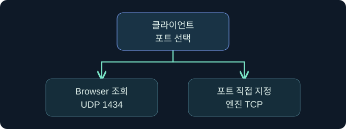
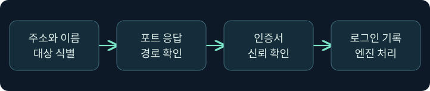

## 1. SQL 서버가 보인다는 말부터 구분합니다

가상의 자산 대장에는 문서 서비스용 SQL 인스턴스가 두 개 있습니다. 네트워크 기록에서는 한 호스트의 TCP 포트가 열려 있고, 디렉터리에는 같은 호스트를 가리키는 서비스 이름이 있습니다. 이 세 자료는 서로 다른 질문에 답합니다. 호스트가 존재하는지, 어떤 인스턴스가 어느 주소에서 연결을 받는지, 실제 데이터베이스 로그인까지 성공하는지를 따로 확인합니다. 주소와 이름은 가상이며 실제 검색·접속은 미실행입니다.

## 2. 호스트와 인스턴스를 따로 기록합니다

호스트는 운영체제와 네트워크 주소를 가진 컴퓨터입니다. 인스턴스는 독립적인 데이터베이스 엔진 서비스입니다. 한 호스트가 기본 인스턴스와 하나 이상의 명명된 인스턴스를 제공할 수 있습니다. 연결 이름, 서비스 이름, TCP 포트는 서로 바꿔 쓸 수 있는 식별자가 아닙니다.

| 항목 | 가상 값 | 확인하는 범위 |
|---|---|---|
| 호스트 | dbdocs.training.example | 이름 해석과 네트워크 위치 |
| 인스턴스 | ARCHIVE | 여러 엔진 서비스 중 대상 |
| 엔진 TCP 포트 | 51433 | 이 사례에서 문서화된 리스너 |
| 데이터베이스 | TrainingDocs | 인스턴스 안의 데이터와 권한 범위 |

기본 인스턴스는 TCP가 활성화된 환경에서 흔히 1433을 쓰지만 다른 포트도 가능합니다. 명명된 인스턴스도 고정 또는 동적 포트를 사용할 수 있습니다. 자산 대장의 포트와 실제 리스너의 관측 시각을 맞춥니다.

## 3. SQL Browser 응답의 의미를 읽습니다

SQL Server Browser는 활성 상태일 때 UDP 1434에서 인스턴스에 대한 요청을 받고, 해당 인스턴스의 연결에 필요한 TCP 포트나 명명된 파이프 정보를 제공할 수 있습니다. 이 조회는 데이터베이스 엔진에 로그인하는 교환과 별개입니다. 가상 환경에서 명명된 인스턴스 검색은 실패하더라도, 관리 문서에 있는 정확한 엔진 포트를 지정한 연결은 가능할 수 있습니다. 반대로 Browser 응답을 받았어도 엔진 쪽 네트워크 정책이 연결을 막을 수 있습니다.

## 4. 디렉터리의 MSSQLSvc 등록은 연결 후보입니다

SPN은 Kerberos가 서비스 신원을 식별할 때 쓰는 이름입니다. TCP SQL 연결에서 `MSSQLSvc/dbdocs.training.example:51433` 같은 등록은 호스트와 포트를 포함할 수 있습니다. 디렉터리에서 이 이름을 발견하면 어떤 계정에 연결돼 있는지 조사할 수 있습니다. 등록이 오래됐거나 잘못됐을 수 있고, 운영 중인 인스턴스에 기대한 등록이 없을 수도 있습니다. 사용자 계정만 검색한 결과에는 컴퓨터 계정이나 다른 서비스 주체의 등록이 빠질 수 있습니다. 승인된 인벤토리와 서비스 운영 기록을 함께 확인합니다.

## 5. 포트 관측에서 로그인까지는 여러 단계입니다

| 기존 관측 | 말할 수 있는 범위 | 다음 근거 |
|---|---|---|
| TCP 연결 수락 | 해당 주소·포트에서 TCP 응답 | SQL 프로토콜과 실제 인스턴스 |
| UDP Browser 응답 | 인스턴스 연결 정보 관측 | 엔진 포트와 실제 도달성 |
| SQL 연결의 인증서 검증 실패 | 보안 채널 설정 단계에서 실패 | 신뢰 체인, 인증서 이름과 연결 이름 |
| SQL 로그인 거부 | 서버가 로그인 요청을 처리 | SQL 오류 로그의 상태와 계정 조건 |
| 로그인 성공 | 인스턴스의 세션이 성립 | 데이터베이스 매핑과 객체 권한 |

한 번의 네트워크 관측을 다른 위치에 확대하지 않습니다. 관측 위치가 바뀌면 DNS, 라우팅, 방화벽 및 인증서 검증 결과가 달라질 수 있습니다.

## 6. Fortra 공식 화면에서 관측 세션을 식별합니다

### 실제 화면 143: Fortra Beacon Console

출처는 [Fortra 콘솔 안내](https://hstechdocs.helpsystems.com/manuals/cobaltstrike/current/userguide/content/topics/ui_consoles.htm)입니다. 2026년 11월 9일 현행 설명과 대조했습니다. 공식 사진은 일반 콘솔이며 설치 버전에 따라 메뉴가 달라질 수 있습니다.

**Cobalt Strike → Visualization → Session Table → 가상 LAB-INV03 행 우클릭 → Interact**를 여는 미실행 예입니다. 하단 입력 줄에 `getuid`를 넣고 **Enter**를 누르는 위치를 확인합니다. 이 값은 관측을 시작할 세션의 사용자 문맥을 구분하며 저장은 필요하지 않습니다. 위쪽 반환에서 선택한 세션을 대조합니다. 여기서 읽는 사용자 문맥은 SQL의 로그인이나 포트 확인 결과와 별개입니다. 이 예의 반환, SQL 확장 모듈의 검색 창과 결과 사진은 확보하지 못했습니다.

## 7. SSMS의 입력값과 결과 확인 위치를 읽습니다

**SQL Server Management Studio → Object Explorer → Connect → Database Engine**에서 연결 창을 여는 미실행 절차입니다. **Server name** 칸에 `tcp:dbdocs.training.example,51433`을 검토값으로 사용합니다. 프로토콜과 문서화된 포트를 명시해 인스턴스 검색 경로와 분리하기 위한 값입니다. **Authentication**에서 사전에 승인된 Windows 인증을 검토합니다. 연결 보안은 설치 버전과 정책에 따라 표시 위치가 다르며, 인증서 신뢰 검증을 유지합니다. **Connect**가 연결 실행 버튼입니다. 설정을 별도로 저장하는 단계는 없습니다.

예상 확인 위치는 Object Explorer의 서버 노드 또는 연결 오류 대화상자입니다. 가상 호스트로 접속하지 않았으며 이 과정의 입력 및 결과 사진은 확보하지 못했습니다. 공식 문서의 실제 연결 창을 참고할 수 있습니다. [Microsoft SSMS 연결 빠른 시작](https://learn.microsoft.com/en-us/ssms/quickstarts/ssms-connect)

## 8. 조건이 바뀌면 어느 근거를 다시 볼까요?

| 가상 상황 | 가능성이 있는 설명 | 대조할 근거 |
|---|---|---|
| 이름 연결 실패, 승인된 포트 연결 성공 | 인스턴스 검색 또는 이름 경로 차이 | Browser 설정·별칭·포트 문서 |
| SPN 존재, 엔진 포트 응답 없음 | 오래된 등록 또는 경로 차단 | 자산 변경 기록과 리스너 상태 |
| Browser 응답, SQL 연결 거절 | 엔진 리스너나 정책이 별도 | 대상 포트와 양쪽 흐름 기록 |
| TCP 연결 성공, 인증서 오류 | 서버 이름이나 신뢰 관계 불일치 | 연결 문자열과 인증서 정책 |

## 9. 다른 조사자가 같은 범위를 확인하도록 기록합니다

가상 점검에서는 승인된 자산 ID, 관측 위치, 시각, 연결 이름과 포트를 나란히 적습니다. 포트 정보가 인벤토리에서 왔는지 Browser 응답에서 왔는지 구분합니다. 연결 실패가 발생한 단계와 오류 원본을 남깁니다. 여러 인스턴스가 같은 호스트를 공유할 때는 이름·포트·서버 응답이 같은 인스턴스를 가리키는지 재확인합니다. 다음 강의는 로그인 이후의 권한을 다룹니다.

## 10. 복습과 즉시 해설

### 복습 1. 호스트 하나에 인스턴스도 하나인가요?
**해설:** 여러 엔진 인스턴스가 한 호스트에 있을 수 있습니다.

### 복습 2. 1433 응답만으로 SQL 로그인이 확인되나요?
**해설:** 리스너 관측 이후 프로토콜과 로그인 결과가 필요합니다.

### 복습 3. UDP 1434는 엔진의 로그인 포트인가요?
**해설:** SQL Browser의 인스턴스 탐색 포트입니다. 엔진 연결은 따로 확인합니다.

### 복습 4. 명명된 인스턴스는 항상 동적 포트를 쓰나요?
**해설:** 구성에 따라 고정 포트도 사용할 수 있습니다.

### 복습 5. SPN이 있으면 인스턴스가 실행 중인가요?
**해설:** 등록과 현재 실행 상태를 대조해야 합니다.

### 복습 6. TCP 연결이 성립하면 TLS 검증도 통과했나요?
**해설:** 네트워크 연결과 인증서 검증은 별도 단계입니다.

### 복습 7. Browser를 거치지 않고 연결할 수 있나요?
**해설:** 승인된 실제 엔진 포트를 지정할 수 있는 환경에서는 가능합니다.

### 복습 8. 콘솔의 사용자 이름이 SQL 로그인인가요?
**해설:** 콘솔 문맥입니다. SQL에서 받아들인 로그인은 SQL 세션 자료로 확인합니다.

## 11. 공식 자료와 확인 범위

- [Microsoft · SQL Server Browser](https://learn.microsoft.com/en-us/sql/tools/configuration-manager/sql-server-browser-service)
- [Microsoft · 인스턴스별 연결 오류](https://learn.microsoft.com/en-us/troubleshoot/sql/database-engine/connect/network-related-or-instance-specific-error-occurred-while-establishing-connection)
- [Microsoft · Kerberos용 SQL Server SPN 등록](https://learn.microsoft.com/en-us/sql/database-engine/configure-windows/register-a-service-principal-name-for-kerberos-connections)

2026년 11월 9일 공식 자료를 확인했습니다. SQL Server·SSMS·Cobalt Strike 실행, 주소 검색, 로그인, 정책 변경은 미실행입니다.
