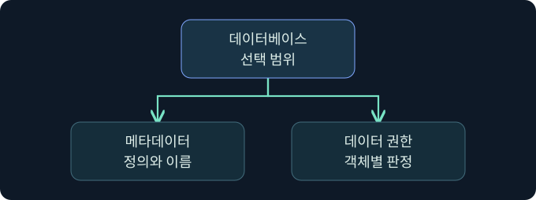

## 1. 연결한 계정이 어디까지 읽을 수 있나요?

가상의 조사자가 SQL 인스턴스에 연결했습니다. 서버 이름을 확인하는 쿼리는 성공하지만 특정 데이터베이스를 열 수 없습니다. 엔진이 인증한 로그인, 데이터베이스가 적용하는 사용자 문맥, 개별 객체에 대한 권한은 서로 다른 단계입니다. 사례에서는 승인된 별도 학습용 데이터베이스를 가정하며 실제 연결과 쿼리는 미실행입니다.


## 2. 인스턴스 로그인과 데이터베이스 사용자를 구별합니다

로그인은 일반적인 인스턴스 연결의 보안 주체입니다. 데이터베이스 사용자는 특정 데이터베이스에서 권한을 판단하는 주체입니다. 같은 로그인에 대해 데이터베이스마다 다른 사용자가 매핑되거나, 일부에는 적절한 매핑이 없을 수 있습니다. 포함된 데이터베이스의 사용자 인증 등 배포 방식에 따른 예외도 있으므로 실제 인증 모델을 확인합니다.

| 항목 | 위치 | 읽을 때의 질문 |
|---|---|---|
| Windows 또는 SQL 로그인 | 인스턴스 | 누가 세션을 만들었나요? |
| 데이터베이스 사용자 | 데이터베이스 | 이 데이터베이스가 어떤 신원을 적용하나요? |
| 서버 역할 | 인스턴스 | 인스턴스 범위의 권한이 있나요? |
| 데이터베이스 역할 | 데이터베이스 | 이 데이터베이스의 어느 권한이 적용되나요? |
| 개별 권한 | 서버·데이터베이스·객체 | 이 동작을 이 자원에서 수행할 수 있나요? |

Windows 인증과 SQL Server 인증은 자격 확인 경로가 다릅니다. 혼합 모드를 지원하는 인스턴스라도 로그인 활성화, 데이터베이스 접근, 암호 정책 등 별도의 조건을 확인합니다.

## 3. public과 높은 권한의 역할을 혼동하지 않습니다

모든 로그인은 서버 수준의 `public` 역할에 속합니다. 데이터베이스 사용자도 데이터베이스의 `public` 역할에 속합니다. 이는 기본 권한의 집합이며 테이블의 데이터를 전부 읽을 수 있다는 뜻이 아닙니다. 서버의 `sysadmin`, `securityadmin`, `serveradmin`과 데이터베이스의 `db_owner`, `db_datareader`는 범위와 효과가 다릅니다. 예를 들어 `db_datareader`는 그 데이터베이스의 사용자 테이블과 뷰에 광범위한 읽기 권한을 부여하므로 좁은 감사 조회보다 훨씬 큰 범위입니다.

역할 명단만으로 끝내지 않습니다. Windows 그룹, 직접 부여와 거부, 소유권 및 특별한 실행 문맥도 결과에 영향을 줄 수 있습니다. 특히 `sysadmin` 멤버는 데이터베이스에 `dbo`로 진입하는 특별 동작이 있으므로 두 이름을 독립적인 역할 배정으로 중복 기록하지 않습니다.

## 4. 세션 이름을 확인하는 읽기 전용 쿼리

아래는 승인된 학습 세션에서 실행을 검토할 수 있는 미실행 예입니다. 사용자 테이블의 값이나 비밀을 반환하지 않습니다.

```sql
SELECT ORIGINAL_LOGIN() AS original_login,
       SUSER_SNAME() AS effective_login,
       USER_NAME() AS database_user,
       DB_NAME() AS database_name;
```

| 열 | 의미 | 사용 이유 |
|---|---|---|
| original_login | 세션을 처음 연결한 로그인 | 실행 문맥이 바뀌어도 시작점을 확인 |
| effective_login | 현재 서버 보안 문맥의 로그인 이름 | 현재 문맥을 시작점과 비교 |
| database_user | 현재 데이터베이스의 사용자 | 로그인과 DB 문맥을 구분 |
| database_name | 현재 데이터베이스 이름 | 권한을 해석할 범위를 고정 |

같은 세션이라도 선택한 데이터베이스에 따라 DB 사용자와 메타데이터 가시성이 달라질 수 있습니다. 결과에는 계정 이름이 들어가므로 업무 환경에서는 기록 범위를 사전에 정합니다.

## 5. 목록에 보이는 객체와 읽을 수 있는 객체를 구별합니다



SQL Server의 메타데이터는 소유하거나 권한이 부여된 보안 개체를 중심으로 노출됩니다. 따라서 낮은 권한에서 객체가 목록에 보이지 않으면 이름 오류, 다른 데이터베이스, 메타데이터 가시성 등이 후보입니다. 객체가 목록에 보여도 그 데이터에 대한 `SELECT` 권한이 있다고 단정하지 않습니다. `VIEW DEFINITION`처럼 정의를 볼 수 있는 권한과 데이터에 접근하는 권한은 구별합니다.

## 6. Fortra 공식 화면에서 로컬 문맥의 위치를 확인합니다

### 실제 화면 144: Fortra Beacon Console


출처는 [Fortra 콘솔 안내](https://hstechdocs.helpsystems.com/manuals/cobaltstrike/current/userguide/content/topics/ui_consoles.htm)입니다. 2026년 11월 9일 현행 문서와 대조했습니다. 화면은 일반 콘솔의 공식 예시이며 버전에 따라 메뉴와 배치가 달라질 수 있습니다.

**Cobalt Strike → Visualization → Session Table → 가상 LAB-INV03 행 우클릭 → Interact**로 여는 미실행 예입니다. 하단 입력 줄에 `getuid`를 넣고 **Enter**를 누르는 위치를 확인합니다. 현재 세션의 보고 문맥을 구분하는 값이며 별도 저장은 없습니다. 위쪽 반환에서 호스트와 세션을 맞춥니다. SQL 엔진의 사용자 및 역할은 SQL 세션에서 따로 확인합니다. 이번 콘솔 반환과 SQL 확장 모듈의 실제 결과 사진은 확보하지 못했습니다.

## 7. SSMS에서 쿼리의 데이터베이스와 반환을 확인합니다

**SQL Server Management Studio → Object Explorer → 승인된 서버 선택 → New Query**로 편집기를 열고 데이터베이스 선택 목록에서 가상 `TrainingDocs`를 검토합니다. 이 값은 실습 범위를 고정하기 위한 예시입니다. 쿼리 입력 창에 4절의 읽기 전용 문장을 넣고 **Execute**를 누르는 미실행 절차입니다. 쿼리 파일 저장은 필요하지 않습니다. **Results**의 네 열을 확인하고, 오류가 나오면 **Messages**와 선택된 데이터베이스를 대조합니다.

실제 SSMS에 연결하지 않았으며 가상 쿼리 결과 사진은 확보하지 못했습니다. 사용 중인 버전의 연결 및 쿼리 화면은 공식 안내에서 대조할 수 있습니다. [Microsoft SSMS 연결과 쿼리](https://learn.microsoft.com/en-us/ssms/quickstarts/ssms-connect)

## 8. 조건을 바꾸어 증거를 판별합니다


| 가상 관측 | 확인한 범위 | 다음 확인 |
|---|---|---|
| 원래 로그인과 현재 문맥이 다름 | 세션 실행 문맥 차이가 관측됨 | 감사 기록과 업무상 문맥 전환 |
| 인스턴스 연결 성공, DB 선택 실패 | DB 접근 실패가 별도로 발생 | 기본 DB, 매핑, 데이터베이스 상태 |
| 테이블 이름이 목록에 없음 | 관측 계정에 표시되지 않음 | 실제 DB와 메타데이터 가시성 |
| 테이블은 보이지만 읽기 거부 | 메타데이터와 데이터 권한이 다름 | 객체의 유효 권한과 거부 기록 |

## 9. 조회 범위를 좁혀 결과를 남깁니다

가상의 조사 메모에는 인스턴스, 데이터베이스, 관측된 세션 문맥, 읽기만 수행하는 이유, 실행 여부를 남깁니다. 조회가 거부되면 계정 권한을 넓히기 전에 연결과 범위를 대조합니다. 권한 확대의 필요성은 별도의 승인으로 다룹니다. 서버 수준 정보의 반환은 임의의 테이블 조회나 운영체제 실행 권한을 입증하지 않습니다.

## 10. 복습과 즉시 해설

### 복습 1. 인스턴스 로그인 성공이면 모든 DB에 들어갈 수 있나요?
**해설:** 데이터베이스별 매핑과 접근 권한을 확인합니다.

### 복습 2. 서버 public과 데이터베이스 public은 같은 범위인가요?
**해설:** 각각 인스턴스와 데이터베이스에 적용됩니다.

### 복습 3. db_owner는 곧 sysadmin인가요?
**해설:** 데이터베이스 역할과 인스턴스 역할은 범위가 다릅니다.

### 복습 4. ORIGINAL_LOGIN과 USER_NAME은 같은 대상을 읽나요?
**해설:** 처음 연결한 로그인과 현재 데이터베이스 사용자를 각각 읽습니다.

### 복습 5. 객체가 목록에 없다면 삭제됐나요?
**해설:** 데이터베이스 선택과 메타데이터 가시성도 확인합니다.

### 복습 6. 정의가 보이면 데이터도 읽을 수 있나요?
**해설:** 메타데이터 가시성과 데이터 권한을 구분합니다.

### 복습 7. 콘솔의 사용자 표시로 SQL 역할을 판단하나요?
**해설:** SQL 세션과 권한 자료를 따로 확인합니다.

### 복습 8. 서버 이름 쿼리의 성공이 운영체제 명령 권한을 입증하나요?
**해설:** 해당 SQL 표현식의 성공입니다. 다른 권한과 실행 경계는 별도입니다.

## 11. 공식 자료와 확인 범위

- [Microsoft · 서버 수준 역할](https://learn.microsoft.com/en-us/sql/relational-databases/security/authentication-access/server-level-roles)
- [Microsoft · 데이터베이스 수준 역할](https://learn.microsoft.com/en-us/sql/relational-databases/security/authentication-access/database-level-roles)
- [Microsoft · 메타데이터 가시성](https://learn.microsoft.com/en-us/sql/relational-databases/security/metadata-visibility-configuration)
- [Microsoft · ORIGINAL_LOGIN](https://learn.microsoft.com/en-us/sql/t-sql/functions/original-login-transact-sql)

2026년 11월 9일 공식 자료를 확인했습니다. SQL Server·SSMS·Cobalt Strike 실행, 쿼리·로그인·정책 변경 및 자격 증명 수집은 미실행입니다.
