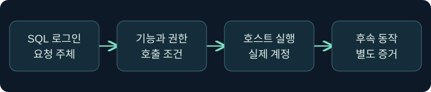
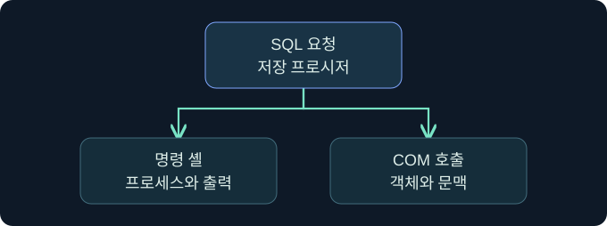

## 1. SQL에서 운영체제로 넘어가는 경계를 찾습니다

가상의 문서 서비스에서 DB 관리자가 인스턴스 설정을 조회합니다. SQL 관리자라는 사실, 운영체제에서 실행되는 서비스 계정, 실제로 생성된 프로세스는 서로 다른 증거입니다. 이 강의에서는 `xp_cmdshell`과 OLE Automation이 그 경계를 어떻게 넘을 수 있는지 설명하고 기존 기록으로 검증합니다. 가상 사례이며 기능 활성화, 운영체제 명령, COM 객체 생성 및 대상 접근은 미실행입니다.



## 2. xp_cmdshell의 요청과 실행 신원을 구별합니다

`xp_cmdshell`은 SQL Server에서 Windows 명령 셸을 호출하고 일반적으로 출력을 행으로 반환하는 확장 저장 프로시저입니다. 호출자의 SQL 로그인과 생성된 Windows 프로세스의 계정은 다를 수 있습니다. 높은 권한의 호출에서는 SQL Server 서비스 계정이 실행 문맥이 됩니다. 승인된 비관리자 호출의 경우 실행 권한과 구성된 프록시 자격 증명 등 별도 조건이 필요하며, 프록시가 없는 비관리자 호출은 실패할 수 있습니다.

| 확인할 항목 | 의미 | 따로 확인할 근거 |
|---|---|---|
| SQL 로그인·역할 | 호출과 구성의 권한 문맥 | 승인된 권한·감사 |
| 서비스 계정 | 엔진의 운영체제 실행 신원 | 서비스 구성과 프로세스 기록 |
| 프록시 계정 | 지정된 호출에서 쓰이는 별도 신원 | 승인된 구성 및 실제 토큰 |
| 자식 프로세스 | 운영체제에서 관측된 동작 | 부모·자식, 계정, 시작 시각 |

서비스 계정을 일률적으로 SYSTEM으로 추정하지 않습니다. 서버마다 가상 계정, 전용 서비스 계정 등 실제 구성이 다릅니다.

## 3. OLE Automation은 COM 객체를 호출합니다

OLE Automation의 SQL 프로시저는 객체 생성, 메서드 호출, 속성 읽기·쓰기, 오류 정보 조회, 객체 해제 등 역할이 나뉩니다. 예를 들어 `sp_OACreate`와 `sp_OAMethod`의 감사 기록은 객체를 만들거나 메서드를 호출한 경로를 살필 단서입니다. 프로세스 내부에서 동작하는 COM 구성 요소도 있고 별도 프로세스에서 동작하는 구성 요소도 있습니다. 따라서 호출을 관찰해도 새 프로세스가 생겼다고 단정하지 않습니다. 메서드나 속성이 결과를 반환할 수 있으며, 그 반환과 셸의 표준 출력은 다른 개념입니다.



## 4. 구성값과 현재 적용값을 함께 읽습니다

다음은 문서화된 SQL Server 인스턴스에서 검토할 수 있는 **미실행 읽기 전용 쿼리**입니다. 현재 인스턴스의 구성 메타데이터만 대상으로 합니다.

```sql
SELECT name, value AS configured_value, value_in_use
FROM sys.configurations
WHERE name IN ('xp_cmdshell', 'Ole Automation Procedures')
ORDER BY name;
```

`value`는 구성된 값이고 `value_in_use`는 현재 사용하는 값입니다. 차이가 있으면 그 시점의 운영 상태와 승인된 변경 이력을 대조합니다. 둘이 모두 0인 스냅샷은 관측 시점의 상태입니다. 더 이른 시각에 켜져 있었는지까지 확인하려면 이전 스냅샷이나 변경 로그가 필요합니다.

## 5. 실행에 관한 네 가지 결론을 구별합니다

| 가상 관측 | 확인된 범위 | 남은 확인 |
|---|---|---|
| 구성값 1, 적용값 0 | 값 차이가 관측됨 | 적용 시점과 변경 승인 |
| 적용값 1, 호출 기록 없음 | 기능이 현재 적용됨 | 호출 감사의 수집 범위 |
| 호출 기록, 프로세스 미확인 | SQL에서 요청한 단서 | 반환 상태·COM 실행 문맥·호스트 감사 |
| 자식 프로세스 관측 | 호스트에 프로세스가 생김 | SQL 호출과의 상관관계 및 후속 동작 |

SQL 오류 로그와 승인된 감사·Extended Events 설정, 운영체제 프로세스 기록을 함께 봅니다. 특정 이벤트가 수집되는지 먼저 확인합니다. 시간, 서버 인스턴스, 로그인, 프로세스 부모와 계정이 일치할수록 연결 근거가 강해집니다.

## 6. 공식 콘솔에서 세션 문맥 확인 위치를 읽습니다

### 실제 화면 145: Fortra Beacon Console


출처는 [Fortra 콘솔 안내](https://hstechdocs.helpsystems.com/manuals/cobaltstrike/current/userguide/content/topics/ui_consoles.htm)입니다. 2026년 11월 9일 현행 문서를 확인했습니다. 공식 일반 콘솔이며 버전에 따라 메뉴가 다를 수 있습니다. **Cobalt Strike → Visualization → Session Table → 가상 LAB-AUDIT04 행 우클릭 → Interact**를 선택하는 미실행 예입니다. 하단에 `getuid`를 입력하고 **Enter**를 누르는 위치를 봅니다. 이 값은 조사 세션의 보고 문맥을 확인하며 저장은 필요하지 않습니다. 위쪽 반환을 선택한 세션과 대조합니다. 이번 반환과 SQL 확장의 실제 구성 감사 화면은 확보하지 못했습니다.

## 7. SSMS에서 읽기 전용 감사의 확인 위치를 읽습니다

**SSMS → Object Explorer → 승인된 엔진 선택 → New Query**에서 4절의 쿼리를 검토하는 미실행 절차입니다. 현재 인스턴스를 먼저 확인하고 입력 창에 두 기능의 공식 설정 이름을 포함한 조회를 넣습니다. **Execute**가 조회 실행 버튼이며 별도 파일 저장은 필요하지 않습니다. **Results**에서 두 열의 차이를 확인하고 누락이나 권한 오류는 **Messages**를 봅니다. 가상 결과와 설정 상태 변경 사진은 확보하지 못했습니다. [Microsoft SSMS 쿼리 안내](https://learn.microsoft.com/en-us/ssms/quickstarts/ssms-connect)

## 8. SQL 기록과 호스트 기록의 시각을 맞춥니다


가상의 감사에서 14시 05분에 설정 변경이 있고 14시 06분에 프로세스 생성이 있습니다. 두 기록이 같은 인스턴스와 호출 문맥을 가리키는지 대조합니다. 네트워크 요청이나 후속 세션이 보여도 별도의 동작으로 기록하며 해당 SQL 호출에서 발생한 것인지는 추가 증거로 확인합니다.

## 9. 상태 복구 검증에서 항목을 혼동하지 않습니다

`xp_cmdshell`, `Ole Automation Procedures`, `clr enabled`는 서로 다른 옵션입니다. 한 옵션이 0으로 관측됐다는 사실로 다른 옵션의 복구를 판단하지 않습니다. 변경 요청과 실제 적용을 구분하고, 승인된 기준선과 같은 시각·인스턴스의 상태를 비교합니다. 이 강의는 기존 자료의 검토로 한정합니다.

## 10. 복습과 즉시 해설

### 복습 1. SQL 로그인과 Windows 프로세스 계정은 항상 같나요?
**해설:** 서비스 또는 프록시 계정의 문맥을 별도로 확인합니다.

### 복습 2. 비관리자에게 실행 권한만 부여되면 충분한가요?
**해설:** 기능 상태와 프록시 구성 같은 별도 조건을 확인합니다.

### 복습 3. 구성값 1이면 현재 적용값도 1인가요?
**해설:** 두 열을 함께 읽어 현재 상태를 확인합니다.

### 복습 4. OLE 호출이 곧 새 프로세스인가요?
**해설:** COM 실행 문맥과 실제 호스트 기록을 확인합니다.

### 복습 5. 설정이 현재 꺼져 있으면 과거에도 꺼져 있었나요?
**해설:** 이전 상태는 변경 이력과 이전 스냅샷에서 확인합니다.

### 복습 6. OLE에 결과 반환이 없다고 일반화하나요?
**해설:** 메서드·속성의 반환은 셸 출력과 다른 형태로 존재할 수 있습니다.

### 복습 7. CLR 상태로 OLE 원복을 확인하나요?
**해설:** 각 옵션의 적용값을 독립적으로 대조합니다.

### 복습 8. 콘솔 표시 계정이 SQL 서비스 계정인가요?
**해설:** 콘솔 문맥이며 SQL 서비스 구성과 별도로 확인합니다.

## 11. 공식 자료와 확인 범위

- [Microsoft · xp_cmdshell](https://learn.microsoft.com/en-us/sql/relational-databases/system-stored-procedures/xp-cmdshell-transact-sql)
- [Microsoft · OLE Automation 객체 생성과 문맥](https://learn.microsoft.com/en-us/sql/relational-databases/system-stored-procedures/sp-oacreate-transact-sql)
- [Microsoft · sys.configurations](https://learn.microsoft.com/en-us/sql/relational-databases/system-catalog-views/sys-configurations-transact-sql)

2026년 11월 9일 공식 자료를 확인했습니다. SQL Server·SSMS·Cobalt Strike 실행과 정책 변경, 운영체제 명령 및 대상 접근은 미실행입니다.
