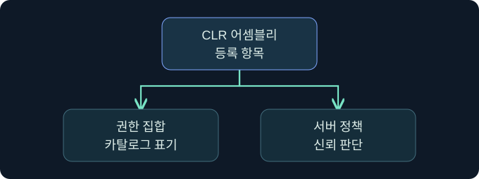

## 1. 설정이 켜져 있어도 코드를 실행했다는 뜻은 아닙니다

가상의 문서 인스턴스는 승인된 텍스트 정규화 함수를 사용합니다. 감사자는 CLR 사용 가능 여부, 승인된 어셈블리, 데이터베이스에 등록된 항목, 호출 이력을 각각 확인합니다. 이 네 가지를 분리하면 구성이 허용된 상태와 코드가 실제로 실행된 사건을 구별할 수 있습니다. 실제 제품과 어셈블리의 생성·배포·호출은 미실행입니다.


## 2. 관리 코드와 SQL 개체의 연결을 읽습니다

SQL CLR은 SQL Server에서 지원하는 .NET Framework 기반 관리 코드를 데이터베이스 기능으로 사용할 수 있게 합니다. 등록된 어셈블리에는 형식과 메서드가 있고, SQL 함수나 프로시저 등의 개체가 그 진입점을 참조할 수 있습니다. 등록된 DLL만으로 SQL 진입점과 호출을 추정하지 않습니다. 예제 템플릿의 클래스 이름이나 `partial` 선언도 SQL CLR의 일반 요구사항으로 해석하지 않습니다.

| 층 | 가상 사례 | 확인할 근거 |
|---|---|---|
| 서버 기능 | CLR 사용 상태 | 인스턴스 구성의 적용값 |
| 승인 | 검토된 공급물과 식별 정보 | 서명·해시·배포 승인 |
| 데이터베이스 등록 | 문서 정규화 모듈 | 카탈로그와 종속 개체 |
| 실제 호출 | 앱의 정규화 요청 | 호출 감사 및 응용 결과 |

## 3. 권한 집합과 보안 경계를 구별합니다

`SAFE`, `EXTERNAL_ACCESS`, `UNSAFE`는 등록에 표시되는 어셈블리 권한 집합입니다. 일반적으로 관리 코드의 제한된 사용, 외부 자원 접근 가능성, 더 넓은 실행 능력을 설명합니다. SQL Server 2017 이후의 `clr strict security`는 기본적으로 켜져 있으며, 이 모드에서는 신뢰 판단에서 `SAFE`와 `EXTERNAL_ACCESS`도 `UNSAFE`처럼 취급합니다. 카탈로그에 `SAFE`라고 표시된 것만으로 독립된 안전 경계라고 판단하지 않습니다. 구성과 제품 버전을 함께 기록합니다.



## 4. 서명과 신뢰 목록, 등록의 차이를 확인합니다

서명 기반 신뢰는 검증 가능한 서명과 서버 수준의 적절한 권한 구성이 필요합니다. SQL Server의 신뢰 목록은 어셈블리 해시를 서버 수준에서 관리할 수 있습니다. 목록에서 해시를 찾았다는 사실은 그 바이트를 신뢰할 근거가 있다는 의미이며, 어느 데이터베이스에 등록됐거나 호출됐다는 뜻은 아닙니다. 반대로 DB에 이름이 같아도 승인 당시의 파일과 같은 바이트인지 이름으로 확인할 수 없습니다.

| 기존 관측 | 확인 범위 | 다음 확인 |
|---|---|---|
| 신뢰 목록에 해시 존재 | 서버 수준 신뢰 등록 | 실제 배포물 식별자와 승인 |
| 데이터베이스에 어셈블리 존재 | 해당 DB 등록 관측 | SQL 진입점·종속 관계 |
| 호출 로그 존재 | 요청이 도착했을 가능성 | 반환 및 오류와 시간 |
| 외부 요청 관측 | 호스트에서 후속 통신 발생 | 실제 호출과의 인과 관계 |

## 5. 적용 구성과 데이터베이스 목록을 읽습니다

다음은 승인된 점검 환경에서 검토할 수 있는 **미실행 읽기 전용 쿼리**입니다. 첫 조회는 인스턴스 설정이며 두 번째 조회는 선택한 데이터베이스의 메타데이터입니다.

```sql
SELECT name, value, value_in_use
FROM sys.configurations
WHERE name IN ('clr enabled', 'clr strict security');

SELECT name, permission_set_desc
FROM sys.assemblies
WHERE is_user_defined = 1;
```

첫 조회는 두 설정의 현재 적용값을 비교합니다. 두 번째 조회는 데이터베이스 이름 및 조회자의 가시성과 함께 해석합니다. 행이 보이지 않아도 다른 데이터베이스 또는 메타데이터 권한 제한을 먼저 확인합니다. 어셈블리 바이트나 사용자 데이터는 조회하지 않습니다.

## 6. 공식 콘솔에서 보고 문맥의 위치를 확인합니다

### 실제 화면 146: Fortra Beacon Console


출처는 [Fortra 콘솔 안내](https://hstechdocs.helpsystems.com/manuals/cobaltstrike/current/userguide/content/topics/ui_consoles.htm)입니다. 2026년 11월 9일 현행 문서를 대조했습니다. 공식 일반 콘솔이며 버전에 따라 배치가 달라질 수 있습니다. **Cobalt Strike → Visualization → Session Table → 가상 LAB-AUDIT04 행 우클릭 → Interact**로 여는 미실행 예입니다. 하단에 `getuid`를 입력하고 **Enter**를 누르는 위치를 봅니다. 선택한 세션의 보고 문맥을 읽기 위한 값이며 별도 저장은 없습니다. 위쪽 반환은 SQL CLR 등록이나 실행 결과와 구별합니다. 이번 반환과 SQL 확장의 어셈블리 감사 화면은 확보하지 못했습니다.

## 7. SSMS에서 인스턴스와 데이터베이스를 확인합니다

**SSMS → Object Explorer → 승인된 엔진 선택 → New Query**에서 데이터베이스 선택 목록에 가상 `TrainingDocs`가 선택됐는지 확인합니다. 이 값은 어셈블리 목록의 범위를 명확히 합니다. 입력 창에 5절의 읽기 전용 문장을 넣고 **Execute**를 누르는 미실행 절차입니다. 별도 저장은 필요하지 않습니다. **Results**에서 구성과 어셈블리 목록을 구분하고 오류는 **Messages**를 확인합니다. 가상 입력·결과 사진은 확보하지 못했습니다. [Microsoft SSMS 쿼리 안내](https://learn.microsoft.com/en-us/ssms/quickstarts/ssms-connect)

## 8. 조건을 바꾸어 결론을 확인합니다


가상의 사례에서 승인된 해시가 남아 있고 DB 목록에는 어셈블리가 보이지 않습니다. 해시가 남았다는 사실과 DB에서 제거됐다는 판단을 분리합니다. 권한 있는 기존 스냅샷으로 DB 범위를 확인합니다. 반대로 등록 항목이 있으나 호출 자료가 없다면 감사 범위, 진입점 연결, 관측 시간을 살펴봅니다. 호출이 성공했더라도 운영체제 프로세스나 네트워크 동작이 발생했는지는 별도의 증거가 필요합니다.

## 9. 변경 전후의 여러 상태를 따로 기록합니다

인스턴스 구성, 신뢰 목록, 데이터베이스 어셈블리, SQL 진입점에는 서로 다른 소유자와 범위가 있을 수 있습니다. 원복 검토에서는 승인된 기준선과 네 층을 따로 비교합니다. 특정 설정이 꺼졌다는 이유로 목록에서 항목이 사라졌거나 파일이 삭제됐다고 판단하지 않습니다. 이 강의에서는 등록·삭제·신뢰 변경을 수행하지 않습니다.

## 10. 복습과 즉시 해설

### 복습 1. CLR 사용 가능 상태는 실행을 입증하나요?
**해설:** 서버 기능 상태입니다. 등록·진입점·호출은 따로 확인합니다.

### 복습 2. SQL 개체와 어셈블리는 같은 대상인가요?
**해설:** SQL 개체는 어셈블리의 진입점을 참조할 수 있습니다.

### 복습 3. SAFE 표시만으로 보안 경계를 확정하나요?
**해설:** 버전과 strict security 적용 상태를 함께 확인합니다.

### 복습 4. 신뢰 해시의 존재는 등록을 증명하나요?
**해설:** 서버 수준 신뢰의 근거입니다. DB 등록을 별도로 확인합니다.

### 복습 5. 이름이 같으면 승인된 바이트와 같나요?
**해설:** 승인 자료와 해시나 서명 등 식별 근거를 대조합니다.

### 복습 6. 어셈블리 목록이 비었으면 서버 전체에 없나요?
**해설:** 선택한 DB와 메타데이터 가시성의 영향을 받습니다.

### 복습 7. SQL 호출 성공은 새 Windows 프로세스를 증명하나요?
**해설:** 호스트 프로세스 자료가 추가로 필요합니다.

### 복습 8. CLR 기능의 적용값이 바뀌면 신뢰 목록도 정리되나요?
**해설:** 구성과 목록은 별도 상태입니다. 기준선에 각각 대조합니다.

## 11. 공식 자료와 확인 범위

- [Microsoft · CLR strict security](https://learn.microsoft.com/en-us/sql/database-engine/configure-windows/clr-strict-security)
- [Microsoft · CREATE ASSEMBLY의 신뢰와 권한](https://learn.microsoft.com/en-us/sql/t-sql/statements/create-assembly-transact-sql)
- [Microsoft · sys.assemblies](https://learn.microsoft.com/en-us/sql/relational-databases/system-catalog-views/sys-assemblies-transact-sql)
- [Microsoft · sys.trusted_assemblies](https://learn.microsoft.com/en-us/sql/relational-databases/system-catalog-views/sys-trusted-assemblies-transact-sql)

2026년 11월 9일 공식 자료를 확인했습니다. SQL Server·SSMS·Cobalt Strike 실행, 쿼리, 배포·호출, 정책 변경과 대상 접근은 미실행입니다.
