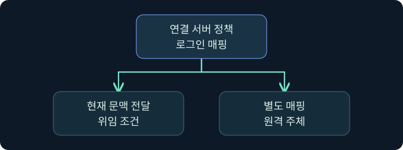

## 1. 연결 서버는 데이터와 신원이 함께 넘어가는 경계입니다

가상의 보고서 인스턴스 A는 보관 인스턴스 B에서 월별 집계를 읽습니다. 사용자는 A에만 연결하지만, 쿼리의 일부는 A의 공급자를 통해 B에서 처리될 수 있습니다. 이때 B가 인정하는 로그인은 A에서 사용자가 보는 로그인과 다를 수 있습니다. 사례는 가상이며 원격 연결, 데이터 조회, 로그인 매핑 변경은 미실행입니다.


## 2. 등록된 이름과 실제 목적지를 구별합니다

연결 서버 이름은 A에 등록된 논리적 별칭입니다. 공급자는 원격 데이터 원본과 통신하는 구성 요소이며, 원본은 다른 SQL Server 외에도 공급자가 지원하는 데이터 시스템일 수 있습니다. 별칭, 공급자, 원격 주소, 기본 카탈로그를 자산 문서에서 각각 확인합니다. A에서 B가 등록됐다는 사실은 B에서 A를 향한 링크가 있다는 뜻도, 실제 네트워크 통신이 가능하다는 뜻도 아닙니다.

## 3. 매핑은 원격 권한의 출발점입니다



| 정책 | 원격에서 확인할 사항 | 자주 생기는 오해 |
|---|---|---|
| 현재 보안 문맥 전달 | 지원되는 인증과 위임 조건, 원격 로그인 | A의 성공 로그인만으로 두 번째 홉을 보장 |
| 명시적인 로그인 매핑 | 해당 로컬 로그인에 대응하는 원격 주체 | A와 B의 역할이 같다고 가정 |
| 매핑이 없는 로그인에 대한 기본 정책 | 연결 거부, 별도 문맥 또는 지원되는 기본 동작 | 개별 매핑이 없으면 항상 접속 불가 |

A의 낮은 권한 로그인 여러 개가 B의 같은 계정에 매핑되면 B의 권한과 감사 식별성이 달라질 수 있습니다. 원격 계정이 이미 가진 권한은 B가 적용합니다. Windows 문맥 전달에는 제품·공급자와 Kerberos 위임 조건이 있으며, Microsoft 문서에 명시된 연결 서버의 제한 위임 지원과 리소스 기반 제한 위임 지원 여부를 구분합니다.

## 4. 분산 데이터 액세스와 RPC Out을 따로 확인합니다

| 관측 항목 | 의미 | 별도 조건 |
|---|---|---|
| Data Access | 연결 서버의 분산 쿼리 사용 옵션 | 공급자와 대상 연결, 원격 권한 |
| RPC Out | 이 인스턴스에서 대상 방향으로 RPC를 허용하는 옵션 | 원격 인증과 호출 권한 |
| RPC | 연결 서버 쪽에서 들어오는 RPC 관련 옵션 | 반대 방향의 실제 구성 |

RPC Out이 꺼져 있어도 분산 데이터 조회의 허용 여부는 따로 확인합니다. 켜져 있어도 원격 프로시저를 실행할 권한이 생기는 것은 아닙니다. SQL 명령이 어느 엔진에서 평가됐는지와 원격 운영체제 동작이 관측됐는지도 구분합니다.

## 5. 원격 호출 없이 현재 등록을 점검합니다

아래는 A의 카탈로그만 읽는 미실행 예입니다. 원격 원본이나 자격 증명은 조회하지 않습니다.

```sql
SELECT name, provider, is_data_access_enabled, is_rpc_out_enabled
FROM sys.servers
WHERE is_linked = 1;
```

등록과 옵션의 관측입니다. 뷰의 행은 조회자의 메타데이터 가시성에 영향을 받을 수 있습니다. 권한이 있는 기존 감사 자료에서 `sys.linked_logins`의 매핑 범위와 원격 로그인 정책을 대조합니다. 버전에 따라 필요한 조회 권한이 다르며, 목록을 보기 위해 권한을 변경하는 절차는 다루지 않습니다.

## 6. 공식 콘솔에서 조사 세션의 문맥을 구분합니다

### 실제 화면 147: Fortra Beacon Console


출처는 [Fortra 콘솔 안내](https://hstechdocs.helpsystems.com/manuals/cobaltstrike/current/userguide/content/topics/ui_consoles.htm)입니다. 2026년 11월 10일 현행 안내서를 대조했습니다. 공식 일반 화면이며 버전에 따라 메뉴가 다를 수 있습니다. **Cobalt Strike → Visualization → Session Table → 가상 LAB-REPORT05 우클릭 → Interact**로 여는 미실행 예입니다. 하단 입력 줄에 `getuid`를 넣고 **Enter**를 누르는 위치를 확인합니다. 관측 세션의 보고 문맥을 읽는 값이며 별도 저장은 없습니다. 위쪽 반환을 선택한 호스트와 대조합니다. 이번 반환 및 SQL 확장의 연결 서버 목록 사진은 확보하지 못했습니다.

## 7. SSMS에서 카탈로그 조회의 결과 위치를 확인합니다

**SSMS → Object Explorer → 가상 LAB-REPORT05의 승인된 인스턴스 선택 → New Query**를 엽니다. 입력 창에 5절 쿼리를 넣습니다. `is_linked = 1`은 로컬 인스턴스 행과 연결 서버를 구분하는 값입니다. **Execute**를 누르는 미실행 예이며 별도 저장은 없습니다. **Results**의 이름·공급자·두 옵션을 대조하고 실패 시 **Messages**에서 대상과 권한을 확인합니다. 이번 SSMS 결과 사진은 확보하지 못했습니다. [Microsoft SSMS 쿼리 안내](https://learn.microsoft.com/en-us/ssms/quickstarts/ssms-connect)

## 8. 조건이 달라지면 관측을 다시 해석합니다


| 가상 상황 | 지금 확인할 수 있는 범위 | 다음 확인 |
|---|---|---|
| 등록은 보이고 원격 인증 실패 | 로컬 구성은 존재 | 공급자·연결 보안·두 번째 홉 |
| 원격 로그인 성공, 테이블 조회 거부 | 인증은 됐지만 인가 실패 가능 | B의 DB 사용자와 객체 권한 |
| RPC Out만 활성 | 출발 방향 옵션만 확인 | 실제 호출 경로와 감사 |
| 여러 로컬 세션이 동일 원격 계정 사용 | 원격 로그만으로 원래 사용자를 가리기 어려움 | A와 B의 시간·업무 요청 식별자 |

## 9. 두 서버의 기록을 연결합니다

A의 요청 시각, 로컬 로그인과 링크 별칭을 적고 B에서는 실제 수신 로그인, 데이터베이스, 작업 결과를 기록합니다. 같은 시각의 배치 작업이 있을 수 있으므로 연결 ID나 업무 식별자를 우선 대조합니다. 한 쪽에서만 보이는 오류는 해당 관측 범위를 표시합니다. 네트워크 도달성, 인증, 객체 인가, 쿼리 결과를 서로 다른 결론으로 남깁니다.

## 10. 복습과 즉시 해설

### 복습 1. 별칭은 원격 호스트 이름과 항상 같나요?
**해설:** 로컬 등록 이름입니다. 실제 원본은 구성 자료에서 확인합니다.

### 복습 2. A의 역할은 B에도 그대로 적용되나요?
**해설:** 원격 로그인 매핑과 B의 역할을 별도로 읽습니다.

### 복습 3. A에서 Windows 인증이 되면 두 번째 홉도 가능한가요?
**해설:** 공급자와 위임 조건, B의 인증을 따로 확인합니다.

### 복습 4. RPC Out이 꺼지면 모든 조회가 막히나요?
**해설:** 분산 데이터 액세스와 RPC는 별도 옵션입니다.

### 복습 5. RPC Out이 켜지면 원격 실행 권한을 얻나요?
**해설:** 방향 옵션이며 원격 호출 권한은 B에서 따로 판단합니다.

### 복습 6. 카탈로그에 링크가 보이면 연결이 입증됐나요?
**해설:** 구성의 증거입니다. 실제 인증과 요청 기록이 필요합니다.

### 복습 7. B에서 같은 로그인 이름이면 요청자도 같은가요?
**해설:** 공통 매핑을 사용할 수 있으므로 A의 요청과 연결합니다.

### 복습 8. 콘솔의 계정 표시로 원격 SQL 로그인을 확인하나요?
**해설:** 콘솔 문맥입니다. B의 로그인 기록을 확인합니다.

## 11. 공식 자료와 확인 범위

- [Microsoft · 연결 서버와 위임 지원](https://learn.microsoft.com/en-us/sql/relational-databases/linked-servers/linked-servers-database-engine)
- [Microsoft · 연결 서버의 보안 설정](https://learn.microsoft.com/en-us/sql/relational-databases/linked-servers/create-linked-servers-sql-server-database-engine)
- [Microsoft · sys.servers](https://learn.microsoft.com/en-us/sql/relational-databases/system-catalog-views/sys-servers-transact-sql)
- [Microsoft · sys.linked_logins](https://learn.microsoft.com/en-us/sql/relational-databases/system-catalog-views/sys-linked-logins-transact-sql)

2026년 11월 10일 공식 자료를 확인했습니다. 제품 실행, 원격 조회, 자격 증명 작업과 설정 변경은 미실행입니다.
