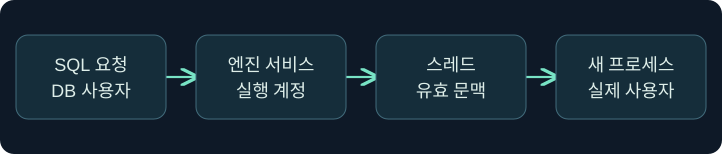
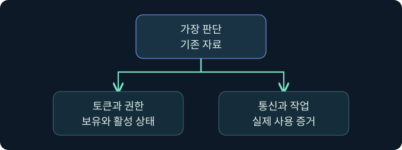

## 1. 데이터베이스 권한과 Windows 실행 신원을 나눕니다

가상의 문서 서버에서 SQL 감사에는 작업 요청이 있고 Windows 기록에는 새 프로세스가 있습니다. SQL 로그인, 엔진 서비스 계정, 스레드의 유효 문맥, 새 프로세스의 사용자 필드를 따로 확인합니다. 서비스 계정이 로컬 관리자라는 가정이나 토큰의 권한 하나만으로 권한 상승을 판정하지 않습니다. 실제 제품·인증·가장·프로세스 생성은 미실행입니다.

## 2. 서비스 계정의 로컬 신원과 네트워크 신원을 읽습니다

SQL Server Database Engine은 운영체제가 지정한 서비스 신원으로 실행됩니다. Windows 가상 서비스 계정은 로컬에서 서비스별 신원으로 동작하며 도메인 환경의 네트워크 리소스에는 컴퓨터 계정 문맥을 사용할 수 있습니다. 전용 도메인 계정이나 관리 서비스 계정을 쓰는 구성도 있습니다. 서비스 구성, 실제 프로세스 토큰, 네트워크 대상의 인증 기록을 함께 확인합니다.

| 범위 | 가상 관측 | 확인할 사항 |
|---|---|---|
| SQL 인스턴스 | 데이터베이스 사용자 | 인스턴스와 DB의 매핑 |
| Windows 서비스 | 가상 서비스 계정 | 구성 계정과 실행 계정 |
| 로컬 프로세스 | 기본 토큰의 사용자 | 프로세스 인스턴스와 시작 시각 |
| 네트워크 대상 | 컴퓨터 계정의 로그인 | 실제 인증 경로와 대상 감사 |

가상 계정의 이름이나 컴퓨터 계정의 접속 기록만으로 로컬 관리자 권한을 추정하지 않습니다.

## 3. SeImpersonatePrivilege가 뜻하는 범위를 확인합니다

이 사용자 권한은 인증 후 클라이언트 가장과 관련됩니다. Windows가 요청을 처리하는 스레드에 가장 토큰을 적용하면 접근 검사에서 그 문맥이 사용될 수 있습니다. 권한의 존재와 활성화 상태, 사용할 수 있는 토큰과 가장 수준, 실제 API 동작은 서로 다른 조건입니다. 보유한 권한 하나가 임의 사용자의 토큰이나 새 프로세스를 자동으로 제공하지 않습니다.

명명된 파이프는 정상적인 프로세스 간 통신에도 널리 쓰입니다. 파이프 연결 한 건으로 높은 권한 문맥을 확보했거나 새 실행이 발생했다고 해석하지 않습니다. 이 강의는 인증 유도, 토큰 획득 및 재사용, 실행 파일 배포를 수행하지 않습니다.

## 4. 스레드 문맥과 새 프로세스의 신원을 구분합니다

| 관측 | 해석의 범위 | 다음 확인 |
|---|---|---|
| 사용자 권한 할당 | 정책상 후보 | 실제 토큰과 활성 상태 |
| 파이프 연결 | 통신 사건 | 양쪽 프로세스, 업무 기준선 |
| 스레드의 가장 확인 | 해당 작업의 유효 문맥 | 적용 시점과 종료 여부 |
| 새 프로세스 생성 | 별도 프로세스 인스턴스 | 실제 사용자, 부모, 시작 시각 |

스레드가 일시적으로 다른 문맥을 쓰더라도 기본 프로세스 토큰과 새 프로세스의 실행 신원은 별도로 확인합니다. 같은 PID가 다시 사용될 수 있으므로 프로세스 GUID 또는 PID와 시작 시간을 함께 기록합니다.

## 5. Windows와 SQL의 감사 자료를 함께 읽습니다

프로세스 생성 감사 4688 및 Sysmon 1은 설정에 따라 새 프로세스의 근거가 될 수 있습니다. Sysmon 17과 18은 구성된 환경에서 명명된 파이프 생성과 연결을 관측합니다. 어떤 이벤트가 수집되는지 먼저 확인합니다. 시간과 호스트, 사용자, 로그온 ID, 부모 프로세스, SQL 요청의 시점을 맞춥니다. 업무 앱에서 정상 사용되는 파이프와 서비스 자동화도 비교합니다.

## 6. 공식 콘솔에서 세션 문맥을 읽습니다

### 실제 화면 148: Fortra Beacon Console

출처는 [Fortra 콘솔 안내](https://hstechdocs.helpsystems.com/manuals/cobaltstrike/current/userguide/content/topics/ui_consoles.htm)입니다. 2026년 11월 10일 현행 문서를 대조했습니다. 공식 일반 화면이며 설치 버전에 따라 배치가 다를 수 있습니다. **Cobalt Strike → Visualization → Session Table → 가상 LAB-ARCHIVE05 우클릭 → Interact**를 선택합니다. 하단 입력 줄에 `getuid`를 넣고 **Enter**를 누르는 미실행 예입니다. 보고 문맥을 확인하는 값이며 저장은 필요하지 않습니다. 위쪽 반환에서 선택한 세션을 대조합니다. 이 값으로 토큰 권한이나 새 프로세스 신원을 판정하지 않습니다. 이번 콘솔 반환과 실제 토큰 조사 화면은 확보하지 못했습니다.

## 7. 이벤트 뷰어에서 기존 기록의 위치를 확인합니다

**Event Viewer → Action → Open Saved Log → 가상 LAB-ARCHIVE05 보안 로그 선택 → Open**을 검토합니다. **Filter Current Log**의 이벤트 ID 칸에 `4688`을 넣고 **OK**를 누르는 미실행 예입니다. 프로세스 생성만 고르기 위한 값입니다. 저장할 설정은 없습니다. **Details**에서 새 프로세스의 ID·이름, 생성 주체·대상 주체 필드를 버전과 함께 확인합니다. 필터 및 가상 결과 사진은 확보하지 못했습니다. [Microsoft 이벤트 4688 화면과 필드](https://learn.microsoft.com/en-us/previous-versions/windows/it-pro/windows-10/security/threat-protection/auditing/event-4688)

## 8. 조건을 바꿔 결과를 재검토합니다

| 가상 상황 | 판단 | 추가 확인 |
|---|---|---|
| 권한이 있고 파이프 연결은 없음 | 토큰 보유 상태만 확인 | 수집 범위와 실행 문맥 |
| 파이프는 연결됐지만 새 프로세스는 미확인 | 통신 관측 | 연결 상대, 정상 기준선 |
| 새 프로세스의 사용자가 서비스 계정과 다름 | 별도 실행 신원 관측 | 실제 부모, 로그온과 작업 요청 |
| 대상 로그온에 컴퓨터 계정이 보임 | 네트워크 인증 근거 | 로컬 서비스와의 연결 및 대상 작업 |

## 9. 판단의 근거와 빈칸을 함께 남깁니다

권한 설정이 있었는지, 토큰에서 실제로 관측됐는지, 스레드에서 사용됐는지, 새 프로세스나 후속 연결이 생겼는지를 별도 칸에 기록합니다. 서로 다른 수집원에서 시각이 어긋나면 허용 범위와 보정 근거를 적습니다. 서비스 프로세스의 정상 작업인지 조사하려면 승인된 업무 기록과 비교합니다.

## 10. 복습과 즉시 해설

### 복습 1. SQL 로그인은 Windows 프로세스의 사용자와 같은가요?
**해설:** DB 문맥과 운영체제 실행 문맥을 나눠 확인합니다.

### 복습 2. 가상 서비스 계정은 네트워크에서도 같은 이름인가요?
**해설:** 도메인 환경에서는 컴퓨터 계정 문맥을 사용할 수 있습니다.

### 복습 3. SeImpersonatePrivilege가 있으면 권한 상승이 발생했나요?
**해설:** 권한 보유만 관측한 것입니다. 실제 토큰 사용 증거가 필요합니다.

### 복습 4. 파이프 연결로 새 프로세스 생성이 입증되나요?
**해설:** 통신과 프로세스 생성은 서로 다른 사건입니다.

### 복습 5. 스레드 토큰과 프로세스 토큰은 같은 역할인가요?
**해설:** 일시적인 스레드 접근 문맥과 기본 프로세스 문맥을 구분합니다.

### 복습 6. 새 프로세스의 계정은 무엇으로 확인하나요?
**해설:** 프로세스 인스턴스의 사용자·시각과 관련 로그온을 대조합니다.

### 복습 7. 같은 PID면 같은 프로세스인가요?
**해설:** 재사용될 수 있습니다. 시작 시각 또는 GUID를 함께 봅니다.

### 복습 8. 콘솔의 사용자 이름만으로 토큰의 권한을 알 수 있나요?
**해설:** 이름은 문맥의 단서입니다. 권한 및 사용 기록은 별도로 확인합니다.

## 11. 공식 자료와 확인 범위

- [Microsoft · SQL Server 서비스 계정과 권한](https://learn.microsoft.com/en-us/sql/database-engine/configure-windows/configure-windows-service-accounts-and-permissions)
- [Microsoft · SeImpersonatePrivilege](https://learn.microsoft.com/en-us/troubleshoot/windows-server/windows-security/seimpersonateprivilege-secreateglobalprivilege)
- [Microsoft · Windows 가장 토큰](https://learn.microsoft.com/en-us/windows/win32/secauthz/impersonation-tokens)
- [Microsoft Sysinternals · Sysmon 이벤트](https://learn.microsoft.com/en-us/sysinternals/downloads/sysmon)

2026년 11월 10일 공식 자료를 확인했습니다. SQL Server·SSMS·Cobalt Strike·Windows 인증, 가장, 자격 증명 수집 및 정책 변경은 미실행입니다.
