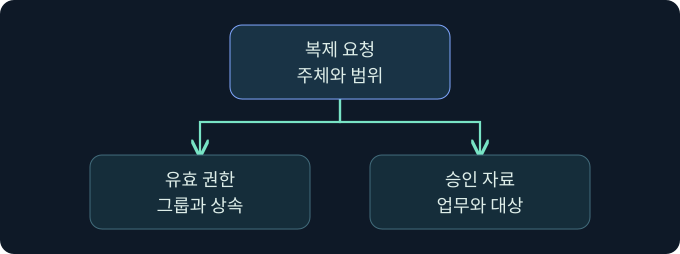

## 1. 복제는 도메인 운영에 필요한 정상 동작입니다

가상 조직의 동부 지점에서 계정을 만들고 서부 지점에서 그 계정을 검색합니다. 두 도메인 컨트롤러(DC)가 변경을 교환하면 지점별 사본의 차이가 줄어듭니다. 그러나 같은 경로를 예상 밖의 주체가 사용하면 민감한 인증 자료가 노출될 수 있습니다. DCSync는 이 복제 기능을 악용하는 방식입니다. 이 강의의 사례는 합성이며 실제 복제 요청과 인증 자료 조회는 미실행입니다.

## 2. 복제의 대상과 방향을 구별합니다

AD DS는 디렉터리 정보를 명명 컨텍스트로 나눕니다. 도메인 데이터, 구성과 스키마에는 서로 다른 복제 범위가 적용됩니다. 변경을 받을 측이 원본 DC에 변경분을 요청할 수 있으며, MS-DRSR의 `IDL_DRSGetNCChanges`는 이 요청에 쓰입니다. 응답 크기나 상태에 따라 여러 차례 교환이 필요할 수 있습니다. 조사에서는 연결 출발지와 DC, 대상 컨텍스트, 수집 시간의 순서로 확인합니다.

## 3. 그룹 이름에서 유효 복제 권한으로 넘어갑니다

| 권한 또는 조건 | 의미 | 확인할 근거 |
|---|---|---|
| Replicating Directory Changes | 지정된 컨텍스트의 변경 복제와 관련 | 대상 컨텍스트와 유효 권한 |
| Replicating Directory Changes All | 비밀 도메인 데이터 복제와 관련 | 권한 조합 및 요청 범위 |
| Replicating Directory Changes In Filtered Set | 필터링된 특성 집합의 복제와 관련 | 요청 특성과 적용 범위 |
| 업무상 승인 | DC나 동기화 주체가 허용된 범위 | 자산·계정·업무 승인 기록 |

직접 권한, 중첩 그룹, 상속, 거부 항목과 넓은 확장 권한을 함께 확인합니다. 관리 그룹에 없더라도 필요한 권한을 위임받은 계정일 수 있습니다. 반대로 권한 이름 하나로 특정 비밀이 응답에 포함됐다고 판단할 수 없습니다.

## 4. 복제 기능의 악용과 다른 접근을 비교합니다

| 구분 | 작업 경계 | 주요 관측 |
|---|---|---|
| 일반 LDAP 검색 | 디렉터리 검색 | 검색 범위와 반환 속성 |
| 정상 DRS 복제 | 승인된 주체가 DC에 변경 요청 | DC 쌍, 토폴로지, 상태 |
| 의심스러운 DRS 복제 | 예상 밖 주체나 경로의 요청 | RPC, DC 감사, 권한 변경 |
| DC 파일 접근 | 호스트 파일 또는 스냅샷 접근 | 파일, 백업, 호스트 감사 |

파일 접근만 감시하는 환경에서는 원격 복제의 징후가 빠질 수 있습니다. RPC 연결도 서버가 요청을 처리하거나 민감한 자료를 반환했다는 증거와 구분합니다.

## 5. 장기 키의 노출은 별도 사고 범위입니다

TGT를 보호하는 계정의 키와 개별 서비스 계정의 키는 역할이 다릅니다. 전자의 노출은 도메인 티켓 신뢰에, 후자는 해당 키를 공유하는 서비스에 영향을 줄 수 있습니다. 어떤 키가 노출됐는지 판단하려면 실제 요청 범위와 처리·반환 증거가 필요합니다. 복구 작업은 도메인 복제와 운영 영향에 대한 판단이 필요한 별도 사고 대응입니다.

## 6. 공식 콘솔에서 조회 문맥을 확인합니다

### 실제 화면 149: Fortra Beacon Console

[Fortra 콘솔 안내](https://hstechdocs.helpsystems.com/manuals/cobaltstrike/current/userguide/content/topics/ui_consoles.htm)의 공식 일반 화면입니다. 2026년 11월 10일 안내서를 확인했으며 설치 버전에 따라 메뉴와 배치가 달라질 수 있습니다. **Cobalt Strike → Visualization → Session Table → 가상 LAB-REVIEW06 우클릭 → Interact**로 엽니다. 하단에 `getuid`를 넣고 **Enter**를 누르는 미실행 예입니다. 선택한 세션의 보고 문맥을 대조하기 위한 값입니다. 별도 저장 없이 위쪽 반환에서 세션을 대조합니다. 이번 조회 반환 및 복제 결과 사진은 확보하지 못했습니다.

## 7. 기존 권한 자료로 조사 범위를 정합니다

가상 동기화 계정이 도메인 컨텍스트에 직접 권한을 받았다고 가정합니다. 권한 스냅샷에서 주체의 SID와 그룹 경로를 확인한 뒤 승인된 호스트와 업무 시간을 대조합니다. 현재의 권한은 언제 부여됐는지 알려주지 않으므로 이전 스냅샷이나 변경 기록을 확인합니다. 실제 권한 화면은 확보하지 못했습니다.

## 8. 조건을 바꾸면 결론도 달라집니다

| 가상 상황 | 관측 범위 | 다음 확인 |
|---|---|---|
| 권한은 있지만 요청 미확인 | 설정 상태 | 감사와 네트워크 가시성 |
| 알려진 DC에서 DC로 요청 | 정상 복제 후보 | 토폴로지와 작업 시각 |
| 비DC에서 DC로 요청 | 조사 후보 | 승인된 동기화 및 실제 계정 |
| 성공 감사 한 건 | 감사된 접근 성공 | 반환 범위와 후속 활동 |

## 9. 조사 결론을 증거 수준에 맞춥니다

대상 도메인과 DC, 요청자와 출발 호스트, 시각 기준을 기록합니다. 권한, 요청, 서버 처리, 실제 노출을 별도 칸으로 나누고 확인되지 않은 단계를 표시합니다. 다음 강의에서는 동일 DC의 감사와 네트워크 관측을 연결하는 방법을 다룹니다.

## 10. 복습과 즉시 해설

### 복습 1. DRS 요청은 곧 공격인가요?
**해설:** 정상 복제에도 쓰이므로 주체와 경로를 확인합니다.

### 복습 2. 복제 범위가 포리스트 전체로 고정되나요?
**해설:** 명명 컨텍스트와 복제 구성을 확인합니다.

### 복습 3. Domain Admins만 복제할 수 있나요?
**해설:** 위임된 유효 권한도 확인합니다.

### 복습 4. 권한 하나로 반환된 특성을 알 수 있나요?
**해설:** 요청 범위, 권한 조합과 정책이 영향을 줍니다.

### 복습 5. DCSync는 DC의 파일 복사인가요?
**해설:** 디렉터리 복제 프로토콜을 이용하는 방식입니다.

### 복습 6. 권한이 보이면 비밀 유출이 확인됐나요?
**해설:** 권한 상태입니다. 실제 요청과 처리·반환 근거가 필요합니다.

### 복습 7. 비DC 요청은 모두 악성인가요?
**해설:** 승인된 동기화 주체와 실제 호스트를 대조합니다.

### 복습 8. 콘솔 계정으로 복제 권한을 알 수 있나요?
**해설:** 세션 문맥과 유효 디렉터리 권한은 따로 확인합니다.

## 11. 공식 자료와 확인 범위

- [Microsoft MS-DRSR · 디렉터리 복제](https://learn.microsoft.com/en-us/openspecs/windows_protocols/ms-drsr/)
- [Microsoft Defender for Identity · DCSync 경보](https://learn.microsoft.com/en-us/defender-for-identity/alerts-xdr)
- [MITRE ATT&CK · DCSync](https://attack.mitre.org/techniques/T1003/006/)

2026년 11월 10일 공식 자료를 확인했습니다. 제품 실행, 복제 요청, 비밀 수집과 정책 변경은 미실행입니다.
