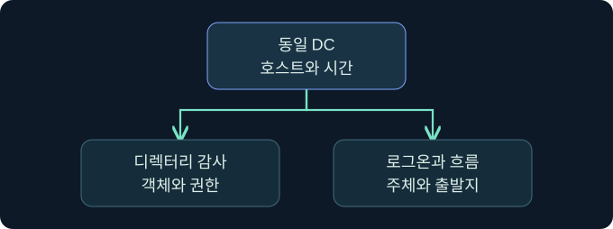
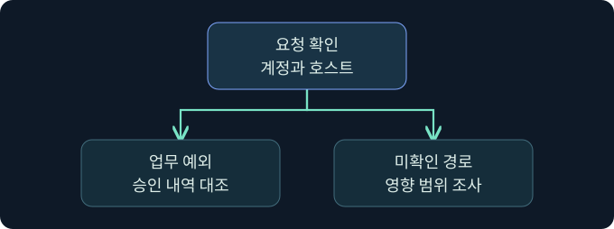

## 1. 단일 경보에서 복제 요청의 맥락으로 넘어갑니다

가상의 SOC에서 서부 DC의 디렉터리 객체 접근 경보가 들어옵니다. 같은 시간에 정상 동기화도 있었습니다. 요청자, 출발지, 사용 권한과 업무 승인을 대조해야 두 경우를 구분할 수 있습니다. 실제 환경에서 복제 요청이나 인증 자료 조회는 수행하지 않았습니다.

## 2. 4662가 기록되는 조건을 이해합니다

4662는 디렉터리 객체 작업의 감사 이벤트입니다. Directory Service Access 감사 정책과 객체의 SACL 및 작업에 맞는 감사 조건이 필요합니다. 어느 DC에서 성공 또는 실패 감사가 나왔는지, 해당 시간의 수집 범위가 어떻게 되는지 확인합니다. 이벤트의 부재는 그 조건을 점검하기 전까지 활동 부재를 입증하지 못합니다.

## 3. 접근 유형과 권한을 함께 읽습니다

| 필드 | 답할 수 있는 질문 | 해석할 때 주의할 점 |
|---|---|---|
| Subject 및 Logon ID | 누가 작업했나요? | 같은 DC의 로그온 기록과 연결 |
| Object Name 및 Object Type | 어느 객체의 작업인가요? | 도메인 컨텍스트와 대조 |
| Access Mask | 어떤 접근 유형인가요? | Control Access의 값은 0x100 |
| Properties | 어떤 권한이나 속성인가요? | 복제 관련 권한인지 스키마 정의와 대조 |

Control Access는 여러 확장 권한에 쓰입니다. `0x100`만으로 복제를 확정하지 않습니다. Properties의 식별자나 변환된 권한 이름을 확인하고, 성공 감사가 반환 자료의 내용을 보여 주는지 구분합니다.

## 4. 인증 기록을 같은 DC에서 연결합니다

4662의 Subject Logon ID를 같은 DC의 4624에서 새 로그온 ID와 대조합니다. 시각과 계정도 함께 읽습니다. 로그온 ID는 다른 호스트에 그대로 적용할 수 있는 전역 식별자가 아닙니다. 인증은 작업보다 먼저 발생할 수 있고 출발 주소가 비거나 중계 주소일 수 있습니다. 이벤트가 여러 개면 세션의 시간 범위와 흐름 자료로 후보를 좁힙니다.

## 5. 네트워크 관측과 권한 변경을 보강 증거로 씁니다

승인된 센서에서 DRS RPC의 인터페이스와 작업을 확인할 수 있다면 출발지, 목적지, 관측 시간을 대조합니다. 일반 RPC 포트만으로는 디렉터리 복제를 확인할 수 없습니다. 암호화와 센서 위치에 따라 세부 동작이 보이지 않을 수 있습니다. 권한 변경 감사가 있다면 사건 이전에 누가 어떤 경로로 접근 능력을 얻었는지 검토하되 실제 요청의 증거와 따로 기록합니다.

## 6. 공식 콘솔에서 관측 문맥을 구분합니다

### 실제 화면 150: Fortra Beacon Console

[Fortra 콘솔 안내](https://hstechdocs.helpsystems.com/manuals/cobaltstrike/current/userguide/content/topics/ui_consoles.htm)의 공식 일반 화면입니다. 2026년 11월 10일 안내서를 확인했으며 설치 버전에 따라 배치가 달라질 수 있습니다. **Cobalt Strike → Visualization → Session Table → 가상 LAB-REVIEW06 우클릭 → Interact**에서 하단 입력 줄에 `getuid`를 넣고 **Enter**를 누르는 미실행 예입니다. 선택한 세션의 보고 문맥을 확인하기 위한 값입니다. 저장 없이 위쪽 반환을 세션과 대조합니다. 이번 반환 및 실제 복제 감사 사진은 확보하지 못했습니다.

## 7. 저장된 로그의 필드를 확인합니다

**Event Viewer → Action → Open Saved Log**에서 가상 DC의 승인된 보안 로그를 선택하고 **Open**을 누르는 미실행 예입니다. **Filter Current Log**의 이벤트 ID 칸에 `4662,4624`를 넣고 **OK**를 누릅니다. 접근과 인증을 함께 검토하기 위한 값입니다. 원본 저장 없이 **Details → XML View**에서 컴퓨터, 로그온 ID, 접근 권한과 시각을 대조합니다. 이번 필터 창과 가상 결과 사진은 확보하지 못했습니다. [Microsoft 이벤트 4662 안내](https://learn.microsoft.com/en-us/previous-versions/windows/it-pro/windows-10/security/threat-protection/auditing/event-4662)

## 8. 정상 기준선과 다른 조건을 비교합니다

| 가상 관측 | 잠정 결론 | 다음 확인 |
|---|---|---|
| 알려진 DC 쌍, 정기 시간대 | 정상 복제 후보 | 토폴로지와 변경 기록 |
| 비DC, 등록된 동기화 계정 | 정상 예외 후보 | 실제 호스트와 승인 범위 |
| 비DC, 신규 권한, 예상 밖 시간 | 우선 조사할 요청 | 권한 변경, 인증, 처리 범위 |
| DRS 흐름만 관측 | 네트워크 단서 | SACL, 수집 상태, DC 기록 |

## 9. 사고 대응에 전달할 근거를 정리합니다

요청한 주체와 경로, 권한 변경 시각, 영향받을 수 있는 도메인과 미확인 증거를 기록합니다. 기존 로그와 네트워크 메타데이터를 보존하고 담당자가 실제 노출 범위를 판단할 수 있도록 요청 성공 여부와 반환 자료의 확인 여부를 나눕니다. 이 강의는 자격 증명을 수집하거나 변경하는 작업을 포함하지 않습니다.

## 10. 복습과 즉시 해설

### 복습 1. 4662는 DCSync 전용인가요?
**해설:** 디렉터리 객체 감사입니다. 권한과 주체를 대조합니다.

### 복습 2. 4662가 없으면 요청도 없었나요?
**해설:** 감사 정책, SACL과 수집 범위를 먼저 확인합니다.

### 복습 3. 0x100이면 복제인가요?
**해설:** 접근 유형입니다. Properties와 객체를 함께 봅니다.

### 복습 4. 로그온 ID를 여러 DC에서 그대로 비교하나요?
**해설:** 같은 컴퓨터의 로그온과 연결합니다.

### 복습 5. 일반 RPC 트래픽은 복제의 증거인가요?
**해설:** 가능한 경우 인터페이스와 작업을 대조합니다.

### 복습 6. 비DC는 모두 악성으로 분류하나요?
**해설:** 승인된 예외와 실제 호스트·계정을 확인합니다.

### 복습 7. 권한 변경이 실제 복제를 보여 주나요?
**해설:** 구성 변화의 단서입니다. 요청과 처리 자료는 별도입니다.

### 복습 8. 성공 감사로 반환된 자료를 확인할 수 있나요?
**해설:** 감사 범위를 읽고 반환이나 후속 사용을 별도로 조사합니다.

## 11. 공식 자료와 확인 범위

- [Microsoft · 이벤트 4662](https://learn.microsoft.com/en-us/previous-versions/windows/it-pro/windows-10/security/threat-protection/auditing/event-4662)
- [Microsoft · 이벤트 4624](https://learn.microsoft.com/en-us/previous-versions/windows/it-pro/windows-10/security/threat-protection/auditing/event-4624)
- [Microsoft Defender for Identity · DCSync 경보](https://learn.microsoft.com/en-us/defender-for-identity/alerts-xdr)

2026년 11월 10일 공식 자료를 확인했습니다. 제품 실행, 감사 설정 변경, 복제와 인증 자료 수집은 미실행입니다.
