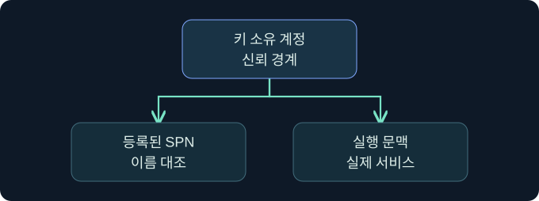

## 1. Silver Ticket과 서비스 키의 신뢰 경계

가상의 문서 서비스가 야간에 사용자 로그온을 받아들였습니다. 같은 분의 DC 로그에는 새 서비스 티켓 요청이 보이지 않습니다. 이전에 받은 정상 티켓일 수도 있고, 다른 DC나 수집 공백이 있을 수도 있습니다. 이 강의는 그런 가능성을 확인한 뒤 서비스 키 노출 가설을 평가합니다. 모든 사례는 가상이며 제품·티켓·대상 접속은 미실행입니다.

## 2. 정상 교환과 신뢰 경계를 읽습니다

클라이언트는 일반적으로 KDC에서 서비스 티켓을 받고 대상에 티켓과 인증자를 제시합니다. 서비스는 자신의 키로 티켓을 열고 인증 교환을 검증합니다. Silver Ticket은 노출된 서비스 키로 만들어진 위조 서비스 티켓이 대상에 제시되는 유형입니다. 정상 발급과 대상 사용은 다른 사건이며 이미 받은 티켓을 다시 사용할 때마다 새 4769가 기록되는 것은 아닙니다.

## 3. 영향 범위를 정합니다

호스트 이름 하나로 영향을 계산하지 않습니다. 한 계정의 키를 여러 서비스가 사용할 수 있으므로 SPN의 등록 계정, 실제 서비스 실행 문맥, 변경 시각을 대조합니다. 서비스가 티켓을 열 수 있어도 인증자·시간·PAC 검증과 자원 인가는 별도로 적용됩니다. 검증 방식은 제품과 업데이트 수준에 따라 다릅니다.

## 4. 감사 필드를 증거 수준별로 나눕니다

| 관측 | 확인 범위 | 추가로 볼 자료 |
|---|---|---|
| 대상 4624 | 성공 로그온 | 인증 패키지, 계정, 원본 주소 |
| DC 4769 | 서비스 티켓 요청 | 다른 DC, 이전 요청과 캐시 |
| 서비스 감사 | 요청한 자원과 결과 | 업무 승인 및 인가 정책 |
| 서비스 등록·구성 | 키가 쓰일 수 있는 범위 | 실제 프로세스 신원과 변경 시각 |

## 5. 조사 순서를 정합니다

먼저 실제 대상과 시각을 고정하고 계정, 서비스, 인증 경로를 기록합니다. 발급 자료와 대상 자료의 수집 범위를 적은 뒤 서로 다른 가설을 대조합니다. 한 이벤트의 부재를 실제 동작 부재로 확대하지 않습니다.

## 6. 공식 콘솔에서 보고 문맥을 확인합니다

### 실제 화면 151: Fortra Beacon Console

[Fortra 콘솔 안내](https://hstechdocs.helpsystems.com/manuals/cobaltstrike/current/userguide/content/topics/ui_consoles.htm)의 일반 공식 화면입니다. 2026년 11월 10일 안내서를 확인했으며 설치 버전에 따라 배치와 메뉴가 다를 수 있습니다. **Cobalt Strike → Visualization → Session Table → 가상 LAB-DOCS07 우클릭 → Interact**로 엽니다. 하단 입력 줄에 `getuid`를 넣고 **Enter**를 누르는 미실행 예입니다. 선택한 세션의 보고 문맥을 확인하기 위한 값입니다. 별도 저장 없이 위쪽 반환을 선택한 세션과 대조합니다. 이번 반환과 가상 티켓 검증 결과의 실제 화면은 확보하지 못했습니다.

## 7. 저장된 이벤트를 읽는 위치를 확인합니다

**Event Viewer → Action → Open Saved Log → 승인된 가상 보안 로그 선택 → Open**을 검토합니다. **Filter Current Log**의 이벤트 ID 칸에 `4624`를 넣고 **OK**를 누르는 미실행 절차입니다. 대상의 성공 로그온을 고르는 값입니다. DC의 서비스 티켓 요청은 별도 로그에서 찾습니다. 별도 저장 없이 **Details → XML View**에서 호스트, 계정, 시각과 이벤트별 결과를 대조합니다. 필터 창과 가상 결과 사진은 확보하지 못했습니다.

## 8. 조건을 바꾸어 판단을 비교합니다

| 가상 조건 | 잠정 판단 | 다음 확인 |
|---|---|---|
| 새 4769 없이 같은 서비스 재접속 | 정상 캐시 재사용 후보 | 이전 발급과 해당 서비스 |
| 한 계정에 여러 SPN | 공유 키의 영향이 넓을 수 있음 | 현재 등록 및 실제 실행 신원 |
| 로그인 성공과 파일 열기 거부 | 인증과 인가 결과가 다름 | 파일 감사와 권한 |
| 키 변경 직후 여러 인증 실패 | 키 버전 차이 후보 | 변경 시점과 정상 서비스 영향 |

## 9. 확인된 사실과 가설을 따로 남깁니다

가상 조사 메모에는 대상 호스트, SPN, 시각, 인증 패키지, 서비스가 실제로 수행한 요청을 남깁니다. 해당 DC만 봤다면 그 범위를 명시합니다. 정상 캐시와 수집 공백을 확인한 뒤에도 의심이 남으면 서비스 키 노출과 실제 사용을 별개 가설로 기록합니다.

## 10. 복습과 즉시 해설

### 복습 1. 어떤 키의 신뢰를 검토하나요?
**해설:** 대상 서비스가 사용하는 키입니다.

### 복습 2. 4624로 파일 접근을 입증하나요?
**해설:** 대상 자원의 인가와 실제 작업은 별도 감사로 확인합니다.

### 복습 3. 새 4769가 없으면 위조인가요?
**해설:** 캐시와 다른 DC, 수집 범위를 확인합니다.

### 복습 4. 같은 호스트의 모든 서비스가 같은 키인가요?
**해설:** 등록과 실제 서비스 계정을 각각 확인합니다.

### 복습 5. 복호화 성공이면 권한 검증도 성공인가요?
**해설:** 인증 교환과 대상 자원 인가가 따로 적용됩니다.

### 복습 6. 4769는 대상 서비스가 티켓을 받았다는 증거인가요?
**해설:** DC가 처리한 티켓 요청을 보여 줍니다.

### 복습 7. 콘솔의 사용자 이름으로 서비스 키 소유자를 확인하나요?
**해설:** 콘솔 세션과 서비스 실행 계정을 분리해 봅니다.

### 복습 8. 서비스 키 노출이면 도메인 TGT 키도 노출됐나요?
**해설:** 키의 역할과 영향 범위가 다릅니다.

## 11. 공식 자료와 확인 범위

- [MITRE ATT&CK · Silver Ticket](https://attack.mitre.org/techniques/T1558/002/)
- [Microsoft · 4624](https://learn.microsoft.com/en-us/previous-versions/windows/it-pro/windows-10/security/threat-protection/auditing/event-4624)
- [Microsoft · Windows PAC](https://learn.microsoft.com/en-us/openspecs/windows_protocols/ms-pac/)
- [Microsoft · 4769](https://learn.microsoft.com/en-us/previous-versions/windows/it-pro/windows-10/security/threat-protection/auditing/event-4769)

2026년 11월 10일 자료를 확인했습니다. 실제 제품 실행, 티켓 작업, 대상 인증, 자격 증명 수집과 정책·키 변경은 미실행입니다.
