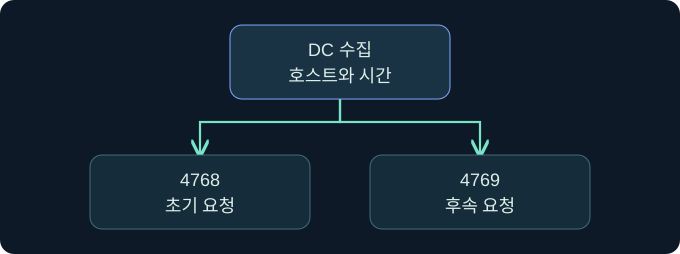

## 1. Golden Ticket과 도메인 TGT의 신뢰 경계

가상의 조직에서 업무 시간 밖에 여러 서비스에 대한 티켓 요청이 관측됐습니다. 각각의 서비스가 영향을 받은 경우와 도메인의 TGT 발급 신뢰가 흔들린 경우는 조사 범위가 다릅니다. 초기 발급 기록을 어느 DC와 시간대에서 확인할지부터 정합니다. 모든 사례는 가상이며 제품·티켓·대상 접속은 미실행입니다.

## 2. 정상 교환과 신뢰 경계를 읽습니다

일반적인 AD 도메인에서는 해당 도메인의 krbtgt 키가 TGT 보호에 쓰입니다. 클라이언트는 TGT를 KDC에 제시해 후속 서비스 티켓을 요청합니다. Golden Ticket은 도메인 신뢰 키가 노출됐을 때 위조 TGT가 이 경로에서 사용되는 유형입니다. 대상 서비스는 자신이 사용하는 별도 키로 서비스 티켓을 검증하며, 자원 접근은 별도의 인가를 거칩니다.

## 3. 영향 범위를 정합니다

먼저 해당 발급 도메인과 실제 후속 서비스 범위를 확인합니다. 다른 도메인까지의 효과는 신뢰 구성과 경로를 확인해야 합니다. 오프라인에서 만들어진 TGT에는 정상 AS 발급 기록이 없지만, 정상 TGT 재사용이나 다른 DC의 발급도 현재 조회 범위에서는 같은 공백을 남길 수 있습니다. 이벤트 수를 일대일로 맞추지 않습니다.

## 4. 감사 필드를 증거 수준별로 나눕니다

| 관측 지점 | 주로 확인하는 것 | 해석 제한 |
|---|---|---|
| DC 4768 | TGT 요청과 결과 | 처리 DC와 수집 구간 |
| DC 4769 | 후속 서비스 티켓 요청 | 초기 TGT의 출처는 별도 |
| 대상 4624 | 성공 로그온 | 자원 인가와 앱 동작은 별도 |
| 서비스 감사 | 작업과 실제 결과 | 수집되지 않은 행위는 미확인 |

## 5. 조사 순서를 정합니다

먼저 실제 대상과 시각을 고정하고 계정, 서비스, 인증 경로를 기록합니다. 발급 자료와 대상 자료의 수집 범위를 적은 뒤 서로 다른 가설을 대조합니다. 한 이벤트의 부재를 실제 동작 부재로 확대하지 않습니다.

## 6. 공식 콘솔에서 보고 문맥을 확인합니다

### 실제 화면 152: Fortra Beacon Console

[Fortra 콘솔 안내](https://hstechdocs.helpsystems.com/manuals/cobaltstrike/current/userguide/content/topics/ui_consoles.htm)의 일반 공식 화면입니다. 2026년 11월 10일 안내서를 확인했으며 설치 버전에 따라 배치와 메뉴가 다를 수 있습니다. **Cobalt Strike → Visualization → Session Table → 가상 LAB-REVIEW07 우클릭 → Interact**로 엽니다. 하단 입력 줄에 `getuid`를 넣고 **Enter**를 누르는 미실행 예입니다. 선택한 세션의 보고 문맥을 확인하기 위한 값입니다. 별도 저장 없이 위쪽 반환을 선택한 세션과 대조합니다. 이번 반환과 가상 티켓 검증 결과의 실제 화면은 확보하지 못했습니다.

## 7. 저장된 이벤트를 읽는 위치를 확인합니다

**Event Viewer → Action → Open Saved Log → 승인된 가상 보안 로그 선택 → Open**을 검토합니다. **Filter Current Log**의 이벤트 ID 칸에 `4768,4769`를 넣고 **OK**를 누르는 미실행 절차입니다. DC의 초기 발급과 후속 서비스 티켓 요청을 고르는 값입니다. 별도 저장 없이 **Details → XML View**에서 호스트, 계정, 시각과 이벤트별 결과를 대조합니다. 필터 창과 가상 결과 사진은 확보하지 못했습니다.

## 8. 조건을 바꾸어 판단을 비교합니다

| 가상 조건 | 지금 기록할 판단 | 다음 확인 |
|---|---|---|
| 후속 요청만 관측 | 초기 발급 미확인 | 여러 DC와 이전 시간대 |
| 예상 밖 형식 및 업무 시간 | 추가 분석 후보 | 계정 정책과 제품 버전 |
| 복제 이상과 여러 서비스 사용 | 조사 범위를 넓힐 근거 | 요청자와 대상 및 호스트 감사 |
| 복구 승인 후 일부 DC에서만 변경 관측 | 반영 범위 미확인 | 복제 수렴과 서비스 영향 |

## 9. 확인된 사실과 가설을 따로 남깁니다

가상 기록에 발급 도메인, 수집한 DC, 시간 기준, 후속 서비스와 확인하지 못한 로그를 적습니다. 신뢰 키 노출과 의심 티켓의 실제 사용을 별도로 기록합니다. 승인된 복구를 확인할 때는 현재·이전 키의 수용, DC 복제와 티켓 수명, 정상 서비스 영향이 서로 다른 조건임을 기록합니다. 실제 키 변경은 수행하지 않습니다.

## 10. 복습과 즉시 해설

### 복습 1. Golden Ticket의 핵심 신뢰는 무엇인가요?
**해설:** 해당 도메인의 TGT 발급 신뢰입니다.

### 복습 2. TGT는 파일 서비스가 직접 검증하나요?
**해설:** 일반 흐름에서는 KDC에 제시하고 서비스에는 서비스 티켓을 냅니다.

### 복습 3. 4769에 대응하는 4768이 없으면 위조인가요?
**해설:** 다른 DC와 발급 시각, 캐시와 수집 공백을 확인합니다.

### 복습 4. 암호 형식 하나면 충분한가요?
**해설:** 버전, 정책, 계정과 요청 경로를 함께 봅니다.

### 복습 5. 후속 티켓 발급이 업무 성공을 입증하나요?
**해설:** 대상 인증과 자원 감사가 필요합니다.

### 복습 6. 한 도메인에서 의심되면 전체 포리스트가 영향을 받나요?
**해설:** 도메인 경계와 신뢰 경로를 별도로 확인합니다.

### 복습 7. 복구 승인 기록만으로 반영됐다고 보나요?
**해설:** DC 적용과 복제 수렴 및 서비스 결과를 확인합니다.

### 복습 8. 콘솔 사용자 이름이 TGT 발급 증거인가요?
**해설:** 세션 문맥을 표시합니다. 발급은 DC 자료로 확인합니다.

## 11. 공식 자료와 확인 범위

- [MITRE ATT&CK · Golden Ticket](https://attack.mitre.org/techniques/T1558/001/)
- [Microsoft · 4768](https://learn.microsoft.com/en-us/previous-versions/windows/it-pro/windows-10/security/threat-protection/auditing/event-4768)
- [Microsoft · 도메인 키 복구](https://learn.microsoft.com/en-us/windows-server/identity/ad-ds/manage/forest-recovery-guide/ad-forest-recovery-reset-the-krbtgt-password)
- [Microsoft · 4769](https://learn.microsoft.com/en-us/previous-versions/windows/it-pro/windows-10/security/threat-protection/auditing/event-4769)

2026년 11월 10일 자료를 확인했습니다. 실제 제품 실행, 티켓 작업, 대상 인증, 자격 증명 수집과 정책·키 변경은 미실행입니다.
