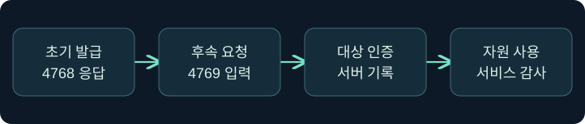
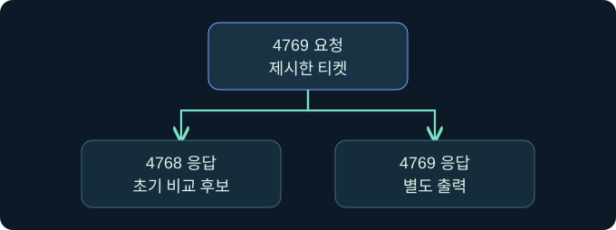

## 1. 정상 발급 기록만으로 무엇을 말할 수 있나요?

가상의 SOC에서 오전 9시에 정상적인 TGT 발급이 관측됐습니다. 잠시 뒤 같은 계정의 후속 서비스 요청과 평소와 다른 권한 사용이 보입니다. 앞의 발급 기록은 KDC가 그 시점에 티켓을 발급했다는 증거입니다. 뒤의 요청이 같은 티켓을 그대로 사용했는지와 요청의 권한이 정당했는지는 따로 확인해야 합니다. 이 강의는 그 관계를 **티켓 계보**라고 부릅니다. 사례는 가상이며 실제 티켓 작업은 미실행입니다.

## 2. Diamond Ticket이 위협하는 신뢰를 이해합니다

Diamond Ticket은 정상 발급된 TGT에서 시작해 내부 권한 정보가 변조된 티켓을 후속 요청에 제시하는 유형입니다. 도메인 TGT 보호 키의 노출이 핵심 가정입니다. PAC에는 사용자와 그룹 관련 권한 데이터가 포함될 수 있습니다. 발급 직후의 신뢰가 이후에 제시된 바이트나 자원 권한까지 보장하지는 않습니다. 이 과정에서는 생성·수정·적용 절차를 수행하지 않습니다.

| 유형 | 조사할 신뢰 경계 | 발급 로그의 한계 |
|---|---|---|
| Silver Ticket | 서비스 계정 키 | 대상 사용 직전 새 서비스 티켓 요청이 없을 수 있음 |
| Golden Ticket | 도메인 TGT 키 | 위조 TGT의 정상 초기 발급은 없지만 정상 로그가 별도로 존재할 수 있음 |
| Diamond Ticket | 정상 발급 뒤 변경된 TGT와 도메인 키 | 정상 초기 발급이 있어도 후속 요청에 사용된 티켓은 별도 확인 |

## 3. 4768과 4769의 방향을 읽습니다

4768은 TGT 요청을, 4769는 서비스 티켓 요청을 기록합니다. 필드를 제공하는 DC 버전에서는 4768의 **응답 티켓 해시**와 4769의 **요청 티켓 해시**를 비교할 수 있습니다. 4769의 응답 해시는 해당 교환의 출력이므로 초기 TGT와 직접 비교하는 값이 아닙니다. Microsoft는 Windows Server 2016 이상에서 2025년 1월 14일 이후 누적 보안 업데이트를 적용했을 때 갱신된 이벤트 형식을 설명합니다. 실제 환경에서는 필드 제공 여부와 파서 매핑을 먼저 확인합니다.

## 4. 해시 비교의 전제와 한계를 정합니다

| 가상 관측 | 지금 말할 수 있는 범위 | 다음 확인 |
|---|---|---|
| 같은 값, 지원 필드 | 관측한 바이트의 연속성을 뒷받침 | 사용자·서비스·대상 권한 감사 |
| 다른 값, 비교 대상 미확정 | 다른 티켓일 가능성 | 갱신·다른 DC·신뢰 경로 |
| 값이 없거나 파서가 버림 | 해시 기준 연결 불가 | 원본 XML·업데이트·수집 범위 |
| 발급 일치, 권한 사용 이상 | 발급과 인가 판단이 별도 | 그룹·정책과 서비스의 실제 요청 |

해시 일치 여부는 합법성 전체에 대한 판정이 아닙니다. 갱신된 TGT나 도메인 간 참조 티켓은 비교 후보를 바꿀 수 있습니다. 정상 기준선으로 시간대를 잡고, 관련 DC의 로그를 수집했는지 표시합니다.

## 5. 디렉터리 상태와 대상 권한을 대조합니다

가상의 서비스가 평소 허용하지 않던 작업을 승인했다면 대상 서비스의 자원 감사를 먼저 확인합니다. 요청자와 대상, 업무 식별자를 남긴 다음 발급 시점의 그룹과 권한 정보를 확인합니다. 현재 그룹 목록만 보면 사건 이후의 정상 변경을 공격의 근거로 오해할 수 있습니다. 암호화 형식이나 티켓 수명은 환경 기준선과 함께 해석합니다.

## 6. 공식 콘솔에서 보고 문맥을 확인합니다

### 실제 화면 153: Fortra Beacon Console

[Fortra 콘솔 안내](https://hstechdocs.helpsystems.com/manuals/cobaltstrike/current/userguide/content/topics/ui_consoles.htm)의 공식 일반 화면입니다. 2026년 11월 10일 문서를 확인했으며 설치 버전에 따라 메뉴가 다를 수 있습니다. **Cobalt Strike → Visualization → Session Table → 가상 LAB-REVIEW08 우클릭 → Interact**로 엽니다. 하단 입력 줄에 `getuid`를 입력하고 **Enter**를 누르는 미실행 예입니다. 선택한 세션의 보고 문맥을 확인하기 위한 값입니다. 별도 저장 없이 위쪽 반환 영역을 세션과 대조합니다. 이번 반환과 실제 티켓 검증 결과 사진은 확보하지 못했습니다.

## 7. 저장된 DC 로그에서 필드 위치를 읽습니다

**Event Viewer → Action → Open Saved Log → 승인된 가상 DC 로그 선택 → Open**을 검토합니다. **Filter Current Log**의 ID에 `4768,4769`를 넣고 **OK**를 누르는 미실행 절차입니다. 초기 발급과 후속 요청을 함께 고르는 값입니다. 별도 저장 없이 **Details → XML View**에서 컴퓨터·시각·이벤트 버전과 해시 필드를 확인합니다. 이번 필터와 결과 화면은 확보하지 못했습니다.

## 8. 발급에서 실제 자원 사용으로 이어지는 근거를 정리합니다

시각을 보정하고 DC 및 서비스를 나눠 기록합니다. 예를 들어 09시 00분의 발급과 09시 04분의 후속 요청이 있어도, 그 뒤 09시 05분에 파일 열기가 허용됐는지는 파일 서비스가 답합니다. 어느 단계의 자료를 확보하지 못했는지도 적습니다.

| 가상 시점 | 원본에서 남길 항목 | 기록에서 판단할 수 있는 범위 |
|---|---|---|
| 09:00 | DC-A, 4768 성공, 발급 계정, 응답 해시 A | DC-A가 그 계정에 TGT를 발급한 기록 |
| 09:04 | DC-B, 4769 성공, 요청 해시 B, 서비스 대상 | DC-B의 요청 처리 기록과 제시된 티켓의 비교 후보 |
| 09:05 | 파일 서버, 자원 감사, 작업 식별자 | 해당 서버에서 관측한 파일 작업과 처리 결과 |

가상 조사에서 A와 B가 다르면 먼저 두 이벤트의 원본 XML과 성공 상태를 확인합니다. 다른 DC가 요청을 받는 상황을 고려해 그 사이에 일어난 갱신과 참조 경로를 검색합니다. 해당 구간에 수집 공백이 있으면 보고서에는 계보 미확인으로 남깁니다. 수집 범위와 비교 대상을 확보한 뒤에도 불일치가 남는다면 티켓 변조 가능성과 그룹·권한 변경 등 별도의 설명을 나누어 검토합니다.

## 9. 조사 메모에 가설을 유지합니다

정상 발급 확인, 후속 요청과의 연속성, 대상 인가 결과를 별도 칸에 적습니다. 티켓 변조와 도메인 키 노출은 서로 다른 가설입니다. 관측 범위를 확인한 뒤 승인된 대응 팀에 전달합니다.

보고서에는 비교한 해시가 각각 어떤 이벤트의 어느 방향에서 얻어졌는지 표시합니다. 이벤트 사본에는 원본을 찾을 수 있는 기록 ID와 DC 이름을 남기고, 서비스 기록의 시간대도 기록합니다. 티켓 원본이나 인증 자료를 모으지 않고도 어떤 연결을 확인했는지 재현할 수 있습니다.

## 10. 복습과 즉시 해설

### 복습 1. 정상 4768이 있으면 후속 요청은 정상인가요?
**해설:** 발급을 보여 줍니다. 후속 요청의 계보는 별도로 확인합니다.

### 복습 2. 4769의 응답 해시를 4768과 비교하나요?
**해설:** 초기 TGT와 비교할 후보는 4769의 요청 티켓 해시입니다.

### 복습 3. 해시가 다르면 변조인가요?
**해설:** 갱신, 다른 DC, 참조 티켓과 수집 범위를 먼저 확인합니다.

### 복습 4. 필드가 없는 이벤트는 요청이 없었다는 뜻인가요?
**해설:** 이벤트 버전과 수집 파서의 지원 여부를 확인합니다.

### 복습 5. 일치하는 해시가 자원 권한까지 증명하나요?
**해설:** 바이트의 연속성 단서입니다. 인가는 대상에서 확인합니다.

### 복습 6. 현재 그룹 목록을 그대로 과거에 적용하나요?
**해설:** 사건 시점의 권한 및 변경 기록을 대조합니다.

### 복습 7. 콘솔의 사용자 이름으로 티켓 계보를 확인하나요?
**해설:** 콘솔 문맥이며 발급·요청 기록은 별도로 봅니다.

### 복습 8. 티켓 이상과 키 노출은 같은 결론인가요?
**해설:** 확인된 증거에 맞춰 별개 가설로 관리합니다.

## 11. 공식 자료와 확인 범위

- [Microsoft · 이벤트 4768](https://learn.microsoft.com/en-us/previous-versions/windows/it-pro/windows-10/security/threat-protection/auditing/event-4768)
- [Microsoft · 이벤트 4769](https://learn.microsoft.com/en-us/previous-versions/windows/it-pro/windows-10/security/threat-protection/auditing/event-4769)
- [Microsoft · Windows PAC](https://learn.microsoft.com/en-us/openspecs/windows_protocols/ms-pac/)
- [MITRE ATT&CK · Kerberos 티켓 위조](https://attack.mitre.org/techniques/T1558/)

2026년 11월 10일 자료를 확인했습니다. 제품, 티켓, 인증, 자격 증명 수집과 키 변경은 미실행입니다.
