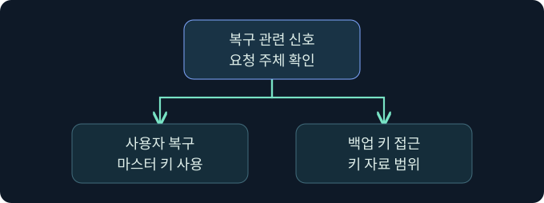

## 1. 업무 복구와 도메인 키 노출을 구분합니다

가상의 직원이 암호 재설정 뒤 저장된 업무 설정을 열지 못합니다. 관리자는 정상 복구 요청을 확인하려고 하지만, 같은 시각에 도메인 복구 키 접근 경보도 들어옵니다. 사용자의 정상 복구와 도메인 복구 비밀에 대한 관리 접근은 다른 경계입니다. 실제 복구 요청, 비밀 수집, 데이터 복호화는 미실행입니다.

## 2. 데이터, 마스터 키, 도메인 백업 키를 나눕니다

| 층 | 역할 | 조사에서 확인할 점 |
|---|---|---|
| 보호된 데이터 | 앱이 DPAPI로 보호한 데이터 | 앱·사용자·장치 및 보호 범위 |
| 사용자 마스터 키 | 보호 데이터에 연결되는 키 재료 | 사용자 및 마스터 키 식별 정보 |
| 도메인 복구 자료 | 지원되는 사용자 마스터 키의 복구 경로 | 도메인·백업 키와 해당 자료의 관계 |
| 도메인 백업 개인 키 | 도메인 복구 경계의 민감한 비밀 | 키 접근과 실제 사용 여부 |

도메인 키가 앱 데이터에 직접 적용되는 구조로 단순화하지 않습니다. 해당 키로 복구할 수 있는 마스터 키 자료와 관련 보호 데이터가 필요합니다. 애플리케이션이 추가 보호를 사용하는지, 사용자 범위인지 컴퓨터 범위인지도 확인합니다.

## 3. 정상 복구가 필요한 조건을 이해합니다

도메인 사용자 마스터 키의 복구는 예를 들어 관리자에 의한 암호 재설정 등에서 필요할 수 있습니다. 사용자 문맥에서 복구 요청을 받아 처리하는 흐름과 도메인 백업 개인 키 자체를 읽는 작업은 서로 다릅니다. Microsoft의 MS-BKRP는 복구에 쓰이는 원격 프로토콜을 정의합니다. 정상적인 요청이 보였다는 이유만으로 개인 키가 클라이언트로 전달됐다고 판단하지 않습니다.

## 4. 사고 범위를 과장하거나 축소하지 않습니다

가상 도메인의 백업 키 접근이 의심된다면 어느 키, 어느 도메인, 어떤 보호 자료가 영향 범위인지 조사합니다. 키에 접근한 기록만으로 모든 사용자의 데이터가 유출됐다고 판단하지 않습니다. 반대로 키에 대응하는 복구 자료와 데이터가 이전에 복사됐다면 과거 자료도 조사 대상이 될 수 있습니다. 사용자 암호 변경만으로 도메인 백업 키 노출 문제가 해소됐다고 보지 않습니다.

## 5. 로그가 답하는 질문을 구별합니다

| 기록 | 무엇을 관측하나요? | 추가 확인 |
|---|---|---|
| 4692 | DPAPI 마스터 키 백업 시도 | 결과와 호출 주체, 업무 문맥 |
| 4693 | DPAPI 마스터 키 복구 시도 | 정상 사용자 작업과 실제 결과 |
| Defender for Identity의 백업 키 관련 경보 | 센서가 감지한 의심 활동 | DC·요청 계정·출발지와 원본 자료 |
| 대상 앱·호스트 기록 | 로컬 데이터 접근 및 앱 동작 | 영향받은 자료의 실제 보호 범위 |

감사 정책과 수집 조건이 충족됐는지 확인합니다. 복구 시도, 개인 키 접근, 실제 데이터 복호화는 별도 판단 항목입니다.

예를 들어 지원팀의 티켓에 업무 앱 복구 작업이 14시 10분으로 승인되어 있고, 그 무렵 사용자 장치에 복구 이벤트가 남았다면 계정과 결과를 대조합니다. 같은 시간에 다른 호스트에서 도메인 백업 키 관련 경보가 들어왔다면 경보 주체, 원본 센서, 영향을 받은 도메인을 별도 사건 행에 기록합니다. 시간대가 겹치는 것만으로 두 관측의 원인이 같다고 판단하지 않습니다.

## 6. 공식 콘솔에서 조회 위치를 확인합니다

### 실제 화면 154: Fortra Beacon Console

[Fortra 콘솔 안내](https://hstechdocs.helpsystems.com/manuals/cobaltstrike/current/userguide/content/topics/ui_consoles.htm)의 공식 일반 화면입니다. 2026년 11월 10일 문서를 확인했습니다. 설치 버전에 따라 메뉴나 배치가 다를 수 있습니다. **Cobalt Strike → Visualization → Session Table → 가상 LAB-RECOVERY08 우클릭 → Interact**에서 하단 입력 줄에 `getuid`를 입력하고 **Enter**를 누르는 미실행 예입니다. 선택한 세션의 보고 문맥을 비교하기 위한 값입니다. 별도 저장 없이 위쪽 반환을 대조합니다. 이번 콘솔 반환과 복구 결과 화면은 확보하지 못했습니다.

## 7. 이벤트의 필드 위치를 확인합니다

**Event Viewer → Action → Open Saved Log → 가상 장치의 승인된 보안 로그 선택 → Open**을 검토합니다. **Filter Current Log**의 ID 칸에 `4692,4693`을 넣고 **OK**를 누르는 미실행 절차입니다. 백업과 복구 시도를 함께 확인하기 위한 값입니다. 별도 저장은 없습니다. **Details → XML View**에서 시각·컴퓨터·주체·결과 및 마스터 키 관련 필드를 비교합니다. 필터와 가상 결과 사진은 확보하지 못했습니다.

## 8. 조건을 바꾸어 결론을 비교합니다

| 가상 조건 | 잠정 판단 | 다음 확인 |
|---|---|---|
| 승인된 복구 작업과 4693 | 정상 복구 후보 | 대상 사용자, 시각, 결과 |
| 예상 밖 계정의 백업 키 접근 경보 | 의심할 관리 작업 | 승인과 원본 센서 정보 |
| 키 노출 의심, 보호 자료 접근 미확인 | 영향 범위 미확인 | 장치·앱 및 보존된 증거 |
| 사용자 암호만 변경 | 사용자 인증 변경 관측 | 도메인 복구 키의 사고 범위 |

## 9. 승인된 대응에 필요한 정보를 남깁니다

도메인과 DC, 키 관련 관측 시각, 승인된 작업 여부, 데이터 접근의 증거와 사각지대를 기록합니다. Microsoft는 공식적으로 지원되는 도메인 백업 키 회전 방식의 한계를 설명합니다. 사고 팀이 복구와 업무 영향을 평가할 수 있도록 자료를 보존합니다. 이 강의에서는 키 복사나 변경을 시도하지 않습니다.

자료 영향 목록은 보호본과 데이터의 보존 범위를 기준으로 좁힙니다. 예를 들어 장치에서 앱 데이터 접근 기록만 확인됐다면 어떤 데이터가 복사됐는지와 대응되는 마스터 키 자료가 있었는지를 구별합니다. 복구 자료가 보관된 오래된 장치 백업이 확인됐다면 현재 장치뿐 아니라 해당 백업의 보존·접근 기록을 검토합니다. 결과에는 확인한 자료와 기록이 부족한 구간을 표시하고 복구 작업의 정상 여부와 키 노출의 영향 평가를 분리합니다.

## 10. 복습과 즉시 해설

### 복습 1. 도메인 백업 키가 앱 데이터를 직접 보호하나요?
**해설:** 사용자 마스터 키의 도메인 복구 경계에 관여합니다.

### 복습 2. 복구 요청이면 개인 키가 사용자에게 전달됐나요?
**해설:** 정상 복구와 개인 키 접근은 별개 작업입니다.

### 복습 3. 사용자 암호 변경으로 도메인 키 노출이 해소되나요?
**해설:** 두 비밀의 역할과 영향 범위가 다릅니다.

### 복습 4. 4693은 무엇을 기록하나요?
**해설:** DPAPI 마스터 키 복구 시도를 기록합니다.

### 복습 5. 키 접근 경보로 모든 데이터 유출을 확정하나요?
**해설:** 영향받을 복구 자료와 실제 데이터 접근을 확인합니다.

### 복습 6. 감사가 없으면 복구가 없었나요?
**해설:** 감사 및 수집 조건부터 점검합니다.

### 복습 7. 사용자 범위와 컴퓨터 범위를 동일하게 보나요?
**해설:** 앱과 보호 범위에 따라 조사 조건이 다릅니다.

### 복습 8. 콘솔의 사용자 이름이 키 접근 증거인가요?
**해설:** 세션 문맥입니다. 실제 DC와 호스트 감사가 필요합니다.

## 11. 공식 자료와 확인 범위

- [Microsoft · AD 도메인 컨트롤러의 DPAPI 백업 키](https://learn.microsoft.com/en-us/windows/win32/seccng/cng-dpapi-backup-keys-on-ad-domain-controllers)
- [Microsoft · BackupKey 원격 프로토콜](https://learn.microsoft.com/en-us/openspecs/windows_protocols/ms-bkrp/)
- [Microsoft · 이벤트 4692](https://learn.microsoft.com/en-us/previous-versions/windows/it-pro/windows-10/security/threat-protection/auditing/event-4692)
- [Microsoft · 이벤트 4693](https://learn.microsoft.com/en-us/previous-versions/windows/it-pro/windows-10/security/threat-protection/auditing/event-4693)
- [Microsoft Defender for Identity · 경보](https://learn.microsoft.com/en-us/defender-for-identity/alerts-xdr)

2026년 11월 10일 자료를 확인했습니다. 제품 실행, 복구, 데이터 복호화, 비밀 수집과 정책 변경은 미실행입니다.
