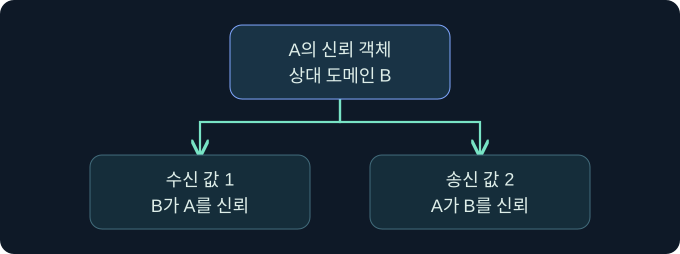

## 1. 신뢰 방향을 읽기 전에 관측 위치를 정합니다

가상의 조직에서 물류 포리스트의 직원이 다른 포리스트의 정산 자료를 읽어야 합니다. 운영팀은 “정산 쪽에 나가는 신뢰가 있다”고 보고합니다. 이 표현의 기준은 정산 쪽 도메인입니다. 직원이 실제로 어느 서버에 들어갈 수 있는지는 그 서버가 어떤 신원을 받아들이고 어떤 접근을 허용하는지에 달려 있습니다.

도메인은 계정·컴퓨터와 정책을 관리하는 디렉터리 단위이고, 포리스트는 공통 스키마와 구성을 공유하는 도메인 집합입니다. 도메인 트리는 연속된 DNS 이름 공간을 이루며, 한 포리스트는 이름 공간이 다른 트리도 포함할 수 있습니다. DNS 접미사만 보고 보안 경계나 신뢰 관계를 추론하면 이름 구조와 실제 디렉터리 구성을 혼동할 수 있습니다.

## 2. 신뢰 유형과 전이 범위를 나눕니다

전이란 중간 도메인을 경유해 다른 도메인까지 인증 경로를 구성할 수 있다는 성질입니다. 양방향은 양쪽에서 상대의 인증을 신뢰할 수 있다는 뜻입니다. 둘은 독립적인 질문입니다. 예를 들어 양방향 외부 신뢰는 직접 연결된 두 도메인으로 범위가 제한됩니다.

| 유형 | 일반적인 설정 | 이 관계로 확인하는 범위 |
|---|---|---|
| 부모·자식 | 도메인 추가 시 자동 생성, 양방향·전이 | 같은 트리의 직접 상하 관계와 이후 경로 |
| 트리 루트 | 기존 포리스트에 트리 추가 시 자동 생성, 양방향·전이 | 서로 다른 DNS 트리 사이의 포리스트 내부 경로 |
| 외부 | 명시적으로 구성, 단방향 또는 양방향, 비전이 | 지정한 두 도메인 사이의 관계 |
| 포리스트 | 포리스트 루트 사이에 구성, 단방향 또는 양방향 | 연결한 포리스트 내부 도메인까지의 경로. 세 번째 포리스트로 자동 연결되지는 않음 |

가령 A 포리스트가 B를, B가 C를 신뢰한다면 A의 리소스에 C 사용자가 도달할 수 있다는 결론에는 별도 경로 근거가 필요합니다. 한 포리스트 내부의 도메인 전이와 여러 포리스트에 걸친 연결의 재전이를 구별합니다. 선택적 인증을 사용하는 경우에는 도달 가능한 경로가 있어도 대상 컴퓨터의 인증 허용 범위를 확인합니다. 공유 폴더 권한은 다시 별도로 봅니다.

## 3. TDO를 읽은 쪽에서 방향을 번역합니다

TDO(Trusted Domain Object)는 상대 도메인과의 신뢰에 관한 디렉터리 객체입니다. 읽어 낸 도메인을 A, 객체에 기록된 상대를 B로 놓고 해석합니다. 아래의 인증 후보는 접근 판단을 설명하기 위한 개념입니다. 실제 접근에는 이름 해석, 인증 정책, 대상 인가가 모두 관여합니다.

| A의 값 | A와 B의 신뢰 관계 | 이 경로에서 먼저 검토할 접근 후보 |
|---|---|---|
| 0 | 방향 플래그 없음 | 비활성 관계의 기록 및 상태 |
| 1 | B가 A를 신뢰 | A 신원을 가진 주체가 B 자원을 요청 |
| 2 | A가 B를 신뢰 | B 신원을 가진 주체가 A 자원을 요청 |
| 3 | A와 B가 서로 신뢰 | 양쪽 요청을 각각 검토 |

가상 A 기록의 값이 2라면 짝이 되는 B의 정상 단방향 기록에서 값 1을 예상합니다. 둘 다 2라면 양방향으로 단정하기 전에 기록 시각, 도메인과 상대 이름, 구성 변경, 확인한 DC와 복제 수렴을 대조합니다. 감사 메모에는 “A가 B를 신뢰한다”와 “B 계정이 A 자원에 인증을 시도한다”를 분리해 적습니다.

## 4. 플래그와 이름을 독립적으로 해석합니다

먼저 `trustPartner`로 상대 DNS 이름을, `flatName`으로 짧은 이름을 대조합니다. `trustType`은 상대의 신뢰 종류를 표현하는 분류이고, `trustDirection`은 관측 도메인의 방향, `trustAttributes`는 비트 조합입니다. 방향 값 3과 특성 값 3은 서로 다른 필드입니다. 포리스트 신뢰에 관한 이름 접미사 정보도 별도 구조에 있으므로 TDO 이름 한 줄로 전체 라우팅을 판단하지 않습니다.

| 특성 비트 | 해석 | 확인할 항목 |
|---|---|---|
| 0x01 | 비전이 | 중간 관계를 이용하는 경로에서 제외되는지 |
| 0x04 | 상대 격리 | 적용되는 PAC의 SID 필터링 규칙 |
| 0x08 | 포리스트 전이 | 두 루트와 이름 접미사 라우팅 |
| 0x20 | 동일 포리스트 | 대상이 실제로 어느 포리스트에 속하는지 |
| 0x40 | 조건을 충족한 교차 포리스트 신뢰를 SID 필터링에서 외부 신뢰처럼 취급 | 일반 외부 신뢰 분류와 구분하고 관련 비트·기능 수준 확인 |

예를 들어 특성의 십진수 72는 16진수 `0x48`입니다. 이 예제에서는 `0x08`과 `0x40`을 각각 읽습니다. 값의 조합만 보고 현재 서버가 특정 SID를 받아들였다고 판단할 수는 없습니다. 규칙이 적용되는 신뢰 유형과 해당 인증 경로의 실제 증거가 필요합니다.

## 5. 참조 티켓이 하는 일을 이해합니다

가상의 사용자 도메인 KDC가 요청한 서비스의 영역을 자기 도메인 밖으로 판단하면, 사용자는 신뢰 경로를 따라 참조 TGT를 받아 다른 KDC에 제시할 수 있습니다. 다음 KDC가 그 참조를 수락하고 필요하면 추가 참조를 내거나 대상 서비스 티켓을 발급합니다. 각 교환은 이름 라우팅과 정책 평가의 영향을 받습니다. 처음 DC 한 곳만 모니터링하면 실제 발급 지점을 놓칠 수 있습니다.

도메인 간 신뢰의 인증 자료는 일반 사용자의 비밀번호와 별도로 관리되는 비밀입니다. 양방향 관계를 조사할 때도 어느 방향의 자료와 어느 KDC가 관련되는지 구분합니다. 조사 초기에 필요한 것은 방향, 속성, DC, 시각과 승인된 변경 이력입니다. 비밀 값은 수집 범위에서 제외합니다.

## 6. 공식 콘솔에서 세션 문맥을 확인합니다

### 실제 화면 155: Fortra Beacon Console

[Fortra 공식 콘솔 문서](https://hstechdocs.helpsystems.com/manuals/cobaltstrike/current/userguide/content/topics/ui_consoles.htm)의 일반 콘솔 화면입니다. 2026년 11월 10일에 확인했습니다. 캡처의 설치 버전은 확인되지 않았으며 메뉴와 배치는 설치 버전에 따라 달라질 수 있습니다. 승인된 학습 환경을 가정해 **Cobalt Strike → Visualization → Session Table → 가상 LAB-TRUST-A 우클릭 → Interact**를 엽니다. 하단 입력 줄에 `getuid`를 넣고 **Enter**를 누르는 미실행 절차입니다. 이 값은 현재 콘솔 세션의 보고 신원을 확인하려고 선택했습니다. 별도 저장 없이 탭 이름과 위쪽 반환의 사용자 문맥을 대조합니다. 반환이 비거나 예상과 다르면 승인된 세션 선택과 작업 상태부터 확인합니다. 해당 예시 반환과 TDO 조회 화면은 확보하지 못했습니다. 세션 보고 신원으로 TDO의 관측 방향을 확정할 수 없습니다.

## 7. 승인된 스냅샷의 열을 순서대로 읽습니다

1. 변경표에서 업무 자원과 계정이 속한 도메인을 각각 적습니다. 자료를 어느 DC에서 언제 얻었는지, 시간대와 관측 도메인도 남깁니다.
2. 신뢰 메타데이터의 상대 이름·방향·특성을 읽고 짝이 되는 상대 기록과 대조합니다. 이름 해석 또는 라우팅 문제는 권한 거부와 분리합니다.
3. 저장된 DC 보안 로그의 4716에서 신뢰 변경의 주체, 방향·속성 및 시간을 변경표와 맞춥니다. 일부 필드는 변경되지 않았거나 보고되지 않았을 수 있습니다.
4. 대상 서비스의 인증과 자원 감사에서 실제 요청 여부를 찾습니다. 감사 정책 또는 수집 구간이 비어 있으면 그 공백을 결과에 포함합니다.

## 8. 조건이 바뀌었을 때 결론을 고칩니다

같은 B 사용자가 A의 정산 서비스를 사용한다고 가정합니다. A가 값 2를 보고하고 B가 값 1을 보고한다면 방향은 가설과 맞습니다. 참조가 이어지지 않으면 먼저 이름 접미사, 서비스 주체 이름, DNS와 해당 DC의 응답을 확인합니다. 티켓이 발급됐지만 대상 인증이 거절되면 선택적 인증과 대상 컴퓨터 범위를 봅니다. 대상 로그온이 관측됐지만 문서 읽기가 거절되면 그 서비스와 자원의 ACL, 유효 그룹과 요청 작업을 확인합니다. 이 단계들은 가상이며 티켓 요청이나 대상 연결을 실행하지 않았습니다.

## 9. 검토 결과에 관측과 판단을 따로 남깁니다

| 기록 | 관측 예 | 결론의 한계 |
|---|---|---|
| 구성 | A의 승인된 내보내기에 방향 2 | B 주체가 실제로 요청했는지 미확인 |
| 변경 | 사건 시간대에 DC의 4716 | 신뢰 변경의 근거. 사용자 접근 기록은 별도 |
| 인증 | 대상 서비스의 로그온 기록 | 특정 파일 작업은 서비스 감사에서 확인 |
| 자원 | 승인된 업무 계정의 읽기 감사 | 쓰기·관리 작업은 각각 별도 검증 |

스냅샷이 오래됐다면 현재 구성이라고 표현하지 않습니다. 4716이 없다면 우선 관련 감사 하위 범주와 DC 수집 범위를 확인합니다. 이 방법으로 관계 설정, 신뢰 경로, 사용 결과를 서로 다른 증거로 남길 수 있습니다.

## 10. 복습과 즉시 해설

### 복습 1. 방향 2는 어떤 도메인의 관점인가요?
**해설:** 객체를 읽은 로컬 도메인이 상대를 신뢰한다는 의미입니다. 상대 계정이 로컬 자원을 요청할 가능성을 검토합니다.

### 복습 2. 값 3이면 누구나 두 도메인 자원에 접근하나요?
**해설:** 양방향 인증 신뢰를 나타냅니다. 컴퓨터 인증 허용과 자원 권한을 각 방향에서 따로 확인합니다.

### 복습 3. 양방향 외부 신뢰는 전이되나요?
**해설:** 외부 신뢰는 직접 지정한 도메인 간 비전이 관계입니다. 양방향 여부와 전이 범위는 독립입니다.

### 복습 4. 특성 72는 하나의 종류 코드인가요?
**해설:** 이 예에서는 비트 `0x08`과 `0x40`의 조합입니다. 각 비트의 적용 조건도 대조합니다.

### 복습 5. B 포리스트와 신뢰하는 A가 자동으로 C와도 연결되나요?
**해설:** B와 C의 별도 포리스트 신뢰로 A까지 자동 연결되지 않습니다. 실제 승인된 경로가 필요합니다.

### 복습 6. 서비스 티켓이 있으면 파일 열기가 확인되나요?
**해설:** 발급과 실제 인가는 별개입니다. 대상 서비스의 파일 감사에서 작업을 확인합니다.

### 복습 7. 4716이 없으면 변경이 없었나요?
**해설:** 기록한 DC와 시간 범위, 감사 정책과 수집 누락부터 확인합니다.

### 복습 8. 콘솔의 계정 이름으로 TDO 방향을 판단할 수 있나요?
**해설:** 콘솔 반환은 해당 세션의 신원 문맥입니다. 방향은 관측 도메인이 명확한 디렉터리 자료에서 읽습니다.

## 11. 공식 자료와 확인 범위

- [Microsoft MS-ADTS · TDO 주요 속성](https://learn.microsoft.com/en-us/openspecs/windows_protocols/ms-adts/c9efe39c-f5f9-43e9-9479-941c20d0e590)
- [Microsoft MS-ADTS · trustDirection](https://learn.microsoft.com/en-us/openspecs/windows_protocols/ms-adts/5026a939-44ba-47b2-99cf-386a9e674b04)
- [Microsoft · 신뢰 유형·방향·특성 구조](https://learn.microsoft.com/en-us/windows/win32/api/ntsecapi/ns-ntsecapi-trusted_domain_information_ex)
- [Microsoft · 신뢰 변경 이벤트 4716](https://learn.microsoft.com/en-us/previous-versions/windows/it-pro/windows-10/security/threat-protection/auditing/event-4716)

2026년 11월 10일 자료를 확인했습니다. 제품·인증·디렉터리 조회·티켓 작업 및 설정 변경은 미실행입니다.
