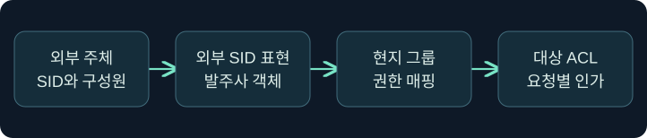
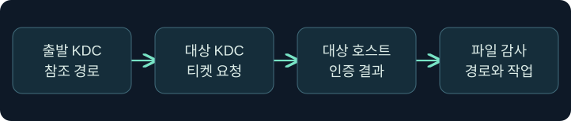

## 1. 수신 신뢰에서 자원 사용까지 따라갑니다

가상의 수리업체 `cedar.example`의 현장 담당자가 발주사 `harbor.example`의 장비 인수 문서를 읽어야 합니다. 계약은 열람만 허용합니다. 조사자는 업체 도메인의 신뢰 객체에 방향 값 1이 있다는 자료를 받았습니다. 이 값은 상대 발주사가 업체 도메인을 신뢰하는 방향을 나타냅니다. 업체 계정으로 발주사에 인증할 경로를 검토할 수 있지만, 실제 열람 권한을 확인하려면 발주사의 계정 매핑과 공유 권한을 조사해야 합니다.

이 강의에서 ‘수신’은 항상 **업체 도메인에서 읽은 TDO의 방향**입니다. 동일한 관계의 발주사 쪽 기록은 송신 방향입니다. 사용자와 인증 트래픽은 업체 쪽에서 발주사 자원 쪽으로 향할 수 있습니다. 방향을 기록할 때 신뢰 문장과 사용자 요청 문장을 나눠 쓰면 서로 다른 팀이 반대 의미로 읽는 실수를 줄일 수 있습니다.

## 2. 외부 보안 주체가 연결하는 것을 봅니다

AD의 Foreign Security Principals 컨테이너에는 포리스트 밖의 보안 주체를 나타내는 객체가 저장될 수 있습니다. 이 객체는 외부 계정의 로컬 사본으로 로그인하는 기능이 아니라, 외부 SID를 발주사 디렉터리의 그룹 구성에 참조할 수 있게 하는 표현입니다. 예를 들어 발주사 그룹이 업체의 보안 그룹 SID를 참조하면, 실제 직원이 해당 업체 그룹에 포함됐는지는 업체 측의 승인된 시점별 자료로 확인합니다.

화면에 친숙한 이름이 보이더라도 권한 대조에는 SID와 발급 도메인을 사용합니다. 이름이 같거나 계정이 다시 만들어져도 기존 SID와 같다는 보장은 없습니다. 이름 해석이 실패해 SID만 보이면 이름 표시의 문제인지 실제 주체가 사라졌는지 구별합니다. 객체가 남아 있다는 사실과 유효한 자원 권한이 남아 있다는 사실도 따로 기록합니다.

## 3. 그룹에서 자원 권한까지 추적합니다

| 대조 지점 | 가상의 승인 자료 | 판단 범위 |
|---|---|---|
| 업체 주체 | 현장 열람 보안 그룹의 SID와 사건 시점 구성원 | 그 직원이 해당 그룹이었는지 |
| 발주사 매핑 | 외부 SID 표현과 발주사 도메인 로컬 그룹 연결 | 발주사 내부에서 그 주체를 어떤 권한 그룹으로 연결하는지 |
| 공유와 파일 | 업무 공유 권한과 대상 폴더 ACL | 읽기·쓰기 등 요청별로 어떤 정책이 적용되는지 |
| 대상 감사 | 세션 및 요청한 경로·액세스 종류·결과 | 실제 요청과 관측된 작업의 범위 |

중첩 그룹이면 중간 그룹의 범위와 사건 시점 구성원을 모두 대조합니다. 예를 들어 상위 그룹에 연결돼도 공유 ACL이 읽기만 허용하면 쓰기를 승인했다고 볼 수 없습니다. 파일 시스템 권한과 공유 권한을 모두 적용하는 SMB 사례에서는 양쪽 조건과 명시적 거부를 함께 확인합니다. 같은 그룹이 다른 서비스에서 재사용되면 각 서비스의 인가 규칙을 따로 살펴봅니다.

## 4. 참조 발급과 실제 자원 접근을 분리합니다

Kerberos의 참조 TGT는 다른 영역 KDC까지 이어지는 경로를 제공합니다. 출발 KDC는 해당 경로에 맞는 영역 간 신뢰 키를 사용하고, 대상 영역은 참조와 정책을 평가합니다. 최종 서비스 티켓은 대상 서비스에 제시됩니다. 출발 영역에서 참조가 발급된 사실, 대상 영역에서 서비스 티켓을 받은 사실, 공유의 읽기 결과는 각각 다른 관측입니다.

신뢰 키의 노출은 참조의 진위를 의심할 근거입니다. 조사자는 어느 방향·어느 영역에서 영향을 받는지 기록하고 승인된 업무 주체, 정상 참조 경로, 실제 대상의 감사와 대조합니다. 참조를 만들거나 제출해 가설을 재현하는 절차는 수행하지 않습니다. 티켓이 캐시된 경우 자원 작업 직전에 신규 발급 로그가 없을 수 있으므로 시간 범위와 양쪽 DC 수집 범위도 봅니다.

## 5. SID 필터링과 선택적 인증의 역할을 구별합니다

| 조건 | 판단하는 질문 | 관측 후보 |
|---|---|---|
| 교차 포리스트 SID 필터링 | 경계를 건너온 PAC의 어떤 SID를 인정하나요? | 신뢰 유형, SID의 소속, MS-PAC 분류 |
| 선택적 인증 | 이 외부 주체가 해당 컴퓨터에 인증할 수 있나요? | 대상 컴퓨터의 인증 허용과 KDC 정책 |
| 대상 인가 | 인증된 주체가 이 작업을 할 수 있나요? | 토큰, 공유 및 파일 ACL, 서비스 감사 |

SID 필터링을 ‘외부 SID를 전부 버린다’고 해석하면 정상적으로 권한이 있는 외부 주체까지 설명할 수 없습니다. 교차 포리스트와 외부 신뢰의 구체적인 SID 범주와 경계 규칙을 확인합니다. 한편 선택적 인증을 적용하면 파일 ACL에 허용 항목이 있더라도 대상 컴퓨터 인증 단계에서 거절될 수 있습니다. 두 보호 조건과 파일 ACL은 각각 다른 질문에 답합니다.

## 6. 공식 콘솔에서 관측 문맥을 확인합니다

### 실제 화면 157: Fortra Beacon Console

[Fortra 공식 콘솔 안내](https://hstechdocs.helpsystems.com/manuals/cobaltstrike/current/userguide/content/topics/post-exploitation_main.htm)의 화면을 2026년 11월 10일 확인했습니다. 캡처의 설치 버전은 확인되지 않았고 메뉴 배치는 버전에 따라 달라질 수 있습니다. **Cobalt Strike → Visualization → Session Table → 가상 LAB-INBOUND 우클릭 → Interact**를 선택합니다. 하단 입력 줄에 `getuid`를 넣고 **Enter**를 누르는 미실행 절차입니다. 승인된 학습 세션의 현재 토큰 사용자 문맥을 구분하려고 이 값을 선택했습니다. 별도 저장 없이 탭 이름과 상단 반환을 대조하고, 결과가 비면 선택한 세션과 작업 상태를 먼저 확인합니다. 이 예시의 콘솔 반환과 외부 보안 주체 조회 결과 화면은 확보하지 못했습니다. 공식 콘솔 화면에 보이는 기존 값은 이 강의의 가상 결과와 별개입니다.

## 7. 저장된 감사 자료에서 실패 위치를 찾아갑니다

1. 승인된 변경표에서 신뢰의 양쪽 도메인과 방향, 대상 공유, 허용된 작업을 적습니다. 신뢰 객체와 외부 주체 객체를 서로 다른 자료로 분류합니다.
2. 출발 및 대상 영역의 보안 기록에서 시간대, DC, 요청 신원, 서비스 이름을 비교합니다. 4769는 Kerberos 서비스 티켓 요청에 관한 기록이며 참조 후보와 최종 서비스 이름을 구별합니다.
3. 대상 서버에서 로그온 자료와 공유 감사의 접근 요청을 맞춥니다. 상세 파일 공유 감사가 수집됐다면 5145의 경로·접근 마스크·접근 검사 결과를 확인합니다. 파일 내용이 실제 전송됐는지는 별도 서비스·파일 감사가 필요할 수 있습니다.
4. 요청 거절이 보이면 이름 해석, 참조, 컴퓨터 인증 허용, 자원 인가 중 어느 단계까지 증거가 있는지 적습니다. 정책이나 로그 수집 범위가 없는 단계는 미확인으로 남깁니다.

## 8. 조건이 달라지면 결론을 바꿉니다

업체 직원이 승인된 그룹에서 제거됐지만 발주사에 외부 주체 객체가 남아 있다고 가정합니다. 오래된 스냅샷과 발급 시점의 그룹 정보가 다를 수 있으므로 현재 구성과 과거 세션을 나눠 봅니다. 반대로 그룹과 ACL이 맞아도 허용 대상 컴퓨터가 제한되어 있다면 공유 권한을 수정할 근거는 아직 없습니다.

정상 참조가 보이고 대상 로그온도 있지만 파일 쓰기가 거절됐다면 승인된 열람 범위와 일치할 수 있습니다. 같은 기록에서 계약 밖의 폴더에 쓰기 요청이 허용됐다면 대상 파일·시각·서비스 로그를 먼저 보존하고 그룹과 ACL의 변경 이력을 확인합니다. 경로 존재, 쓰기 권한, 실제 쓰기는 각기 다른 결론입니다.

## 9. 다른 팀이 재검증할 수 있게 남깁니다

검토표에는 관측 도메인, 상대 도메인, 요청 신원, 자원·작업, 증거 종류와 시각을 각각 남깁니다. 양쪽 로그가 모두 있는지, SID 해석을 어느 팀이 확인했는지, 필터링 상태와 실제 수락 범위 중 무엇이 확인됐는지도 표시합니다. 신뢰 키나 사용자의 비밀은 보고서에 포함하지 않습니다.

외부 주체를 제거하거나 신뢰를 변경하면 다른 업무도 영향을 받을 수 있습니다. 이 강의의 판단은 승인된 내보내기와 기록을 해석하는 데 한정합니다. 실제 연결, 디렉터리 변경, 키 추출, 티켓 조작과 보호 기능 변경은 미실행입니다.

## 10. 복습과 즉시 해설

### 복습 1. 업체 TDO의 수신 값 1은 어느 요청 경로를 검토하게 하나요?
**해설:** 발주사가 업체를 신뢰하므로 업체 신원이 발주사 자원을 요청하는 경로입니다.

### 복습 2. 외부 보안 주체 객체는 현지 로그인 계정인가요?
**해설:** 외부 SID를 참조하는 표현입니다. 외부 주체와 그 권한을 별도로 대조합니다.

### 복습 3. 외부 객체가 그룹에 보이면 쓰기가 허용되나요?
**해설:** 그룹 연결의 증거입니다. 요청한 작업은 대상 공유와 파일 ACL에서 확인합니다.

### 복습 4. 참조 티켓과 최종 서비스 티켓은 왜 나눠 보나요?
**해설:** 참조는 다른 영역의 KDC로 이어지는 단계입니다. 최종 티켓은 실제 대상 서비스의 인증에 사용됩니다.

### 복습 5. SID 필터링과 선택적 인증은 무엇을 검사하나요?
**해설:** SID 필터링은 경계를 통과하는 권한 SID를, 선택적 인증은 해당 컴퓨터에서 외부 주체의 인증 허용을 검사합니다.

### 복습 6. 5145 하나로 파일 전체가 전송됐다고 판단할 수 있나요?
**해설:** 특정 경로와 접근 요청의 검사 근거입니다. 실제 작업과 전송 범위는 추가 기록으로 확인합니다.

### 복습 7. 방금 4769가 없으면 대상의 인증을 부정할 수 있나요?
**해설:** 캐시, 수집 범위, 여러 DC와 시간대를 확인한 뒤 결론을 냅니다.

### 복습 8. 콘솔에 업체 사용자가 표시되면 발주사 권한도 확인됐나요?
**해설:** 콘솔의 토큰 문맥입니다. 발주사 인증과 자원 권한은 대상 자료에서 별도로 확인합니다.

## 11. 공식 자료와 확인 범위

- [Microsoft MS-ADTS · Foreign Security Principals 컨테이너](https://learn.microsoft.com/en-us/openspecs/windows_protocols/ms-adts/5aa09c90-c5db-4e97-98d0-b7cdd6bc1bfe)
- [Microsoft MS-KILE · 도메인 간 신뢰와 참조](https://learn.microsoft.com/en-us/openspecs/windows_protocols/ms-kile/bac4dc69-352d-416c-a9f4-730b81ababb3)
- [Microsoft MS-PAC · SID 필터링](https://learn.microsoft.com/en-us/openspecs/windows_protocols/ms-pac/55fc19f2-55ba-4251-8a6a-103dd7c66280)
- [Microsoft · 서비스 티켓 요청 이벤트 4769](https://learn.microsoft.com/en-us/previous-versions/windows/it-pro/windows-10/security/threat-protection/auditing/event-4769)
- [Microsoft · 파일 공유 접근 검사 이벤트 5145](https://learn.microsoft.com/en-us/previous-versions/windows/it-pro/windows-10/security/threat-protection/auditing/event-5145)

2026년 11월 10일 공식 자료를 확인했습니다. 표와 조사 사례는 설명용 가상 자료입니다.
