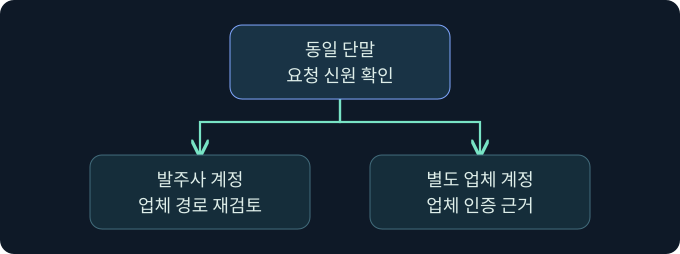
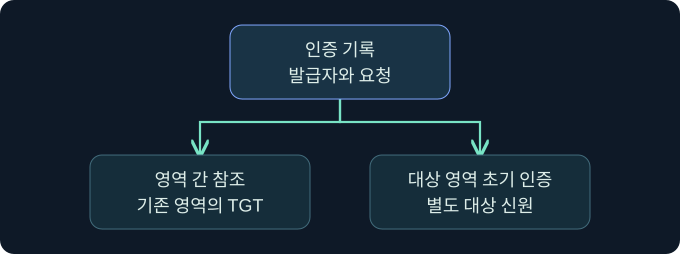
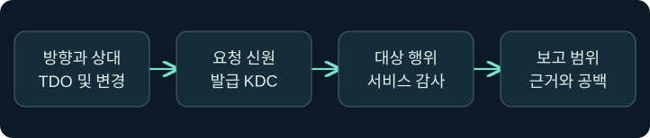

## 1. 송신 신뢰와 별도 신원을 구별합니다

가상의 발주사 `harbor.example`에서는 업체 `cedar.example`의 승인된 작업자가 정산 자료를 읽을 수 있습니다. 이 관계의 발주사 TDO에는 송신 값 2가 있습니다. 그런데 조사 자료에는 발주사 관리용 단말에서 업체 디렉터리에 인증한 기록도 보입니다. 기록이 맞다면 무엇이 반대쪽 요청을 가능하게 했는지 확인해야 합니다. 단말이 속한 도메인과 네트워크 요청에 사용한 신원이 언제나 같지는 않기 때문입니다.

발주사는 업체 계정의 인증을 신뢰합니다. 이 단방향 관계만으로 발주사 계정이 업체 자원에 인증할 수 있다고 기대할 수는 없습니다. 반면 같은 단말에서 승인된 업체 계정으로 업체 KDC에 인증할 수 있는 별도 문맥이 있었다면 그 요청은 다른 가설로 설명합니다. 경계 설정이 바뀌었는지, 같은 컴퓨터에서 다른 신원을 썼는지, 실제 대상이 무엇이었는지를 기록으로 구분합니다.

## 2. 네트워크 도달, 인증, 인가의 증거를 나눕니다

| 관측 | 확인할 질문 | 관측만으로 판단하기 어려운 것 |
|---|---|---|
| DNS 및 TCP 연결 | 올바른 호스트와 서비스까지 도달했나요? | 어떤 신원으로 인증했는지 |
| LDAP Bind 결과 | 선택한 인증 방식과 신원이 수락됐나요? | 디렉터리 항목 열람 권한 전체 |
| Kerberos 티켓 요청 | 어느 KDC가 어느 요청을 처리했나요? | 실제 대상 서비스 작업의 결과 |
| 대상 자원 기록 | 어떤 신원·경로·작업이 관측됐나요? | 신뢰 설정 변경의 주체와 시각 |

예를 들어 LDAP Bind의 오류 49는 해당 요청에서 인증 자격을 수락하지 않았다는 단서입니다. 단방향 신뢰와 맞을 수 있지만 그 오류만으로 방향을 판정하지 않습니다. 대상 DC, 사용한 인증 방식, 계정 상태, 요청 시점의 정책과 응답을 비교합니다. Kerberos의 서비스 주체 조회 오류도 방향 외에 서비스 이름, 등록 상태, 접미사 라우팅을 점검해야 합니다.

## 3. 신뢰 계정과 TDO의 역할을 구분합니다

TDO는 상대와의 신뢰 관계를 저장하는 디렉터리 객체입니다. Microsoft의 MS-ADTS는 수신 또는 양방향 신뢰에 연결된 별도의 도메인 간 신뢰 계정을 정의합니다. 수신 쪽 TDO와 계정은 상대 도메인의 NetBIOS 이름을 통해 연관되며, 신뢰 계정 이름은 그 이름 뒤에 달러 기호가 붙는 형식을 사용합니다. 이름의 끝 문자만 보면 컴퓨터 계정 등과 헷갈릴 수 있으므로 분류와 관계를 함께 확인합니다.

| 항목 | 확인할 자료 | 해석 |
|---|---|---|
| 발주사 송신 TDO | 로컬 DC, 상대 도메인, 값 2 | 업체 도메인 인증을 신뢰하는 방향 |
| 업체 수신 TDO | 업체 측 상대 기록, 값 1 | 발주사가 업체를 신뢰하는 같은 방향의 반대 관측점 |
| 업체 측 도메인 간 신뢰 계정 | 계정 유형, 수신 관계와의 연관 | 신뢰에 쓰이는 별도 주체 |
| 일반 운영 계정 | 소유 조직, 사용 승인, 대상 및 역할 | 해당 업무 문맥에 부여된 접근 |

공유 비밀은 방향별 신뢰 검증에 사용되며 TDO의 비밀 속성은 일반 디렉터리 조회의 대상이 아닙니다. 이 강의는 승인된 비밀 없는 목록으로 관계와 계정만 대조합니다. 신뢰 계정의 존재가 사용자나 관리자 권한을 뜻하지는 않습니다.

## 4. 참조와 대상 영역의 초기 인증을 구분합니다

일반적인 영역 간 참조에서는 클라이언트가 기존 영역의 TGT에서 출발합니다. KDC가 다른 영역에 도달할 필요를 판단하면 적절한 참조 TGT를 발급할 수 있습니다. 이에 비해 대상 영역에 속한 별도 신원으로 그 영역의 KDC에 초기 인증을 하면 해당 영역의 초기 TGT 교환을 검토해야 합니다. 두 경우는 동일한 단말에서 출발해도 발급자, 주체와 티켓 대상이 다릅니다.

권한 있는 조사 자료에 4768과 4769가 있다면 4768은 TGT 요청, 4769는 서비스 티켓 요청 쪽의 근거로 사용합니다. 참조 티켓 대상과 최종 서비스 이름도 구분합니다. 로그가 여러 DC에 분산되거나 감사 정책·버전이 다르면 모든 연결을 동일하게 복원할 수 없습니다. 로컬 콘솔 표시값과 대상 KDC가 기록한 요청 신원이 다를 수 있다는 점을 조사표에 남깁니다.

## 5. 신뢰 키 노출의 범위를 가정별로 확인합니다

공유 비밀의 노출이 의심되면 어느 관계와 방향의 비밀인지, 어느 시점과 구성의 자료인지 먼저 조사합니다. 해당 신뢰에 연결된 인증 기록의 진위를 다시 검토해야 할 이유는 되지만, 역방향 신뢰가 생성됐거나 대상의 모든 자원에 접근했다고 결론 내리기에는 근거가 부족합니다. 도메인 TGT 보호 키, 영역 간 신뢰 키, 대상 서비스 키는 역할이 다릅니다. 17장에서 살펴본 도메인 전체의 발급 신뢰와 관계 하나의 신뢰 검증을 구분합니다.

키 세대, 이전 상태, 교체·복제 시점의 차이는 조사 시간 범위에 영향을 줄 수 있습니다. 암호화 형식은 환경과 정책, 실제 발급 및 요청의 필드로 확인합니다. 티켓의 암호화 형식과 세션 키 형식도 서로 다른 값일 수 있습니다. 특정 형식이 보였다는 사실만으로 신뢰 비밀의 노출이나 사용을 확정하지 않습니다.

## 6. 공식 콘솔에서 로컬 보고 신원을 확인합니다

### 실제 화면 158: Fortra Beacon Console

[Fortra 공식 콘솔 안내](https://hstechdocs.helpsystems.com/manuals/cobaltstrike/current/userguide/content/topics/post-exploitation_main.htm)의 공개 화면입니다. 2026년 11월 10일 확인했고, 캡처의 설치 버전은 확인되지 않았습니다. 메뉴는 설치 버전에 따라 달라질 수 있습니다. **Cobalt Strike → Visualization → Session Table → 가상 LAB-OUTBOUND 우클릭 → Interact**에서 하단 입력 줄에 `getuid`를 넣고 **Enter**를 누르는 미실행 절차입니다. 예시값은 현재 토큰의 보고 문맥을 구별하기 위해 선택했습니다. 별도 저장 없이 탭과 상단 반환을 대조하며 반환이 비면 세션 선택과 작업 상태를 확인합니다. 이 예시의 반환, 대상 도메인 인증 결과 및 신뢰 계정 조회 화면은 확보하지 못했습니다. 제품 문서에 보이는 값은 공식 화면의 시연값이며 이번 조사 결과가 아닙니다.

## 7. 이미 수집된 기록을 연결합니다

1. 양쪽 관리팀의 승인된 TDO 요약에 도메인과 상대, 방향, 수집 DC와 시각을 기록합니다. 설정 변경 가설은 변경 승인과 DC의 4716을 대조합니다.
2. 요청이 발생한 단말과 연결된 서버를 특정합니다. 대상 KDC에서 4768과 4769의 발급자·계정·서비스 이름·시각을 비교해 정상 참조와 별도 초기 인증을 구분합니다.
3. 대상 서버의 로그온과 서비스 감사에서 실제 작업을 확인합니다. 로그온 ID가 있다면 같은 호스트 안의 기록을 연결하고, 다른 호스트의 기록은 시간·계정·출발지 등으로 별도 대조합니다.
4. 비밀 노출 가설은 승인된 보안 사건 기록과 키 변경 이력의 메타데이터로 좁힙니다. 원본 비밀이나 인증 자료를 채집하지 않고, 확인된 노출·의심되는 노출·증거 공백을 따로 표시합니다.

## 8. 같은 단말에서 다른 가설을 검토합니다

| 가상의 조건 | 먼저 검토할 가설 | 추가로 볼 자료 |
|---|---|---|
| 발주사 신원으로 업체 Bind가 거절됨 | 해당 시도에서 신원을 수락하지 않음 | 오류 코드와 인증 방식, 신뢰 방향, 계정 상태 |
| 승인된 업체 신원으로 업체 서비스가 열림 | 같은 단말의 별도 대상 도메인 인증 | 업체 KDC의 요청 주체와 대상 자원 권한 |
| 신뢰 계정 문맥이 일반 업무 단말에서 관측됨 | 사용의 승인 여부와 범위를 조사할 신호 | 평상시 출발지, 요청된 티켓, 대상 서비스 감사 |
| 신뢰 변경 이력이 나타났으나 실제 접근 자료가 없음 | 구성 변경은 관측됨 | 상대 TDO, 복제·시각, 대상 접근 로그 |

승인된 업체 서비스 접근이 있었다면 그 접근이 필요했던 업무와 해당 작업의 범위를 확인합니다. 이름만 신뢰 계정처럼 보인다면 실제 계정 유형을 먼저 대조합니다. 대상 기록이 없을 때는 수집 범위나 보존 기간의 공백을 남기고, 한 방향의 자료만으로 양쪽의 사용을 결론 내리지 않습니다.

## 9. 영향과 대응의 확인 범위를 적습니다

조사 결과를 관계 설정, 계정 문맥, 실제 자원 행위로 나눠 기록합니다. 노출 의심으로 대응 검토를 의뢰할 때는 관련 도메인, 승인 주체, 대상 업무 서비스와 관측 시간을 남깁니다. 정상 신뢰 관계가 영향을 받을 수 있으므로 변경 권한과 서비스 검증은 승인된 운영 절차에서 다룹니다.

이 강의의 사례에는 실제 인증·비밀 획득·티켓 생성·키 교체나 정책 변경이 없습니다. 대응을 평가할 때도 실제 서비스의 성공 기준과 감사 범위를 합의한 뒤 각 지점의 관측을 사용합니다.

## 10. 복습과 즉시 해설

### 복습 1. 발주사 TDO의 값 2는 어떤 관계인가요?
**해설:** 발주사가 업체 도메인의 인증을 신뢰하는 방향입니다. 반대쪽의 기록은 이 관계에서 수신 값 1로 해석합니다.

### 복습 2. 같은 단말이 두 도메인에 접속하면 양방향 신뢰인가요?
**해설:** 단말은 여러 승인된 신원 문맥을 가질 수 있습니다. 신뢰 방향은 TDO, 실제 신원은 대상 기록에서 확인합니다.

### 복습 3. 끝에 달러 기호가 붙으면 신뢰 계정인가요?
**해설:** 이름 형식은 단서입니다. 계정 유형과 해당 수신 관계의 연관을 확인합니다.

### 복습 4. LDAP 오류 49로 신뢰 방향을 확정할 수 있나요?
**해설:** 해당 Bind의 인증 실패 단서입니다. 실제 관측 도메인과 TDO를 확인합니다.

### 복습 5. 대상 영역의 초기 TGT와 영역 간 참조는 어떻게 구분하나요?
**해설:** 발급 KDC, 사용 주체, 요청 종류와 티켓 대상을 대조합니다. 초기 인증과 이미 존재하는 영역에서 이어진 요청을 분리합니다.

### 복습 6. 4716이 있으면 파일 접근이 확인되나요?
**해설:** 신뢰 변경에 관한 DC 기록입니다. 실제 자원 사용은 대상 서비스의 감사 자료에서 확인합니다.

### 복습 7. 신뢰 키가 노출되면 반대 방향도 자동으로 열린다고 보나요?
**해설:** 노출된 관계와 방향의 검증에 영향이 생길 수 있습니다. 다른 방향과 실제 권한 행사는 별도 근거로 확인합니다.

### 복습 8. 콘솔의 로컬 보고 사용자와 대상의 인증 신원이 다르면 어떻게 하나요?
**해설:** 각각 관측 위치와 시각을 남기고, 대상 KDC 및 서비스 기록으로 네트워크 신원 가설을 검토합니다.

## 11. 공식 자료와 확인 범위

- [Microsoft MS-ADTS · 도메인 간 신뢰 계정의 속성](https://learn.microsoft.com/en-us/openspecs/windows_protocols/ms-adts/ac527b5b-0e88-48a1-8c73-497d40388d04)
- [Microsoft MS-ADTS · 방향별 신뢰 인증 자료](https://learn.microsoft.com/en-us/openspecs/windows_protocols/ms-adts/c964fca9-c50e-426a-9173-5bf3cb720e2e)
- [Microsoft MS-ADTS · Kerberos와 신뢰 인증 자료](https://learn.microsoft.com/en-us/openspecs/windows_protocols/ms-adts/cd20fbd1-eabe-4da2-bba3-31ab3036d019)
- [Microsoft · 신뢰 변경 이벤트 4716](https://learn.microsoft.com/en-us/previous-versions/windows/it-pro/windows-10/security/threat-protection/auditing/event-4716)
- [Microsoft · 초기 티켓 요청 이벤트 4768](https://learn.microsoft.com/en-us/previous-versions/windows/it-pro/windows-10/security/threat-protection/auditing/event-4768)

2026년 11월 10일 공식 자료를 확인했습니다. 제품·인증·티켓·비밀 수집 및 설정 변경은 미실행입니다.
