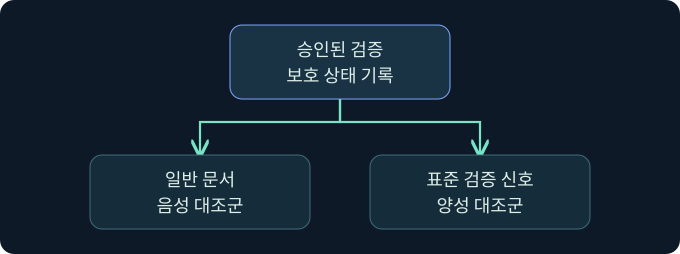
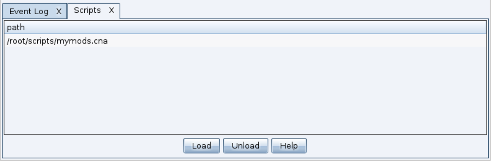

## 1. 파일에 대한 판단과 실행에 대한 판단을 나눕니다

가상의 배포팀이 같은 업무 프로그램의 이전 버전과 새 버전을 비교합니다. 이전 파일은 보안 로그에 기록되지 않았고 새 파일은 내려받는 중에 격리됐습니다. 사용자는 “새 버전이 실행돼 차단됐다”고 설명했지만, 기록에는 다운로드 경로와 탐지만 남아 있습니다. 파일이 실행되기 전에 차단된 경우와 실행 뒤 활동이 중단된 경우는 서로 다른 사건입니다.

이 강의는 **정적 산출물과 탐지·조치·보고의 경계**를 다룹니다. 실행 파일에 관한 관측만으로 프로세스가 만들어졌다고 결론 내리지 않으며, 실제 파일을 수정하거나 실행하지 않은 예시에서도 방어 검증 표를 작성할 수 있습니다.

## 2. 템플릿과 최종 배포 파일을 구분합니다

템플릿은 산출물을 만들 때 재사용하는 구조입니다. Cobalt Strike의 Artifact Kit는 컴파일된 산출물의 템플릿을 다루는 제품 구성 요소입니다. 템플릿과 생성된 파일은 분석 대상이 다릅니다. 예를 들어 같은 제품에서 EXE, DLL, 서비스용 실행 파일은 배포 형식과 실행 문맥이 다를 수 있습니다. x86과 x64는 아키텍처를, staged와 stageless는 후속 구성 요소를 얻는 방식의 차이를 나타냅니다. 이 분류만으로 어느 보호 계층이 탐지할지 알 수는 없습니다.

| 조사 대상 | 기본 기록 | 해석 범위 |
|---|---|---|
| 템플릿 | 버전, 출처, 형식, 검토 이력 | 산출물의 기반을 식별 |
| 최종 파일 | 출처, SHA-256, 서명 상태, 경로 | 관측된 배포 단위의 동일성 확인 |
| 실행 문맥 | 실행 방식, 계정, 호스트, 부모 프로세스 | 실제 프로세스가 생성됐는지 확인 |
| 보안 조치 | 탐지 이름, 작업 종류, 결과, 시간 | 차단·격리·정리 및 보고 여부 확인 |

파일 형식이나 해시가 다르더라도 업무 기능이 같을 수 있습니다. 반대로 이름과 제품 설명이 같아도 파일 바이트와 서명 상태는 달라질 수 있습니다. 그래서 표에는 사람이 읽는 이름과 파일 식별자를 함께 남깁니다.

## 3. 정적 판정과 실행 중 관측을 비교합니다

파일 저장 또는 열기 시 검사, 실행 중 활동 분석, 중앙 경보는 서로 다른 관측점입니다. 정적 검사는 실행 전에도 파일 내용이나 메타데이터를 확인할 수 있습니다. 실제 제품의 판단에는 엔진, 보안 인텔리전스, 클라우드 판정과 정책 상태가 관여할 수 있습니다. 파일을 검사한 기록과 프로세스에서 보인 행위의 기록을 같은 결과 칸에 합치면 오류 위치를 찾기 어렵습니다.

| 계층 | 확인할 질문 | 이 관측만으로 알기 어려운 것 |
|---|---|---|
| 파일 검사 | 저장·열기·검사 시 엔진이 판정했나요? | 대상 코드가 실행됐는지 |
| 실행 및 행위 | 어느 프로세스·계정에서 어떤 행위가 있었나요? | 그 파일이 모든 환경에서 동일하게 평가되는지 |
| 로컬 대응 | 제품이 어떤 조치를 완료했나요? | 원격 관리 시스템에 언제 도착했는지 |
| 중앙 보고 | 어떤 장치와 탐지 항목이 수집됐나요? | 로컬에서 조치가 실제 완료됐는지 |

템플릿 한 개의 판정은 관측 당시 설정과 그 파일에 대한 결과입니다. 재검증 시에는 한 번에 하나의 비교 조건만 바꾸고 실행의 유무를 명시합니다. 엔진과 정책의 차이를 기록하지 않으면 파일 변경의 영향과 제품 업데이트의 영향을 혼동할 수 있습니다.

## 4. 보호 설정을 유지한 상태에서 대조군을 정합니다

검증 설계에서 음성 대조군은 승인된 일반 문서입니다. 양성 대조군은 기관이 승인한 제조사 문서상의 무해한 검증 신호입니다. Microsoft가 안내하는 EICAR는 제품 연결과 탐지 보고를 점검하는 표준 테스트 입력입니다. 이 강의에는 테스트 파일을 포함하지 않으며, 다운로드·생성·실행도 하지 않았습니다. 테스트 환경에서 양성 신호가 보였다고 해서 운영 환경의 모든 행위 유형을 관측할 수 있다는 뜻은 아닙니다.

가상 검증표에는 같은 호스트, 같은 엔진 및 정책, 같은 시간대와 수집 구간을 적습니다. 먼저 파일 검사 범위를 확인하고 프로세스 감사와 중앙 보고는 별도 목표로 둡니다. 어느 항목을 확인하지 못했는지와 검증 담당자를 남겨 결과가 다른 장치로 잘못 일반화되지 않게 합니다.

## 5. 탐지 이벤트와 조치 이벤트를 연결합니다

Microsoft Defender Antivirus의 1116은 탐지, 1117은 제품의 조치에 관한 기록입니다. 이벤트가 가까운 시각에 나타났더라도 장치, 탐지 식별자, 경로를 비교해 같은 사건인지 확인합니다. 1117에서 작업과 상태를 읽어 성공·실패를 구분합니다. 조치 이벤트가 있다는 사실만으로 모든 위협이 제거됐다고 단정할 수 없습니다.

실행 여부를 검증할 때는 이미 수집된 프로세스 생성이나 서비스 자료를 같은 시간 구간에서 봅니다. 예를 들어 파일이 격리됐고 프로세스가 관측되지 않았다면 “수집 범위에서 실행을 확인하지 못함”으로 적습니다. 감사 정책이 해당 유형을 기록하는지, 다른 경로나 이름을 사용했는지, 로그가 보존됐는지도 확인합니다.

## 6. 공식 Script Manager에서 산출물 관리와 연결되는 위치를 읽습니다

### 실제 화면 159: Fortra Script Manager

[Fortra Scripting Cobalt Strike](https://hstechdocs.helpsystems.com/manuals/cobaltstrike/current/userguide/content/topics/welcome_cs-scripting.htm)의 실제 화면입니다. 2026년 11월 10일 확인했으며 캡처의 제품 버전과 설치 UI는 다를 수 있습니다. 화면의 예시 목록은 공식 문서의 표시이며 이 강의의 결과가 아닙니다.

1. 격리된 교육용 클라이언트를 가정해 **Cobalt Strike → Script Manager → Load**로 이동합니다.
2. 파일 선택창의 **File name**에 사전 검토된 로컬 표시용 가상 파일 `training-label-only.cna`를 고르고 **Open**을 누르는 미실행 예입니다. 이름은 산출물을 바꾸거나 원격 작업을 등록하는 코드와 구별하기 위한 값입니다. 파일은 제공하지 않으며 별도 저장 버튼은 없습니다.
3. **Scripts** 목록에서 항목 경로와 승인 목록의 일치를 확인하고, 오류가 있다면 스크립트 콘솔의 초기화 메시지를 봅니다. 가상 항목을 해제할 때는 해당 행과 **Unload**를 확인합니다. 등록은 파일 생성·검사·실행의 증거와 별개입니다.

파일 선택창, 가상 로드·해제 결과, 산출물 생성·검사 화면은 확보하지 못했습니다. 이 강의에서는 템플릿을 등록하거나 보안 기능을 변경하지 않았습니다.

## 7. 저장된 Defender 로그를 읽는 순서

1. 검토할 기간을 정하고 장치 식별자, 운영체제, 정책과 엔진 상태를 보존 자료에서 기록합니다.
2. **Event Viewer → Action → Open Saved Log**에서 승인된 가상 내보내기 `lab-endpoint-defender.evtx`를 골라 **Open**을 누르는 미실행 절차입니다. 파일명은 장치 로그 종류를 구별하기 위한 값입니다.
3. 이벤트 목록에서 1116과 1117을 찾아 **Details**에서 탐지 식별자, 경로, 동작과 상태를 읽습니다. 실시간 로그라면 **Applications and Services Logs → Microsoft → Windows → Windows Defender → Operational**의 위치에 해당합니다. 이 가상 필터 결과 화면은 확보하지 못했습니다.
4. 별도로 보존된 프로세스 감사와 중앙 경보를 확인합니다. 장치 및 시간 기준을 맞추고 확인되지 않은 항목은 빈칸 대신 ‘미확인’으로 표시합니다.

## 8. 한 조건이 달라진 사례에서 결론을 좁힙니다

| 가상 관측 | 우선 해석 | 추가 확인 |
|---|---|---|
| 1116과 성공한 격리 조치, 프로세스 자료 없음 | 파일 탐지와 격리가 관측됨 | 실행 감사의 범위와 보존 상태 |
| 로컬 조치, 중앙 항목 없음 | 중앙 수집 또는 도착 지연 가능 | 장치 연결, 보고 범위와 시각 |
| 일반 문서에서 경보, 비교 장치에서는 미관측 | 탐지 차이의 원인 미확인 | 파일 해시, 엔진과 정책, 경보 출처 |
| 승인된 검증 신호가 두 채널에서 미관측 | 검증 경로를 재점검할 필요 | 입력 도달, 보호 상태, 이벤트 및 연결 상태 |

비교 장치의 시계가 느리면 시간 범위만으로 매칭하지 않습니다. 같은 이름의 다른 파일이 있을 때는 해시와 경로를 함께 보고, 격리 이후 원본을 다시 읽는 식의 변경 작업은 이번 검증 범위에서 제외합니다.

## 9. 승인된 방어 검증 기록의 완료 기준

보고서에는 ‘관측 대상 파일’, ‘파일 검사’, ‘실행 증거’, ‘조치’, ‘중앙 보고’를 독립 항목으로 둡니다. 각 행에 확인한 시스템과 시간을 적고, 예외 또는 미수집 범위를 표시합니다. 보호 설정을 유지한 상태로 확인 가능한 결론을 먼저 작성하면 점검의 재현성과 업무 환경의 안전을 함께 지킬 수 있습니다.

이번 예제의 파일명과 경로는 가상입니다. 실제 보호 해제, 우회용 산출물 수정, 페이로드 생성, 클라이언트 및 대상 실행은 하지 않았습니다.

## 10. 복습과 즉시 해설

### 복습 1. 템플릿과 최종 산출물의 기록을 왜 구분하나요?
**해설:** 최종 파일에는 형식과 설정에 따른 차이가 생길 수 있습니다. 해시·서명·배포 문맥은 최종 파일에서 확인합니다.

### 복습 2. 1116으로 실행 여부를 확정할 수 있나요?
**해설:** 탐지의 근거입니다. 실행은 프로세스나 서비스 등 별도 관측으로 대조합니다.

### 복습 3. 1117이 있으면 어떤 필드를 더 봐야 하나요?
**해설:** 동작과 상태를 읽어 격리·정리·기타 조치와 그 결과를 구분합니다.

### 복습 4. 같은 이름이면 같은 파일인가요?
**해설:** 이름은 분류 단서입니다. 해시와 실제 경로, 서명으로 비교합니다.

### 복습 5. 중앙 경보가 없으면 로컬 탐지도 없었나요?
**해설:** 로컬과 중앙은 관측점이 다릅니다. 연결과 지연, 수집 정책을 확인합니다.

### 복습 6. 무해한 양성 검증 신호는 무엇을 확인하나요?
**해설:** 정한 신호의 로컬 탐지와 보고 경로를 확인합니다. 실제 악성 행위 전반의 보장을 의미하지 않습니다.

### 복습 7. Script Manager 목록에서 보이면 산출물이 실행됐나요?
**해설:** 스크립트 등록 상태입니다. 파일 생성이나 대상 실행은 각각 별도 근거가 필요합니다.

### 복습 8. 장치 간 판정이 다르면 무엇을 고정하나요?
**해설:** 파일 해시·경로, 정책과 엔진, 수집 구간을 대조해 비교 가능한 조건을 먼저 정합니다.

## 11. 공식 자료와 확인 범위

- [Fortra · Scripting Cobalt Strike와 Script Manager](https://hstechdocs.helpsystems.com/manuals/cobaltstrike/current/userguide/content/topics/welcome_cs-scripting.htm)
- [Microsoft · Defender Antivirus 이벤트 1116 및 1117](https://learn.microsoft.com/en-us/defender-endpoint/troubleshoot-microsoft-defender-antivirus)
- [Microsoft · Defender 탐지 및 보고 검증](https://learn.microsoft.com/en-us/defender-endpoint/validate-antimalware)

2026년 11월 10일 공식 자료를 확인했습니다. 예제와 제품 절차는 미실행이며 공식 화면에 보이는 값과 구분합니다.
