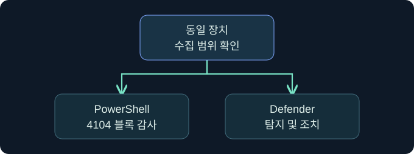

## 1. 파일 검사 뒤에 스크립트 검사가 또 필요한 이유

가상의 운영팀이 장치 점검용 PowerShell 스크립트를 승인했습니다. 정적 파일 점검에서 경보는 없었습니다. 실제 업무 호스트에서는 스크립트 검사를 거쳤는지, 명령이 어떤 상태로 끝났는지, 기록이 어디에 남는지를 별도로 확인해야 합니다. 호스트가 실행 전에 보는 내용과 파일에 보존된 표현이 항상 같은 시점의 자료는 아니기 때문입니다.

이 강의는 **AMSI, PowerShell 감사, 엔드포인트 탐지와 결과**의 관계를 설명합니다. 승인된 합성 기록과 읽기 전용 검토를 가정합니다. 스크립트 난독화, 검사 무력화, 로더 또는 페이로드 실행은 미실행입니다.

## 2. AMSI는 연결점이고 제공자가 판정합니다

AMSI(Antimalware Scan Interface)는 Windows 애플리케이션이 보안 제품의 검사 기능을 이용하도록 마련한 인터페이스입니다. 호스트는 통합 방식에 따라 콘텐츠를 제출하고 검사 결과를 받습니다. 제공자와 호스트의 처리 경로, 정책과 제품 버전에 따라 어떤 이벤트가 관측되는지가 달라질 수 있습니다. 인터페이스가 존재한다는 사실은 모든 앱이나 모든 버전이 같은 순간에 동일한 내용을 검사한다는 뜻이 아닙니다.

예를 들어 PowerShell 호스트는 스크립트 콘텐츠를 검사 과정에 제공할 수 있습니다. 파일이 없거나 명령이 대화형으로 입력된 경우에도 호스트 통합 여부에 따라 검사 지점이 생길 수 있습니다. 반대로 파일 검사의 깨끗한 판정은 나중에 다른 호스트나 문맥에서 무엇이 관측될지 보장하지 않습니다.

## 3. 스크립트 템플릿과 실행 문맥을 비교합니다

앞 강의의 Artifact Kit는 주로 컴파일된 배포 템플릿을 설명하는 사례였습니다. Resource Kit는 제품의 스크립트 기반 리소스 템플릿과 관련됩니다. 템플릿에서 보는 텍스트, 실제 스크립트 호스트가 처리하는 콘텐츠, 실행 중 행위는 별도의 검증 대상입니다. 이 구분은 한 형태에서 관측한 결과를 다른 형태 전체에 확대하지 않도록 돕습니다.

| 관측 대상 | 확인할 맥락 | 판단 범위 |
|---|---|---|
| 리소스 템플릿 | 출처, 버전, 승인된 배포 형식 | 준비된 입력의 구성 |
| 호스트의 스크립트 블록 | 호스트와 버전, 정책, 시각 | 해당 호스트가 처리·기록한 내용 |
| 보안 제공자 이벤트 | 장치, 탐지 원본과 조치 | 제품이 보고한 탐지·조치 |
| 실행 결과 | 프로세스, 오류, 업무 산출물 | 실제 후속 작업의 관측 |

호스트가 문자열을 읽었다는 사실과 그 문자열이 업무 동작을 끝냈다는 사실은 다릅니다. 운영 관점에서는 처리 단계별 관측 지점을 정한 뒤 보호 설정을 유지합니다.

## 4. 4104와 탐지 이벤트가 답하는 질문을 구분합니다

스크립트 블록 로깅이 구성되면 PowerShell은 처리한 스크립트 블록의 내용을 해당 Operational 채널에 기록할 수 있습니다. 4104는 그 내용에 관한 감사 자료입니다. 긴 블록이 여러 이벤트로 나뉘면 같은 Script Block ID와 메시지 순서를 대조합니다. Windows PowerShell과 PowerShell 7은 이벤트 채널과 정책 적용 문맥이 다를 수 있습니다.

Microsoft Defender Antivirus의 1116·1117은 탐지와 조치에 관한 기록입니다. 같은 장치에서 4104와 1116이 가까운 시각에 나왔다고 해서 인과를 곧바로 확정하지 않습니다. 시각, 호스트, 경로 또는 관련 식별자, 탐지 원본을 추가로 확인합니다. 스크립트 감사에는 민감한 문자열이 포함될 수 있으므로 필요한 범위만 열람하고 예제는 합성 텍스트를 씁니다.

## 5. 설정과 수집 범위가 다른 사례를 대조합니다

| 가상의 자료 | 잠정 판단 | 다음 확인 |
|---|---|---|
| 4104와 정상 업무 결과, 보호 경보 없음 | 콘텐츠 관측과 업무 결과가 존재 | 검사 계층이 보고하는 항목과 시간 범위 |
| 4104와 보안 경보, 후속 결과 미확인 | 처리 및 탐지 근거가 존재 | 조치 상태와 실제 프로세스·업무 결과 |
| 보안 탐지 원본이 AMSI, 4104 없음 | 해당 보호 관측이 보고됨 | 호스트 종류와 해당 로깅·수집 범위 |
| 두 기록 모두 없음 | 이 자료에서 확인되지 않음 | 실행 입력, 호스트·채널, 보존 및 수집 조건 |

가상 비교에서 같은 읽기 전용 입력을 사용하더라도 호스트 버전과 채널이 다르면 먼저 채널 차이를 설명해야 합니다. 로그가 비었다는 이유로 보호 기능이 동작하지 않았다고 단정하면 정상적인 수집 범위 차이와 장애를 구분할 수 없습니다.

## 6. 공식 콘솔에서 실행 문맥 표시를 확인합니다

### 실제 화면 160: Fortra Beacon Console

[Fortra The Beacon Console](https://hstechdocs.helpsystems.com/manuals/cobaltstrike/current/userguide/content/topics/post-exploitation_main.htm)의 공식 캡처입니다. 2026년 11월 10일 확인했으며 캡처의 설치 버전은 확인되지 않았습니다. 설치 버전에 따라 메뉴와 배치가 달라질 수 있습니다.

승인된 가상 클라이언트에서 **Cobalt Strike → Visualization → Session Table → LAB-SCRIPT-AUDIT 행 우클릭 → Interact**를 가정합니다. 하단 입력 줄에 `getuid`를 넣고 **Enter**를 누르는 미실행 절차입니다. 이 값은 콘솔의 토큰 보고 문맥을 대조하기 위한 것이며 스크립트 검사를 호출하는 예시가 아닙니다. 별도 저장 없이 탭과 반환 영역의 신원 문맥을 봅니다. 반환이 비면 세션과 작업 상태를 확인합니다.

그림에 표시된 입력과 반환은 Fortra의 공식 예시입니다. 이번 가상 세션 반환, 리소스 생성 결과 및 AMSI 판정의 제품 화면은 확보하지 못했습니다. Cobalt Strike 콘솔의 상태만으로 Windows 호스트의 스크립트 검사 여부를 확인할 수 없습니다.

## 7. 승인된 로그를 단계별로 대조합니다

1. 이미 수집된 자료에서 운영체제, 호스트 이름과 버전, 장치 식별자, 시간대를 확인합니다. 콘텐츠나 비밀의 원문 대신 검토에 필요한 최소 필드를 남깁니다.
2. **Event Viewer → Action → Open Saved Log**에서 가상 내보내기 `lab-powershell-audit.evtx`를 선택하고 **Open**을 누르는 미실행 절차입니다. 이름은 승인된 스크립트 감사 자료를 구분하기 위한 값입니다.
3. **Find**에 `4104`를 입력하고 **Find Next**를 누릅니다. **Details → XML View**에서 이벤트 ID, 컴퓨터, 시각 및 Script Block ID를 확인합니다. 같은 ID의 메시지 순서와 전체 수를 읽고, 추적용 식별자가 누락됐으면 그 제한을 기록합니다.
4. Defender 채널에 저장된 보안 이벤트와 업무 결과를 대조합니다. 가상 파일 선택창, 찾기 결과와 대상 업무 결과의 화면은 확보하지 못했습니다. 실제 제품 또는 로그의 기록과 달리 아래 사례는 합성입니다.

## 8. 같은 시각의 로그가 서로 다른 해석을 가질 수 있습니다

가상의 장치에서 09시 40분에 4104가 보이고 09시 41분에 Defender 경보가 보였다고 가정합니다. 첫 기록은 점검 호스트가 처리한 블록이고, 경보는 다른 프로세스에서 생성된 파일에 관한 기록일 수도 있습니다. 장치의 시각이 일치해도 프로세스와 경로가 다르면 둘을 한 사건으로 합치지 않습니다.

다른 가정에서는 같은 경로가 보고되지만 보안 조치 성공이 미확인입니다. 이때 ‘탐지 확인, 조치 결과 미확인, 업무 실행 여부 미확인’으로 기록합니다. 유효한 업무 산출물과 출처가 확인된 경우에도 그 자료를 어느 단계가 만든 것인지 로그와 함께 검증합니다.

## 9. 검사 정상 여부를 보고하는 기준을 정합니다

검증표에는 요청한 입력, 실제 호스트, 수집 채널, 검사 계층, 조치 및 업무 결과를 독립 항목으로 둡니다. 사전 승인된 음성·양성 대조가 있다면 각 신호의 예상 관측과 검증 범위를 정합니다. 로깅이 적용됐는지와 보안 검사가 적용됐는지는 별도의 점검입니다. 의심스러운 내용을 만들거나 보호 기능을 해제하는 대신 기존 자료에서 경계를 확인합니다.

보고서에는 로그에 남은 사실과 자료 공백, 추가로 볼 채널을 남깁니다. 예제의 Windows·Cobalt Strike 조작과 검사, 대상 스크립트 실행은 모두 미실행입니다.

## 10. 복습과 즉시 해설

### 복습 1. AMSI는 무엇을 연결하나요?
**해설:** 통합된 앱이 보안 제공자에 검사할 콘텐츠를 제출할 수 있게 합니다. 앱과 제공자의 실제 처리 문맥을 따로 확인합니다.

### 복습 2. 파일 검사와 호스트 검사의 결과를 같은 것으로 볼 수 있나요?
**해설:** 관측 대상과 시점이 다릅니다. 어느 계층이 무엇을 검사했는지 구분합니다.

### 복습 3. 4104는 탐지 이벤트인가요?
**해설:** PowerShell 스크립트 블록 감사입니다. 보안 제품의 탐지 및 조치는 그 제품의 이벤트에서 확인합니다.

### 복습 4. 4104 하나의 내용이 전체 블록인가요?
**해설:** 긴 블록은 나뉠 수 있습니다. 동일 Script Block ID의 순서와 전체 수를 대조합니다.

### 복습 5. 4104가 없으면 실행이 없었나요?
**해설:** 채널, 호스트, 정책, 보존 및 수집 범위를 먼저 확인합니다.

### 복습 6. 인접한 4104와 1116을 언제 연결하나요?
**해설:** 장치와 시간 외에 경로, 프로세스와 관련 식별자 등 같은 사건을 뒷받침하는 근거를 확인합니다.

### 복습 7. 콘솔의 getuid로 AMSI 판정을 읽을 수 있나요?
**해설:** 콘솔의 사용자 문맥을 확인합니다. 검사와 탐지 판정은 호스트 및 보호 로그에서 검토합니다.

### 복습 8. 가상의 정상 업무 결과는 무엇을 검증하나요?
**해설:** 해당 업무가 기대한 결과를 냈는지 판단하는 자료입니다. 보안 검사 및 탐지 여부는 별도로 기록합니다.

## 11. 공식 자료와 확인 범위

- [Microsoft · Antimalware Scan Interface](https://learn.microsoft.com/en-us/windows/win32/amsi/antimalware-scan-interface-portal)
- [Microsoft · Windows PowerShell 로깅](https://learn.microsoft.com/en-us/powershell/module/microsoft.powershell.core/about/about_logging?view=powershell-5.1)
- [Microsoft · Windows의 PowerShell 7 로깅](https://learn.microsoft.com/en-us/powershell/module/microsoft.powershell.core/about/about_logging_windows)
- [Microsoft · Defender Antivirus의 탐지 및 조치 이벤트](https://learn.microsoft.com/en-us/defender-endpoint/troubleshoot-microsoft-defender-antivirus)

2026년 11월 10일 공식 자료를 확인했습니다. 표와 검토 절차는 설명용이며 화면 출처의 공식 예시와 구분합니다.
