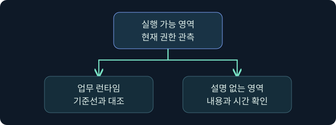

## 1. 서명된 모듈과 메모리 페이지를 따로 확인합니다

가상의 응용 프로그램에서 서명된 모듈이 로드됐고, 몇 초 뒤 같은 프로세스의 실행 가능 페이지에서 이상 징후가 보고됩니다. 첫 기록은 디스크 이미지가 적재됐다는 근거입니다. 두 번째 기록은 특정 시각의 가상 주소 범위와 권한을 설명합니다. 이름과 서명만으로 그 주소의 현재 바이트나 실행 여부까지 알 수는 없습니다.

이번 강의에서는 프로세스 주소 공간을 **출처, 페이지 권한, 현재 내용, 실제 사용**으로 나누어 읽습니다. 가상의 표와 승인된 스냅샷 검토 절차를 사용합니다. 메모리 쓰기, 페이지 권한 변경, 이미지 조작은 미실행입니다.

## 2. 페이지의 상태와 유형을 구별합니다

가상 주소 공간은 디스크 파일과 동일한 형태의 연속 배열이 아닙니다. 운영체제는 페이지 범위의 상태와 매핑 유형, 현재 보호 속성을 관리합니다. Windows 메모리 조회 결과에는 예약·커밋·해제 여부, 이미지 또는 데이터 매핑과 사설 메모리 여부, 영역 크기와 보호 속성이 별도 필드로 나타날 수 있습니다.

| 필드 | 답하는 질문 | 해석 한계 |
|---|---|---|
| State | 페이지가 커밋, 예약, 해제 중 어느 상태인가요? | 주소가 예약됐다는 사실로 데이터 존재를 확인할 수 없음 |
| Type | 이미지·데이터 매핑·사설 영역 중 어떤 계열인가요? | 현재 내용의 무결성을 직접 확인할 수 없음 |
| Protect | 조회 시점에 어떤 접근이 허용되나요? | 이전 보호 상태나 실제 접근 이력을 뜻하지 않음 |
| AllocationProtect | 처음 할당할 때 어떤 보호가 지정됐나요? | 현재 보호와 다를 수 있음 |

조회 도구가 여러 연속 페이지를 한 영역으로 요약할 수도 있습니다. 서로 다른 도구 결과를 비교할 때는 주소 범위와 시각, 읽을 수 있었던 영역을 함께 확인합니다. 보호 값이 정의되지 않는 상태에는 권한 의미를 부여하지 않습니다.

## 3. MEM_IMAGE와 원본 일치를 혼동하지 않습니다

Windows의 이미지 매핑은 파일 이미지가 주소 공간에 매핑됐다는 계열을 보여 줍니다. 공유 이미지 페이지가 쓰기 때문에 사설 사본으로 바뀌어도 VirtualQuery는 그 페이지의 유형을 계속 MEM_IMAGE로 보고할 수 있습니다. Microsoft는 특정 페이지가 현재 공유되는지 살필 때 작업 집합 정보의 Shared 비트를 검토하는 방법과 페이지 상주 조건을 설명합니다.

| 관측 | 확인되는 것 | 추가로 볼 근거 |
|---|---|---|
| MEM_IMAGE와 모듈 이름 | 이미지 매핑 계열과 관련 모듈 후보 | 실제 주소 범위와 페이지 내용 |
| 공유 상태의 변화 | 페이지의 공유 상태가 달라진 정황 | 정상 재배치·패치·계측과의 비교 |
| 이미지 실행 영역의 차이 | 기준 자료와 현재 관측이 다름 | 버전, 로더 적용 사항, 획득 무결성 |
| 스레드 시작 주소 | 기록된 시작 위치의 근거 | 실제 실행 흐름과 후속 행위 |

파일 기반 이미지를 이용해 변형된 내용이 나타나는 유형을 분석할 때 이 구분이 중요합니다. 변경된 페이지가 보이더라도 정상 로더 동작이나 승인된 계측 등 가능한 원인을 대조합니다. 하나의 유형 값이나 모듈 이름으로 결론 내리지 않습니다.

## 4. 실행 가능과 실제 실행을 구별합니다

읽기·쓰기·실행이 모두 허용되는 페이지는 우선 검토할 단서입니다. JIT 컴파일러와 개발 도구도 실행 가능 메모리를 사용할 수 있습니다. 반대로 스냅샷에 쓰기·실행이 함께 보이지 않아도 앞선 시각의 변경이나 짧게 존재한 영역은 관측 범위에 없을 수 있습니다. 현재 권한을 과거에 그대로 적용하지 않습니다.

가상의 문서 뷰어에서 실행 가능한 사설 영역이 발견됐다면 프로세스의 정상 기준선, 런타임 로드, 영역 생명주기와 시작 주소를 비교합니다. 다른 가정에서 해당 주소가 정상 모듈로 분류됐다면 로드 로그와 현재 바이트의 출처를 다시 맞춥니다. 어느 경우든 관측된 권한만으로 실제 실행을 확인할 수는 없습니다.

## 5. PE 헤더는 비교 기준과 함께 해석합니다

PE 헤더와 섹션 표는 파일이 어떻게 구성됐는지 읽는 출발점입니다. 섹션의 파일 오프셋과 메모리에 매핑된 상대 가상 주소는 다른 좌표입니다. 파일과 메모리를 같은 오프셋에서 기계적으로 비교하면 정렬, 재배치, 로더의 정상 처리 때문에 차이가 생길 수 있습니다. 기준 버전의 파일과 실제 이미지 주소, 섹션의 대응 범위를 먼저 맞춥니다.

특정 주소에 PE 시그니처가 보이지 않는다는 사실은 여러 설명을 가집니다. 검사 위치가 섹션 내부였거나, 자료 일부가 읽히지 않았거나, 해당 영역의 유형이 이미지가 아니었을 수 있습니다. PE 구조 부재가 확인돼도 실행 여부는 별도 자료에서 확인합니다. 이 강의의 그림은 관측 관계를 설명하며 메모리 덤프 화면을 재현하지 않습니다.

## 6. 공식 콘솔에서 세션 식별값의 위치를 봅니다

### 실제 화면 161: Fortra Beacon Console

[Fortra The Beacon Console](https://hstechdocs.helpsystems.com/manuals/cobaltstrike/current/userguide/content/topics/post-exploitation_main.htm)의 실제 화면입니다. 2026년 11월 10일 확인했으며 캡처의 설치 버전은 확인되지 않았습니다. 설치 버전별 메뉴와 표시가 다를 수 있습니다.

1. 승인된 가상 클라이언트를 가정해 **Cobalt Strike → Visualization → Session Table → LAB-MEM-A 행 우클릭 → Interact**로 이동합니다.
2. 하단 입력 줄에 `getuid`를 넣고 **Enter**를 누르는 미실행 예입니다. 조사 메모의 토큰 문맥을 확인하기 위한 값입니다. 별도 저장 버튼은 없습니다.
3. 탭과 상태 표시줄을 확인하고 상단 반환에서 사용자 문맥을 대조합니다. 늦은 반환이 있으면 선택한 세션과 작업 시각을 먼저 확인합니다.

화면의 기존 입력과 반환은 Fortra의 시연 자료입니다. 이번 가상 반환이나 메모리 권한·PE 분석 결과의 실제 화면은 확보하지 못했습니다. 세션의 토큰 문맥은 페이지 권한 또는 실행 내용을 증명하지 않습니다.

## 7. 승인된 스냅샷을 대조하는 순서

1. 장치, 프로세스 식별자와 생성 시각, 자료 수집 시각을 고정합니다. 이름과 PID가 같아도 재시작한 인스턴스일 수 있습니다.
2. 보존된 스냅샷에서 해당 주소 범위의 유형, 상태와 현재 권한을 기록합니다. 파일 매핑 후보가 있다면 기준 이미지의 해시와 버전, 섹션 대응 관계를 대조합니다.
3. 작업 집합 정보나 스레드 기록이 있으면 같은 시각과 주소인지 확인합니다. 수집이 빠졌거나 읽을 수 없는 페이지는 ‘미확인’으로 남깁니다.
4. 모듈 로드, 프로세스·스레드 관측 및 실제 대상 행위를 시간순으로 비교합니다. 직접 운영 시스템에 접속하거나 메모리를 변경하지 않는 검토 절차입니다.

## 8. 관측 조건이 달라지면 판단 범위를 고칩니다

| 가상 관측 | 우선 해석 | 다음 대조 |
|---|---|---|
| MEM_IMAGE, 공유 상태 정상, 모듈 로그 일치 | 해당 시각의 이미지 매핑이 관측됨 | 실행 및 후속 행위 기록 |
| MEM_IMAGE, 일부 페이지 사설, 승인된 계측 이력 | 복사 후 쓰기 또는 계측 가설 | 같은 버전의 기준선, 관련 변경 기록 |
| 실행 가능 사설 영역, 스레드 기록 누락 | 실행 가능 권한은 확인됨 | 센서 적용·관측 시각과 업무 런타임 |
| 헤더 시그니처 없음, 범위 일부만 보존 | 구조 판독의 근거 부족 | 실제 기준 주소와 수집 범위 |

스냅샷 수집과 로그 기록의 시차가 길면 주소 재사용을 의심할 이유가 생깁니다. 해당 프로세스가 같은 인스턴스인지 확인한 뒤 현재 주소의 의미를 판단합니다.

## 9. 보고서에 근거의 시점을 남깁니다

조사표에는 주소, 유형, 현재 권한, 공유 상태, 이미지 파일, 스레드와 동작의 근거를 별도 열로 둡니다. 각 항목에 관측 도구와 시각, 관련 제한을 적습니다. 가상의 보고서라면 “실행 가능한 영역 관측, 실제 실행 미확인”처럼 확인된 사실과 추론의 범위를 분리합니다. 설정 및 증거 수집은 조직의 승인된 절차에서 다룹니다.

## 10. 복습과 즉시 해설

### 복습 1. MEM_IMAGE면 파일의 내용과 일치하나요?
**해설:** 이미지 매핑 유형입니다. 현재 페이지 내용과 공유 상태는 별도 자료에서 확인합니다.

### 복습 2. 사설 사본이 생기면 유형도 항상 MEM_PRIVATE로 바뀌나요?
**해설:** Windows는 복사 후 쓰기 된 이미지·데이터 매핑을 기존 유형으로 표시할 수 있습니다.

### 복습 3. RWX로 실제 실행을 확인할 수 있나요?
**해설:** 해당 시점에 허용된 접근 종류입니다. 스레드와 동작 기록이 실행 판단을 보강합니다.

### 복습 4. 현재 보호와 초기 보호의 차이는 무엇인가요?
**해설:** 조회 시점과 할당 시점의 값입니다. 변경 경로는 시간에 따른 별도 근거에서 확인합니다.

### 복습 5. PE 파일 오프셋과 RVA를 그대로 비교할 수 있나요?
**해설:** 파일 내부 좌표와 이미지의 상대 주소입니다. 섹션과 기준 주소를 먼저 대응합니다.

### 복습 6. 모듈 서명으로 현재 메모리의 무결성을 확인하나요?
**해설:** 파일 검증의 근거입니다. 메모리의 현재 내용과 보호는 스냅샷에서 따로 봅니다.

### 복습 7. PID와 주소가 같으면 같은 관측을 합칠 수 있나요?
**해설:** 재사용될 수 있습니다. 호스트, 생성 시각, 주소 범위와 관측 시각을 확인합니다.

### 복습 8. 공식 콘솔에서 세션 사용자를 확인하면 페이지 권한도 확인되나요?
**해설:** 사용자 문맥만 확인합니다. 페이지 권한은 별도 메모리 관측이 필요합니다.

## 11. 공식 자료와 확인 범위

- [Microsoft · VirtualQuery와 복사 후 쓰기 페이지](https://learn.microsoft.com/en-us/windows/win32/api/memoryapi/nf-memoryapi-virtualquery)
- [Microsoft · QueryWorkingSetEx](https://learn.microsoft.com/en-us/windows/win32/api/psapi/nf-psapi-queryworkingsetex)
- [Microsoft · PE 형식과 섹션 구조](https://learn.microsoft.com/en-us/windows/win32/debug/pe-format)
- [Microsoft · 메모리 보호 상수](https://learn.microsoft.com/en-us/windows/win32/memory/memory-protection-constants)

2026년 11월 10일 공식 자료를 확인했습니다. 제품, 메모리 조작, 페이로드 및 대상 접근은 미실행입니다.
