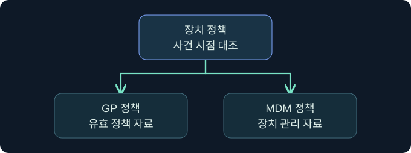

## 1. 규칙을 배포했다는 보고부터 검증합니다

가상의 회계팀은 승인된 정산 프로그램만 실행하도록 AppLocker를 배포했습니다. 정책 관리 화면에는 규칙이 있지만, 한 장치의 감사 로그에서는 “강제였다면 차단”이라는 결과가 보입니다. 규칙 작성, 장치 적용, 평가, 실제 차단을 같은 의미로 보면 이 차이를 설명할 수 없습니다.

이 강의에서는 어떤 사용자와 파일에 어떤 컬렉션이 적용됐는지 확인하고, 구성 자료와 이벤트를 대조합니다. 정책 변경과 파일 실행은 미실행입니다.

## 2. 먼저 규칙 컬렉션을 정합니다

AppLocker는 파일 유형에 따라 규칙을 묶습니다. 승인된 EXE가 실행된다는 사실은 그 프로그램에 관련된 설치 파일이나 스크립트, DLL에 같은 판정이 적용됐음을 의미하지 않습니다. 설치와 실행도 별도 요청입니다.

| 컬렉션 | 대표 범위 | 먼저 확인할 것 |
|---|---|---|
| 실행 파일 | EXE, COM | 대상 이미지와 사용자 |
| Windows Installer | MSI, MSP, MST | 설치 파일 및 실행 주체 |
| 스크립트 | PS1, BAT, CMD, VBS, JS | 파일 유형과 실제 호스트 |
| 패키지 앱 | 패키지 앱과 설치 프로그램 | 배포 또는 실행, 패키지 ID |
| DLL | DLL, OCX | 컬렉션 활성 여부와 로드 문맥 |

일부 컬렉션의 규칙이 비어 있을 때와, 해당 컬렉션에 규칙이 있는데 파일에 맞는 허용 규칙이 없을 때의 기본 동작을 구별합니다. Microsoft 문서에서 적용 조건과 컬렉션 간 예외를 확인하고, 단일 컬렉션의 상태를 다른 유형으로 확대하지 않습니다.

## 3. 규칙에서 주체·동작·조건을 읽습니다

규칙의 이름은 운영팀이 붙인 설명입니다. 실제 평가는 사용자 또는 그룹, 허용 또는 거부 동작, 조건과 예외를 읽어야 이해할 수 있습니다. 동일한 파일이라도 운영 계정과 일반 계정의 유효 그룹이 다르면 다른 결과가 나올 수 있습니다. 해당 주체와 파일에 모두 적용되는 명시적 거부는 허용보다 우선합니다.

| 조건 | 검토의 기준 | 바뀌는 상황 |
|---|---|---|
| 게시자 | 서명과 규칙이 요구하는 게시자·제품·파일·버전 범위 | 새 버전이나 서명 변경 |
| 경로 | 평가 대상 경로와 규칙의 범위 | 이동, 하위 경로, 권한 변경 |
| 파일 해시 | 지정한 파일의 식별값 | 같은 이름의 새 빌드 |

가상의 승인 규칙은 정산 프로그램의 특정 게시자와 버전 범위, 회계팀 그룹에만 적용됩니다. 버전 범위를 벗어난 새 빌드의 판정을 설명할 때 이름이 아니라 서명과 실제 규칙을 대조합니다. 파일 유형과 조건이 맞아도 명시적 거부와 예외를 별도로 읽습니다.

## 4. 정의된 정책과 장치에서 유효한 정책을 구별합니다

중앙에서 편집한 GPO, 로컬 정책, 사건 시점 장치에 실제 반영된 정책은 동일하지 않을 수 있습니다. 정책 범위, 새로고침과 적용 시각, 대상 장치와 사용자, 관련 서비스 상태를 확인합니다. 관리 경로가 MDM일 때는 해당 배포 자료와 장치의 관리 보고를 봅니다. Microsoft는 `Get-AppLockerPolicy -Effective`가 GP 경로의 유효 정책을 조회하며 CSP로 배포된 정책을 반영하지 못한다고 설명합니다. 이 명령의 결과 하나로 CSP 상태를 판단하지 않습니다.

승인된 정책 스냅샷이라도 수집일이 사건 뒤라면 당시 규칙과 같았는지 확인해야 합니다. 정책의 출처와 버전, 적용 시각이 확인되지 않은 경우 보고서에 그 공백을 남깁니다.

## 5. 감사 결과와 차단 결과를 구별합니다

| 예시 이벤트 | 관측 범위 | 확인할 다음 항목 |
|---|---|---|
| 8002 | EXE 또는 DLL 허용 평가 | 대상, 사용자와 판정 규칙 |
| 8003 | 감사 모드에서 강제 시 차단 예정 | 실제 실행 자료와 컬렉션 모드 |
| 8004 | EXE 또는 DLL 차단 | 사건 시각, 규칙·사용자·경로 |
| 8005–8007 | MSI 또는 스크립트 컬렉션의 허용·감사·차단 계열 | 실제 호스트와 후속 행위 |

8003은 AppLocker가 그 파일의 실행을 차단했다는 뜻이 아닙니다. 반대로 허용 판정은 그 파일의 업무 결과나 다른 보호 제품의 결과를 보장하지 않습니다. PowerShell 등 호스트에 따른 스크립트 처리 차이는 다음 강의에서 다룹니다.

## 6. 공식 화면에서 세션 식별 위치를 확인합니다

### 실제 화면 163: Fortra Beacon Console

[Fortra The Beacon Console](https://hstechdocs.helpsystems.com/manuals/cobaltstrike/current/userguide/content/topics/post-exploitation_main.htm)의 실제 화면입니다. 2026년 11월 10일 확인했습니다. 이미지의 설치 버전은 확인되지 않았으며 메뉴 표기는 제품 버전에 따라 달라질 수 있습니다.

가상 교육 클라이언트에서 **Cobalt Strike → Visualization → Session Table → LAB-POLICY-A 우클릭 → Interact**를 가정합니다. 하단 입력 줄에 `getuid`를 입력하고 **Enter**를 누르는 미실행 예입니다. 사용자 문맥을 확인하기 위한 값이며 별도 저장 버튼은 없습니다. 선택한 세션과 반환 영역의 사용자 표시를 대조하고, 반환이 없으면 세션과 요청 상태를 확인합니다. 화면에 이미 보이는 값은 Fortra의 시연입니다. 가상 콘솔 반환과 AppLocker 정책·감사 결과 화면은 확보하지 못했습니다. 콘솔의 사용자는 Windows 정책 결과를 입증하지 않습니다.

## 7. 저장된 정책 자료와 감사 이벤트를 읽습니다

1. 승인된 정책 스냅샷의 대상 장치, 수집 시각, 전달 경로와 컬렉션 모드를 적습니다. 규칙의 주체, 동작, 조건 및 예외를 확인합니다.
2. **Event Viewer → Action → Open Saved Log**에서 승인된 가상 파일 `lab-policy-exe-dll.evtx`를 고르고 **Open**을 누르는 미실행 예입니다. 이름은 자료의 채널을 구별하기 위한 값입니다. 로컬 채널의 위치는 **Applications and Services Logs → Microsoft → Windows → AppLocker → EXE and DLL**입니다.
3. **Details**에서 이벤트 ID, 대상 경로, 사용자, 규칙과 시각을 기록합니다. 중앙 수집 시각과 장치의 발생 시각을 구분합니다. 별도 저장은 필요하지 않으며 실제 필터 결과 화면은 확보하지 못했습니다.
4. 같은 호스트의 프로세스 또는 업무 자료와 맞춰 결론을 씁니다. 대상이 다른 컬렉션이면 채널을 바꾸어 검토합니다.

## 8. 조건이 바뀌면 결론도 바꿉니다

| 가상 조건 | 잠정 결론 | 추가 자료 |
|---|---|---|
| 8003과 업무 프로세스 생성 | 정책 평가상 강제 시 차단 후보 | 사건 당시 컬렉션 모드 |
| 8004와 같은 경로의 프로세스 미확인 | 해당 요청의 차단 관측 | 장치와 파일·사용자 식별 일치 |
| 관리 정책에 규칙은 있으나 장치 이벤트 없음 | 정의 확인, 적용 및 평가 미확인 | 장치 적용, 채널, 수집 범위 |
| 다른 사용자에게 결과가 다름 | 정책 범위 차이 가능 | 실제 그룹·규칙·파일 버전 |

로그가 없다면 그 자체로 허용, 차단, 무효화 중 하나를 선택하지 않습니다. 애초에 실행 요청이 있었는지, 올바른 채널을 보는지, 장치가 해당 정책을 받았는지 확인합니다.

## 9. 점검 결과의 승인 기준을 남깁니다

가상의 검증표는 장치·사용자·파일 식별, 컬렉션, 정책 원본과 적용 시각, 모드, 판정과 실제 결과를 따로 기록합니다. 승인된 일반 파일의 과거 감사와 정책 모델을 대조하며, 실행 검증과 변경이 필요한 경우 해당 조직의 별도 승인 절차를 적용합니다. 이 강의의 검증은 저장된 자료 해석이며 제품·정책 변경과 파일 실행은 미실행입니다.

## 10. 복습과 즉시 해설

### 복습 1. EXE 허용 규칙으로 DLL 컬렉션의 상태를 알 수 있나요?
**해설:** 컬렉션과 강제 모드를 각각 확인합니다.

### 복습 2. 게시자 규칙에서 새 빌드는 항상 허용되나요?
**해설:** 서명과 규칙의 제품·파일·버전 범위를 대조합니다.

### 복습 3. 같은 대상에 허용과 명시적 거부가 모두 적용되면 어떻게 되나요?
**해설:** 해당 주체와 파일에 적용되는 거부가 우선합니다.

### 복습 4. 8003은 차단인가요?
**해설:** 감사에서 강제 시 차단 예정임을 기록한 것입니다.

### 복습 5. 8004는 모든 보호 계층이 같은 판단을 했다는 뜻인가요?
**해설:** 해당 AppLocker 차단의 근거입니다. 다른 계층의 결과는 별도로 봅니다.

### 복습 6. 유효 정책 조회가 CSP 배포를 보여 주나요?
**해설:** 해당 GP 조회는 CSP를 반영하지 않습니다. 장치 관리 자료를 대조합니다.

### 복습 7. 중앙 규칙 화면을 사건 시점의 정책으로 봐도 되나요?
**해설:** 장치 적용 시각과 사건 당시 자료가 필요합니다.

### 복습 8. 콘솔의 계정 이름으로 AppLocker 결과를 확정하나요?
**해설:** 세션 문맥과 Windows의 평가 주체를 별도로 대조합니다.

## 11. 공식 자료와 확인 범위

- [Microsoft · AppLocker 규칙 컬렉션](https://learn.microsoft.com/en-us/windows/security/application-security/application-control/app-control-for-business/applocker/understanding-applocker-rule-collections)
- [Microsoft · AppLocker 이벤트 뷰어](https://learn.microsoft.com/en-us/windows/security/application-security/application-control/app-control-for-business/applocker/using-event-viewer-with-applocker)
- [Microsoft · Get-AppLockerPolicy의 범위](https://learn.microsoft.com/en-us/powershell/module/applocker/get-applockerpolicy?view=windowsserver2025-ps)

2026년 11월 10일 자료를 확인했습니다. 표의 사례는 가상이며 공식 화면에 보이는 결과와 별개입니다.
