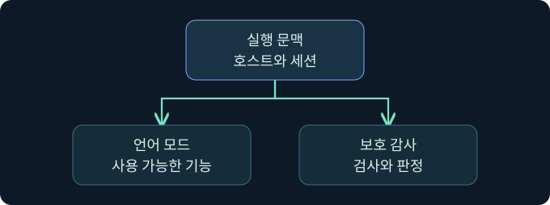

## 1. 허용 경로의 파일을 누가 관리하는지 확인합니다

가상의 승인 목록에는 부서의 배포 디렉터리가 있습니다. 플랫폼팀만 배포할 수 있다는 가정으로 만든 규칙입니다. 업무 운영팀이 바뀐 뒤 여러 계정이 하위 폴더를 수정할 수 있게 됐다는 보고가 들어옵니다. 실행 정책 자체가 바뀌지 않아도 허용 조건이 의존한 가정이 달라졌을 수 있습니다.

이 강의에서는 경로 규칙, 경로의 실제 권한, PowerShell 언어 모드와 DLL 컬렉션을 따로 검증합니다. 사례의 이름과 결과는 모두 가상이며 작업 실행이나 설정 변경 없이 보존 자료로 판단합니다.

## 2. 규칙 범위와 유효 ACL을 교차 검토합니다

경로 규칙은 특정 파일이나 폴더의 범위를 나타냅니다. 규칙 이름에 ‘관리자 배포’가 들어 있어도 그 경로를 관리하는 실제 주체는 ACL과 그룹에서 확인해야 합니다. 권한 상속과 예외, 파일 생성·수정·삭제·교체에 관여하는 권한을 구분합니다. 부모 폴더만 검토하면 별도의 ACL이 설정된 하위 경계를 놓칠 수 있습니다.

| 확인 항목 | 의미 | 추가로 남길 자료 |
|---|---|---|
| 경로 조건 | 어떤 범위가 규칙에 포함되는가 | 규칙 ID, 예외와 사건 당시 버전 |
| 유효 권한 | 어떤 주체가 파일과 폴더를 관리할 수 있는가 | 그룹, 상속, 접근 권한의 출처 |
| 업무 배포 | 누가 언제 어떤 파일을 승인했는가 | 배포 이력, 해시 및 서명 |
| 장치 판정 | 해당 요청에 어떤 모드와 규칙이 적용됐는가 | 이벤트 채널, 대상 주체와 경로 |

예를 들어 가상의 `C:\Training\Approved`에 대해, 관리 그룹만 쓸 수 있다는 승인 문서와 장치의 유효 권한 보고서를 맞춥니다. 이름의 유사성이나 별표만으로 실제 포함 범위를 판단하지 않습니다. 검증은 조직의 승인된 대상에 한정하며 파일을 배치하거나 실행해 허용 여부를 시험하지 않았습니다.

## 3. PowerShell 언어 모드와 보호 계층을 구분합니다

ConstrainedLanguage는 PowerShell이 노출하는 언어 기능을 제한하는 실행 문맥입니다. 모든 명령을 일률적으로 막는 판정은 아닙니다. Microsoft는 AppLocker 스크립트 판정에 따른 제한 동작을 설명하며, 다른 스크립트 호스트가 같은 판정을 같은 방식으로 처리할 것이라고 가정할 수 없습니다. 승인된 스크립트와 대화형 세션의 모드가 다를 수 있으므로 어느 호스트, 세션, 실행 유형을 관측했는지 적습니다.

예를 들어 보존된 교육 기록의 언어 모드가 ConstrainedLanguage라면 그것은 그 세션에 관한 관측입니다. 동시에 스크립트 블록 로깅이나 AMSI가 어떻게 동작했는지는 각각의 정책·호스트와 보호 자료를 비교합니다. 다른 세션 또는 시스템 전체의 상태로 확대하지 않습니다.

## 4. EXE의 실행과 DLL의 적재를 독립적으로 판단합니다

| 계층 | 평가 대상 | 근거의 한계 |
|---|---|---|
| AppLocker EXE | 시작되는 실행 파일 | 후속 모듈 전체의 허용을 뜻하지 않음 |
| AppLocker DLL | 해당 컬렉션이 평가하는 DLL 및 OCX | 적용 모드와 대상 주체를 별도 확인 |
| 이미지 적재 감사 | 어느 프로세스에 어떤 모듈이 적재됐는가 | 모듈의 모든 기능이 실행된 근거는 아님 |
| 파일·스크립트 보호 | 제품과 호스트가 평가한 내용 및 조치 | AppLocker 정책 결과와 같은 뜻이 아님 |

DLL 컬렉션은 기본으로 활성화되지 않습니다. 활성화된 장치에서는 업무 프로그램이 사용하는 모듈의 정책 영향과 실제 적재를 따로 봅니다. 호스트 실행의 허용 판정을 DLL 정책의 허용으로 기록하면 안 됩니다. 반대로 DLL 로그가 없을 때는 수집 범위와 당시 컬렉션의 적용 상태를 먼저 확인합니다.

## 5. 정상 시스템 프로그램도 문맥을 붙여 조사합니다

서명된 시스템 도구의 실행 자체는 정상일 수 있습니다. 승인되지 않은 실행 가설을 검토할 때는 파일 이름의 평판보다 실행 주체, 부모 프로세스, 의도한 업무, 대상 파일의 서명과 설치 이력을 봅니다. 이른바 정상 도구의 악용 가능성을 평가하더라도 구체적인 실행 조합을 재현할 필요는 없습니다. 승인된 소프트웨어 배포와의 일치 여부가 첫 비교 기준입니다.

가상의 작업 기록에서 새로운 모듈이 보이면 앞 강의의 이미지 로드 이벤트와 실제 작업의 근거를 분리합니다. 대상 경로의 권한이 넓다는 정보와 실제로 파일이 변경됐다는 정보도 별개입니다.

## 6. 공식 Process Browser에서 조사 대상을 확인합니다

### 실제 화면 164: Fortra Process Browser

[Fortra Process Browser](https://hstechdocs.helpsystems.com/manuals/cobaltstrike/current/userguide/content/topics/post-exploitation_process-browser.htm)의 실제 화면입니다. 2026년 11월 10일 확인했습니다. 이미지의 설치 버전은 확인되지 않았으며 메뉴와 표는 버전에 따라 다를 수 있습니다.

승인된 가상 환경을 가정해 **Sessions → LAB-POLICY-B 한 행 우클릭 → Explore → Show Processes**를 선택하는 미실행 예입니다. 반환 목록에서 가상의 `PolicyReview.exe`, PID `5120` 행을 클릭합니다. 한 호스트와 PID를 함께 고르는 이유는 다른 장치와 다른 인스턴스를 섞지 않기 위해서입니다. 조회 후 오른쪽 표의 **Name·PID·PPID·User**를 대조합니다. 행 선택에는 입력 칸이나 저장 버튼이 없습니다. 목록이 비면 선택한 호스트와 조회 상태를 확인합니다.

그림은 Fortra의 시연이며 가상 조회의 반환, 유효 ACL, 언어 모드 또는 DLL 정책 결과의 실제 화면은 확보하지 못했습니다. 프로세스 표에서 이 결과를 판정하지 않습니다.

## 7. 승인된 증거의 검토 순서를 정합니다

1. 장치·시간·사용자, 파일 유형과 출처를 확정하고 사건 시점의 유효 규칙을 구합니다. 정책 전달 경로와 적용 모드를 먼저 적습니다.
2. 경로 규칙이면 승인된 ACL 보고서와 그룹 자료에서 파일 관리 권한을 대조합니다. 경로 포함, 실제 권한과 실제 변경을 다른 열에 기록합니다.
3. 스크립트라면 승인된 호스트·언어 모드·스크립트 블록 자료와 보호 이벤트를 대조합니다. DLL은 장치의 컬렉션 상태 및 해당 프로세스의 모듈 로드 자료를 비교합니다.
4. 승인된 업무 결과와 AppLocker 판정에 관해 확인 범위를 씁니다. 배포 예외나 수집 공백은 증거와 분리합니다.

## 8. 조건이 바뀌었을 때 해석을 고칩니다

| 가상 관측 | 확인된 범위 | 다음 대조 |
|---|---|---|
| 경로 규칙은 동일하고 하위 ACL만 변경 | 승인 모델의 권한 가정 변경 가능 | 적용 대상과 상속·그룹 근거 |
| PowerShell 세션에서 제한 모드 관측 | 해당 세션의 언어 문맥 | 승인 스크립트와 호스트별 정책 자료 |
| EXE 허용, DLL 컬렉션 감사 | 실행 파일과 DLL의 평가 범위 차이 | DLL 관련 이벤트와 실제 적재 |
| 서명된 도구가 승인된 시각 밖에 관측 | 이름과 시각의 불일치 | 배포 승인, 부모와 대상 모듈 |

가상의 두 장치에서 같은 프로그램이 실행됐더라도, DLL 감사와 강제가 다르면 결과를 같은 정책 상태로 기록하지 않습니다. 현재 설정과 당시 설정이 다른 경우에는 시간 범위를 분리합니다.

## 9. 보호 범위와 남은 공백을 보고합니다

검증표의 각 행에 정책, 실제 권한, 호스트 문맥, 실행과 적재의 관측, 확인하지 못한 범위를 적습니다. 권한 변화나 적용되지 않은 컬렉션이 확인되면 어떤 업무 통제가 그 가정에 의존했는지 기록합니다. 이는 정책 담당자가 영향 범위를 파악하는 데 쓰이는 설명입니다. 예제에서 실제 정책 변경, 파일 배치, 실행 또는 보호 기능 해제는 미실행입니다.

## 10. 복습과 즉시 해설

### 복습 1. 경로 규칙만 읽으면 누가 파일을 바꿀 수 있는지 알 수 있나요?
**해설:** 유효 ACL과 그룹, 상속 및 예외를 별도로 확인합니다.

### 복습 2. 부모 폴더의 ACL만 보면 충분한가요?
**해설:** 자식에 별도 ACL이 있을 수 있습니다. 승인된 범위의 실제 권한을 대조합니다.

### 복습 3. ConstrainedLanguage 관측을 모든 PowerShell 세션에 적용하나요?
**해설:** 해당 호스트와 세션의 문맥을 먼저 확인합니다.

### 복습 4. 언어 모드와 AMSI는 같은 보호 결과인가요?
**해설:** 언어 기능의 범위와 콘텐츠 검사 경로는 각각 다릅니다.

### 복습 5. EXE 허용 결과로 DLL 컬렉션의 강제를 확인하나요?
**해설:** 컬렉션의 상태·모드·이벤트를 별도로 읽습니다.

### 복습 6. 모듈 적재 이벤트로 전체 모듈 동작을 확정하나요?
**해설:** 적재 근거입니다. 작업 결과와 후속 행위는 추가 기록을 확인합니다.

### 복습 7. 서명된 정상 도구라는 이유로 관측을 끝내도 되나요?
**해설:** 업무 문맥, 부모 프로세스, 승인 시간 및 대상 자료를 비교합니다.

### 복습 8. 프로세스 표에서 DLL 정책을 확인할 수 있나요?
**해설:** 프로세스 문맥을 보는 표입니다. DLL 정책과 적재는 장치 자료가 필요합니다.

## 11. 공식 자료와 확인 범위

- [Microsoft · AppLocker 경로 조건](https://learn.microsoft.com/en-us/windows/security/application-security/application-control/app-control-for-business/applocker/understanding-the-path-rule-condition-in-applocker)
- [Microsoft · AppLocker 스크립트 규칙](https://learn.microsoft.com/en-us/windows/security/application-security/application-control/app-control-for-business/applocker/script-rules-in-applocker)
- [Microsoft · AppLocker DLL 규칙](https://learn.microsoft.com/en-us/windows/security/application-security/application-control/app-control-for-business/applocker/dll-rules-in-applocker)
- [Microsoft · PowerShell 언어 모드](https://learn.microsoft.com/en-us/powershell/module/microsoft.powershell.core/about/about_language_modes)

2026년 11월 10일 자료를 확인했습니다. 화면에 표시된 공식 예시와 강의의 가상 절차를 구분했습니다.
