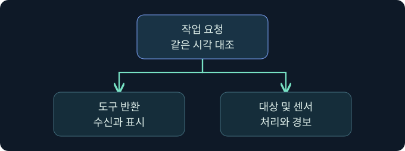
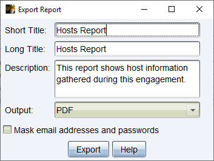

## 1. 도구 보고서가 증거 검토에서 맡는 역할

가상의 업무 공유 점검에서 검증팀은 승인된 테스트 계정이 공유에 접근했는지 확인합니다. 작업자 기록에는 요청을 보냈다는 메모가 있고, 제품 보고서에는 세션 활동이 표시되며, 대상 서버에는 접근 검사 이벤트가 있습니다. 세 자료를 합치면 조사 방향을 정할 수 있지만 서로 다른 질문에 답합니다. 요청 전송, 대상의 권한 검사, 실제 데이터 사용까지 각각 근거가 필요합니다.

보고서 내보내기는 도구에 저장된 자료를 일정한 형식으로 정리하는 작업입니다. 이번 강의에서는 검토 목적에 맞는 유형을 선택하고, 범위·시각·민감 정보와 근거의 한계를 확인합니다. 모든 장치·파일·계정 이름은 가상이며 실제 제품 내보내기는 미실행입니다.

## 2. 질문에 따라 보고서 유형을 고릅니다

| 보고서 | 주로 답하는 질문 | 교차 확인 |
|---|---|---|
| Activity | 도구가 기록한 활동이 어떤 순서로 보이나요? | 작업자 기록, 대상 및 센서 시각 |
| Hosts | 호스트별로 어떤 항목이 수집됐나요? | 승인 자산 목록, 호스트 식별과 접근 범위 |
| Indicators of Compromise | 어떤 지표가 도구 기록에 연결됐나요? | 해시 알고리즘, 지표의 출처와 유효 기간 |
| Sessions | 세션별 활동과 지표가 어떻게 연결되나요? | 서버와 세션 식별자, 대상 결과 |
| Social Engineering | 도구에 기록된 시뮬레이션 참여 이벤트는 무엇인가요? | 승인 대상·기간, 중복 클릭 및 자동 검사 가능성 |
| TTP | 기록된 활동에 어떤 ATT&CK 분류가 붙었나요? | 원본 활동과 분류의 적합성 |

Activity는 전체 흐름, Sessions는 특정 세션의 경로를 이해하는 데 적합합니다. Hosts에는 민감한 항목이 포함될 수 있으므로 자산 확인에 필요한 필드만 제한적으로 공유합니다. IOC의 MD5는 도구가 제공하는 식별값의 형식을 뜻합니다. 무결성 관리가 목적이라면 승인된 자료에서 별도 SHA-256을 기록하고 서로 다른 알고리즘 값을 직접 비교하지 않습니다. TTP 항목은 활동 분류의 출발점이며 방어 통제가 작동했다는 판정은 센서와 대상 기록으로 확인합니다.

## 3. 데이터 범위를 먼저 고정합니다

여러 Team Server에 연결된 클라이언트는 보고서에 여러 서버의 기록을 반영할 수 있습니다. 생성 전에 승인된 평가의 서버, 날짜와 시간대, 세션과 호스트를 확인합니다. 서로 다른 서버의 이름이나 세션 번호가 같을 수 있으므로 단일 이름으로 합치지 않습니다. 내보내기 창에서 필터가 제공되지 않는 범위는 분석 단계에서 확인하고 보고서에 한계를 명시합니다.

가상의 두 서버 중 하나가 점검 도중 연결되지 않았다면 보고서에 해당 서버 활동이 모두 포함됐다고 가정하지 않습니다. 대상 시스템의 별도 로그나 작업자의 승인된 기록으로 공백을 확인하고, 시간대 및 시계 오차가 다르면 공통 기준으로 변환한 시각과 원래 시각을 함께 남깁니다.

## 4. 도구 기록과 실제 결과를 나눕니다

| 관측 | 말할 수 있는 범위 | 추가로 볼 근거 |
|---|---|---|
| 작업 등록 | 도구에 요청이 기록됨 | 세션 수신, 상태 및 반환 |
| 세션 반환 | 도구가 해당 응답을 받음 | 대상 호스트의 처리 및 시각 |
| 서버 접근 검사 | 대상에서 허용 또는 거부를 평가함 | 실제 객체·처리 결과와 사용 범위 |
| 센서 경보 | 방어 시스템에 경보가 기록됨 | 조사 시작과 대응 조치 |

세션 보고서는 특정 작업을 보존하는 데 유용합니다. 작업 항목에 명령이 보인다는 사실만으로 대상에서 모든 효과가 발생했다고 보고하지 않습니다. 로그가 비어 있으면 먼저 수집 조건과 기간, 제품 버전, 연결된 서버 목록을 검토합니다.

## 5. 원본 보존과 공유용 사본을 분리합니다

원본 내보내기는 조직이 승인한 제한 저장 위치에 보존합니다. 원본의 생성 시각, 적용 범위, 검증 담당자와 파일 식별값을 남깁니다. 검토용 사본에는 판단에 필요한 근거만 포함하고, 불필요한 개인정보·비밀·내부 식별값을 제거합니다. 문서 안의 본문뿐 아니라 이미지, 머리말, 문서 속성, 주석과 첨부도 확인합니다.

제품의 마스킹 옵션을 사용해도 모든 민감 정보가 자동으로 제거됐다고 가정할 수 없습니다. 파일을 열어 승인된 공유 대상과 공유 범위를 확인한 뒤 배포합니다. 공개 예시에는 독립적으로 작성한 합성 표를 사용합니다.

## 6. 공식 Export Report 화면에서 입력과 출력을 읽습니다

### 실제 화면 165: Fortra Export Report 대화상자

[Fortra Reporting and Logging 4.13](https://hstechdocs.helpsystems.com/manuals/cobaltstrike/current/userguide/content/topics/rpt-log0_reporting%20and%20logging.htm)의 그림 84입니다. 2026년 11월 10일 확인했습니다. 캡처의 실제 설치 버전과 설치 환경의 필드는 다를 수 있습니다. 그림에 보이는 Hosts Report와 체크 상태는 Fortra의 시연값입니다.

1. 승인된 교육용 클라이언트에서 연결 범위를 확인한 뒤 **Reporting → Hosts Report**를 선택하는 미실행 절차입니다.
2. **Short Title**에 가상의 `LAB-20`, **Long Title**에 `승인 자산 관측 검토`, **Description**에 `합성 자산만 포함 · 내부 검토용`을 입력합니다. 짧은 제목은 검토 건을 식별하고 긴 제목과 설명은 목적 및 공개 범위를 밝히는 값입니다.
3. **Output**에서 검토용 **PDF**를 고릅니다. 화면처럼 **Mask email addresses and passwords**가 제공되면 체크합니다. 이 항목은 보조 수단이며 공유 전 내용 검토가 필요합니다.
4. **Export**를 누르고 저장 위치를 묻는 경우 승인된 제한 폴더와 가상 파일명 `lab20-hosts-review.pdf`를 지정합니다. 내보낸 파일을 열어 제목, 대상, 기간, 빈 구간, 민감 정보와 표시 형식을 확인합니다.

가상 설정의 저장 창과 PDF 결과 화면은 확보하지 못했습니다. 이번 강의에서 제품 실행, 로그 수집 또는 문서 내보내기는 수행하지 않았습니다.

## 7. 출처를 대조하는 순서

1. 승인 범위, 기록의 출처와 관측 시간을 적습니다. 보고서의 호스트 표시를 승인된 자산 목록과 비교합니다.
2. 작업 기록을 필요한 수준에서 사건 ID와 연결합니다. 기술적 세부는 근거를 재확인할 수 있을 만큼만 기록합니다.
3. 대상 결과와 방어팀 관측을 별도 열에 넣습니다. 확인되지 않은 항목은 ‘미수집’, ‘아직 미확인’ 등 이유를 적습니다.
4. 원본은 제한 위치에 보존하고 검토용 사본을 검사합니다. 받는 사람과 공개 수준을 검토한 뒤 승인된 채널에서만 공유합니다.

## 8. 결과가 달라졌을 때 범위를 고쳐 씁니다

| 가상 상황 | 잠정 해석 | 다음 확인 |
|---|---|---|
| 도구에는 요청만 있고 응답 없음 | 요청 기록 확인, 완료 미확인 | 세션 반환과 대상 기록 |
| 대상 활동과 방어 경보의 시각이 다름 | 서로 다른 시계 또는 수집 지연 가능 | UTC 환산과 발생·수집 시각 |
| 특정 서버를 포함했는지 모름 | 전체 활동 범위 미확인 | 서버 연결과 원본 목록 |
| 공유용 PDF에 내부 이름이 남음 | 추가 비식별화 필요 | 본문, 이미지, 속성 및 첨부 검토 |

도구의 결과를 보고서에 첨부하더라도 판단 근거와 결과 범위를 본문에서 설명합니다. 도구가 관측하지 못한 단계는 보고서에 없을 수 있으므로 사건 전체가 없었다고 결론 내리지 않습니다.

## 9. 인수인계에 필요한 최소 정보를 정합니다

증거 목록에 평가 ID, 자료 ID, 원본 위치의 내부 참조, 생성자, 시간대, 민감도, 검토 상태를 남깁니다. 예를 들어 ‘가상 E-20-03, 세션 보고서, 대상 로그와 시각 대조 완료, 승인된 검토자만 열람’처럼 정리합니다. 활동 내용은 다음 강의의 관찰·권고와 연결하되 원본 파일 위치를 공개 글에 그대로 싣지 않습니다.

## 10. 복습과 즉시 해설

### 복습 1. 세션별 활동을 보려면 무엇을 검토하나요?
**해설:** Sessions를 출발점으로 삼고 세션 ID, 서버, 대상 기록을 대조합니다.

### 복습 2. 도구에 작업이 등록되면 대상에서 완료됐나요?
**해설:** 등록과 수신·실행·업무 결과는 별개이며 대상 기록이 필요합니다.

### 복습 3. TTP 분류가 방어 통제 성공을 입증하나요?
**해설:** 활동 분류입니다. 방어의 탐지와 대응은 각각의 근거를 확인합니다.

### 복습 4. 여러 Team Server가 연결되면 무엇을 확인하나요?
**해설:** 승인 범위에 해당하는 서버와 세션, 기간을 따로 확인합니다.

### 복습 5. 마스킹을 켜면 사본을 바로 공유해도 되나요?
**해설:** 본문·이미지·문서 속성과 첨부에 남은 자료를 검토합니다.

### 복습 6. 보고서의 MD5와 보존용 SHA-256을 직접 비교하나요?
**해설:** 서로 다른 알고리즘입니다. 각각의 용도와 자료 출처를 기록합니다.

### 복습 7. 로그의 시간이 다르면 먼저 무엇을 보나요?
**해설:** 시간대, 시계 차이와 발생·수집 시각을 구별합니다.

### 복습 8. 원본과 공유용 사본을 왜 분리하나요?
**해설:** 원본의 증거성을 보존하면서 받는 사람에게 필요한 범위만 전달합니다.

## 11. 공식 자료와 확인 범위

- [Fortra · 보고서 유형](https://hstechdocs.helpsystems.com/manuals/cobaltstrike/current/userguide/content/topics/reports-logs_reports.htm)
- [Fortra · Logging](https://hstechdocs.helpsystems.com/manuals/cobaltstrike/current/userguide/content/topics/reports-logs_logs.htm)
- [NIST SP 800-115 · 평가 및 결과 보고](https://csrc.nist.gov/pubs/sp/800/115/final)

2026년 11월 10일 확인했습니다. 화면의 공식 시연과 강의의 합성 사례를 구분했습니다.
