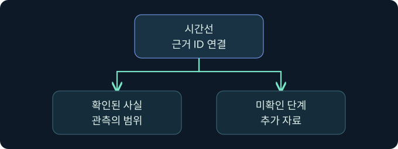
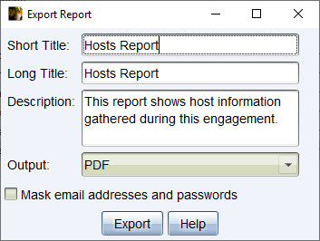
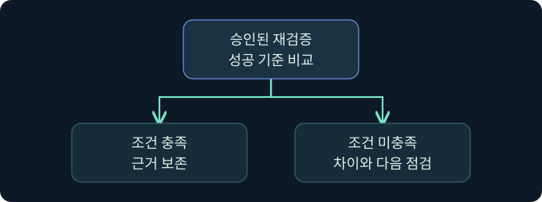

## 1. 평가 보고서는 다음 결정을 돕습니다

가상의 검증팀은 승인된 공유의 읽기 접근이 탐지되고 검토되는지 평가했습니다. 대상에서는 한 건의 접근 검사가 관측됐지만 중앙 경보와 대응 기록은 수집 구간에서 확인되지 않았습니다. 보고서에는 확인된 접근 검사, 경보 상태, 수집 제한을 따로 적고, 다음에 어떤 자료를 검토할지 정해야 합니다.

평가 보고서의 독자는 업무 책임자, 기술 담당자, 재검증 담당자입니다. 같은 근거를 사용하되 독자마다 먼저 필요한 정보가 다릅니다. 기술 담당자가 원본을 추적할 수 있고 업무 책임자가 우선순위를 정할 수 있게 구성합니다.

## 2. 보고서의 다섯 부분을 구성합니다

| 부분 | 독자가 얻어야 할 답 | 포함할 내용 |
|---|---|---|
| 경영진 요약 | 어떤 업무 위험과 결정이 중요한가요? | 핵심 결과, 영향 범위와 우선 조치 |
| 목표와 시나리오 | 어떤 조건에서 무엇을 검증했나요? | 승인된 목표·기간·대상, 가정과 제한 |
| 사건 흐름 | 실제로 어떤 단계가 관측됐나요? | 시간선, 자료 ID, 관측·추론 구분 |
| 관찰 및 권고 | 무엇을 보완해야 하며 누가 맡나요? | 판정, 영향, 담당자·기한·완료 기준 |
| 결론 | 무엇이 확인됐고 무엇을 다시 보나요? | 확인 범위, 남은 위험과 재검증 계획 |

기술적인 부록에는 상세 증거의 참조와 승인된 범위의 예를 둡니다. 경영진 요약에는 조사에서 뒷받침된 업무 결과와 의사결정 사항을 먼저 배치합니다. 도구의 자동 보고서를 그대로 붙이면 어떤 근거가 최종 판단을 지지하는지 독자가 다시 분석해야 합니다.

## 3. 목표, 범위와 제한을 기록합니다

‘파일 공유 보안 확인’보다 ‘승인된 교육용 계정의 읽기 요청이 대상 기록과 중앙 경보에 남는지 확인’이 검증 가능합니다. 승인 대상과 시간, 허용 동작, 제외 항목을 교전수칙 등 승인 문서와 맞춥니다. 가상 사례에서 쓰기와 삭제는 검증 범위가 아니므로 읽기 근거로 쓰기 통제를 평가하지 않습니다.

공유와 장치가 여러 개라면 어느 장치의 증거를 확보했는지 남깁니다. 범위 내에서도 센서 상태가 달랐다면 별도 조건으로 분류합니다. 시험하지 않은 범위는 발견 사항이 없다는 표현으로 합치지 않습니다.

## 4. 시간선에서 관측과 추론을 구분합니다

| UTC 예시 | 근거 ID와 관측 | 판단의 한계 |
|---|---|---|
| 01:20 | E-20-01, 승인된 계정의 읽기 요청 기록 | 도구의 요청 시각 |
| 01:21 | E-20-02, 서버가 공유의 접근 요청을 평가 | 실제 파일 내용 전달 여부는 별도 |
| 01:25 | E-20-03, 중앙 검색 구간과 결과를 보존 | 경보가 그 검색 범위에서 미확인 |

보고서에서 ‘조사팀이 경보를 확인하지 못했다’와 ‘조직이 탐지하지 못했다’의 범위는 다릅니다. 센서가 경보를 생성했지만 전달이 지연됐을 수도 있습니다. 자료가 없는 단계는 가설을 붙이되 확인 방법과 책임을 명시합니다. 시간선은 누가 무엇을 기록했고 어떤 단계가 연결되는지 검토할 수 있어야 합니다.

## 5. 관찰에서 우선순위와 권고를 도출합니다

예를 들어 ‘중앙 경보를 확인하지 못함’이라는 관찰이 있다면, 영향은 ‘이 유형의 승인 범위 접근을 중앙 분석에서 식별하는 시점이 지연될 수 있음’처럼 근거 범위에 맞춥니다. 고위험으로 분류하려면 영향받는 업무, 중요도, 범위, 악용 조건과 불확실성이 그 판단을 뒷받침해야 합니다. 로그 누락 하나만으로 전체 방어 실패를 선언하지 않습니다.

권고는 ‘로그를 개선하세요’보다 구체적으로 씁니다. 가상 권고는 ‘로그 플랫폼 담당자가 해당 서버 채널의 수집·파싱 상태를 확인하고, 통제 담당자가 승인된 읽기 이벤트를 동일 기준으로 재검증한다’입니다. 완료 조건은 대상 기록, 중앙 이벤트와 승인된 검토 절차의 증거입니다. 목표 도착 시간은 조직의 합의값을 기록하며 업계 공통 기준으로 제시하지 않습니다.

## 6. 공식 내보내기 화면을 부록 작성에 연결합니다

### 실제 화면 166: Fortra Export Report 대화상자

[Fortra Reporting and Logging 4.13](https://hstechdocs.helpsystems.com/manuals/cobaltstrike/current/userguide/content/topics/rpt-log0_reporting%20and%20logging.htm)의 그림 84입니다. 2026년 11월 10일 확인했습니다. 공식 캡처는 Hosts Report 예시입니다. 아래 Activity Report의 필드 제공 여부와 배치는 설치 버전 및 보고서에 따라 다를 수 있습니다.

1. 승인된 합성 기록만 있다고 가정해 **Reporting → Activity Report**를 선택하는 미실행 절차입니다. 전체 사건 흐름을 기술 부록과 대조하려는 선택입니다.
2. 표시되는 경우 **Short Title**에 `LAB-20-A`, **Long Title**에 `가상 평가 활동 부록`, **Description**에 `검토용 · 대상 증거와 별도`를 넣습니다. 이 값은 부록의 근거 유형을 구별하기 위한 예입니다.
3. **Output → PDF**를 선택하고 마스킹 항목이 제공되면 체크합니다. **Export**를 눌러 승인된 제한 폴더에 가상의 `lab20-activity-appendix.pdf`를 저장하는 절차입니다.
4. 결과의 제목, 시간대, 범위와 민감 정보 잔존 여부를 확인합니다. 항목이 빠졌다면 원본 기록과 대상 로그를 다시 대조합니다. 배포 여부는 별도로 승인받습니다.

Activity Report의 해당 입력 화면, 파일 저장 창과 가상 PDF의 실제 사진은 확보하지 못했습니다. 제품 실행과 문서 내보내기는 미실행입니다.

## 7. 조치 담당자와 재검증 조건을 정합니다

1. 발견 사항별로 증거 ID와 영향, 관련 업무 통제, 담당자를 지정합니다.
2. 권고를 적용할 장치와 정책, 업무 영향 및 예정일을 합의합니다. 변경 계획과 실제 적용 여부를 분리합니다.
3. 동일하거나 비교 가능한 조건에서 볼 근거를 정합니다. 테스트 주체, 장치, 승인 기간, 수집 채널과 성공 판정 기준을 기록합니다.
4. 재검증 결과는 ‘충족’, ‘부분 충족’, ‘미충족’, ‘검증 불가’처럼 조건에 따라 구분합니다. 자료가 부족하면 부족한 항목과 재개 기준을 남깁니다.

## 8. 조건 변화에 따라 보고서를 갱신합니다

| 가상 변경 | 보고서에 반영할 판단 |
|---|---|
| 중앙 이벤트는 도착하지만 대응 기록 없음 | 수집은 확인, 대응 검증은 별도 유지 |
| 환경에 다른 정책이 적용됨 | 이전 시험과 비교 가능한 조건인지 먼저 확인 |
| 보고 범위에서 제외된 자산이 발견됨 | 승인 범위와 별도로 표시하고 자료 공개 범위 검토 |
| 권고 적용 확인, 재검증 기록 없음 | 조치 적용은 관측됐지만 효과는 미확인 |

경영진 요약에서도 제한이 빠지면 기술 본문의 근거보다 강한 결론이 전달됩니다. 예를 들어 ‘모든 공유 접근을 검증’이라는 문장을 ‘승인된 두 장치에서 지정한 읽기 경로를 검증’으로 구체화합니다.

## 9. 배포용 문서와 원본 근거를 분리합니다

제목, 평가 기간, 상태, 검토자, 버전, 접근 등급을 확인합니다. 공개용 합성 예시와 승인된 고객 보고서, 원본 증거는 배포 대상이 다릅니다. 보고서에 사용한 스크린샷은 자산명과 민감 정보 잔존 여부를 확인합니다. 파일과 문서 속성, 첨부와 링크도 검토합니다. 원본의 보존 위치를 일반 배포본에 직접 공개하지 않습니다.

이 강의의 사례는 합성 기록이며 실제 활동과 고객 평가 결과를 의미하지 않습니다. 결과 표는 내보낸 제품 파일의 내용이 아니라 보고서 작성 연습입니다.

## 10. 복습과 즉시 해설

### 복습 1. 경영진 요약의 첫 질문은 무엇인가요?
**해설:** 어떤 업무 위험이 확인됐고 어떤 결정이 필요한지입니다.

### 복습 2. 도구 보고서로 최종 관찰을 대체할 수 있나요?
**해설:** 도구 기록은 근거의 일부입니다. 승인 범위, 대상 기록과 판단을 함께 설명합니다.

### 복습 3. 경보가 검색되지 않았을 때 어떤 표현이 적절한가요?
**해설:** 확인한 범위와 기간에서 미관측이라고 쓰고 수집 조건을 밝힙니다.

### 복습 4. 쓰기를 시험하지 않았다면 읽기 결과를 쓰기에 적용하나요?
**해설:** 읽기 확인과 쓰기 미검증을 각각 보고합니다.

### 복습 5. 권고가 실무에서 완료됐음을 어떻게 확인하나요?
**해설:** 담당자와 완료 기준을 정하고 적용 증거와 재검증 결과를 따로 봅니다.

### 복습 6. 자동 보고서의 마스킹으로 모든 정보가 제거되나요?
**해설:** 옵션의 적용 범위를 확인하고 문서와 첨부를 별도로 검토합니다.

### 복습 7. 환경이 바뀐 재검증 결과를 바로 비교하나요?
**해설:** 정책, 장치, 대상과 수집 범위가 비교 가능한지 확인합니다.

### 복습 8. 결과를 입증하지 못한 항목은 어떻게 기록하나요?
**해설:** 미확인 이유, 필요한 자료와 재개 조건을 남깁니다.

## 11. 공식 자료와 확인 범위

- [NIST SP 800-115 · 평가 보고와 개선](https://csrc.nist.gov/pubs/sp/800/115/final)
- [Fortra · Activity Report와 기타 보고서 유형](https://hstechdocs.helpsystems.com/manuals/cobaltstrike/current/userguide/content/topics/reports-logs_reports.htm)
- [MITRE · ATT&CK 분류 체계](https://attack.mitre.org/)

2026년 11월 10일 확인했습니다. 공식 화면, 합성 자료 및 미실행 절차를 각각 표시했습니다.
