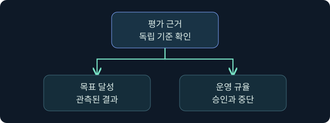
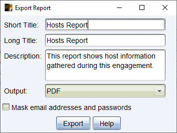
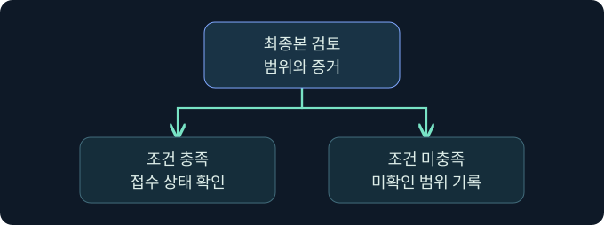

## 1. 최종 평가에서 무엇을 증명하나요?

가상의 조직이 공유 폴더의 접근 통제를 평가합니다. 승인된 교육 계정으로 요청한 읽기 작업이 어디까지 허용됐는지, 보안팀이 그 요청을 관측할 수 있었는지가 목표입니다. 작업에 성공했다는 기록, 그 작업이 승인 범위 안이었다는 근거, 조직이 관측한 기록은 서로 다른 질문에 답합니다.

이 강의에서는 **승인 범위 → 목표 검증 → 제출 → 결과 개선**을 한 흐름으로 연결합니다. 사례의 이름, 시간, 배점과 결과는 독립적으로 만든 연습용 자료입니다. 실제 시험 안내는 해당 시험의 최신 공식 지침에서 확인합니다.

## 2. 출발 조건과 승인 범위를 문장으로 적습니다

가상 평가에서 ‘내부에 이미 초기 접근이 있다고 가정’하면 초기 접근 단계를 검증한 것이 아닙니다. 평가자가 제공한 출발점에서 어떤 보호를 확인하는지 명시합니다. 제공된 장치, 대상 목록, 계정, 시간 창과 금지 동작을 각각 적고 경계가 불분명하면 작업을 보류합니다. 도구에 자산이 표시된다는 사실은 그 자산을 승인 범위에 넣지 않습니다.

| 항목 | 가상 예 | 검증할 경계 |
|---|---|---|
| 출발 조건 | 제공된 교육용 워크스테이션 한 대 | 외부 진입이나 다른 장치 접근은 평가에 포함되지 않음 |
| 대상 | 승인 목록의 교육용 공유 | 유사한 이름의 운영 공유 제외 |
| 허용 작업 | 읽기 요청의 관측을 기존 기록으로 검토 | 쓰기·삭제·설정 변경은 평가에 포함되지 않음 |
| 중단 조건 | 대상 식별 불일치 또는 예상 밖 자료 노출 | 추가 활동을 보류하고 지정된 평가 담당자에게 보고 |

검토를 시작하기 전에 목표와 중단 조건을 한 문장씩 씁니다. 시간이 촉박할수록 이 기록이 작업 범위를 지키는 기준이 됩니다.

## 3. 목표 달성과 운영 규율을 독립적으로 평가합니다

연습용 채점표에서는 목표 증거를 60점, 범위·보존·안전 준수를 40점으로 가정합니다. 목표 근거가 있어도 범위 위반이 확인되면 검토 결과가 달라질 수 있도록 별도의 중단 기준을 둡니다. 이 수치는 과정의 가상 예시입니다. 점수 자체보다 각 항목의 증거와 판정 조건이 명확해야 합니다.

| 축 | 완료 근거 | 확인할 한계 |
|---|---|---|
| 목표 | 승인된 대상의 접근 검사와 요청 신원 | 실제 파일 내용 전달까지 관측했는가 |
| 범위 준수 | 대상·작업·기간이 승인 문서와 일치 | 승인되지 않은 요청이 기록에 섞였는가 |
| 증거 품질 | 출처·시각·자산 ID·원본 참조가 연결됨 | 누락된 채널과 오차 범위 |
| 운영 규율 | 금지 동작 제외, 중단 및 보고 절차 준수 | 방어 경보가 없다는 이유로 준수를 확정할 수 없음 |

경보는 방어 관측의 근거가 될 수 있습니다. 경보를 피하기 위해 활동을 바꾸는 대신, 어떤 행위와 관측이 있었는지와 어떤 조건에서 평가했는지를 보고합니다.

## 4. 활성 시간과 마감 시각을 따로 관리합니다

가상 시험은 ‘활성 환경 90분’과 ‘다음 날 17시 제출’이라는 두 제약을 둡니다. 환경을 멈췄을 때 활성 시간의 소모가 중단되더라도 달력상의 제출 마감은 계속 진행될 수 있습니다. 실제 동작은 제공자의 최신 안내와 화면 상태를 확인합니다. 시간대가 다른 경우 절대 마감 시각과 로컬 변환값을 함께 적습니다.

예를 들어 15시 40분에 활성 시간이 35분 남고 제출 마감이 17시라면, 자료 검토와 제출에 필요한 시간도 남겨야 합니다. 활성 시간이 충분해 보여도 별도의 마감에 먼저 도달할 수 있습니다. 중단 전에 저장 상태, 미완료 점검, 다음에 볼 자료와 승인된 저장 위치를 적습니다. 화면에 저장 완료가 확인되지 않으면 재개 가능성을 가정하지 않습니다.

## 5. 제출 전 증거 묶음을 완성합니다

작업 일지와 대상 로그, 방어팀 관측의 시각을 대조합니다. 예를 들어 E-97-01은 요청이 기록됐음을, E-97-02는 대상에서 접근 검사가 이루어졌음을, E-97-03은 중앙 수집 범위와 검색 조건을 보여 줍니다. E-97-03에서 경보가 미확인이라면 ‘수집 범위에서 미관측’이라고 씁니다. 대응이 없었다는 판정에는 대응 절차와 해당 기간에 대한 별도 근거가 필요합니다.

원본과 제출용 사본을 구분합니다. 제출물에는 승인된 자료만 남기고 문서의 본문, 이미지, 주석, 속성과 첨부에서 불필요한 식별 정보를 점검합니다. 출처가 바뀌거나 시간선에 공백이 생겼다면 결론과 부록의 범위를 함께 고칩니다.

## 6. 공식 Export Report 화면에서 증거 부록의 경계를 확인합니다

### 실제 화면 167: Fortra Export Report 대화상자

[Fortra Reporting and Logging 4.13](https://hstechdocs.helpsystems.com/manuals/cobaltstrike/current/userguide/content/topics/rpt-log0_reporting%20and%20logging.htm)의 공식 그림 84입니다. 2026년 11월 10일 확인했습니다. 캡처는 Hosts Report 예시이며 설치 버전 및 보고서 종류에 따라 필드와 배치가 다를 수 있습니다. 그림에 보이는 값은 공식 문서의 시연입니다.

1. 합성 기록만 있는 승인된 교육 클라이언트에서 **Reporting → Hosts Report**를 고르는 미실행 예입니다. 자산 목록을 평가 범위와 대조하기 위한 선택입니다.
2. **Short Title**에 `LAB-21`, **Long Title**에 `가상 평가 자산 부록`, **Description**에 `승인 자산 대조용`을 입력합니다. 평가 ID와 자료의 목적을 구분하는 값입니다.
3. **Output → PDF**를 선택하고 마스킹 항목이 있으면 체크합니다. **Export**를 누르고 저장 위치를 묻는 경우 승인된 제한 폴더에 `lab21-scope-appendix.pdf`를 지정합니다.
4. 파일을 열어 제목, 장치 범위와 민감 정보 잔존 여부를 확인합니다. 이 내보내기는 평가 제출과 별개입니다.

가상 저장 창, PDF 결과 및 평가 플랫폼의 제출·채점 화면은 확보하지 못했습니다. 제품 실행, 내보내기, 평가 제출은 미실행입니다.

## 7. 제출과 평가 처리의 상태를 구별합니다

1. 제출 전 승인 범위, 목표 증거, 검토한 자료와 미확인 항목을 점검합니다. 파일이 열리는지, 최종본과 첨부가 서로 맞는지 확인합니다.
2. 실제 시험의 안내에서 제출이 되돌릴 수 있는지, 확정 후 세션을 계속 사용할 수 있는지 확인합니다. 가상의 사례는 한 번 확정하면 종료되는 방식입니다.
3. 제출 후에는 접수 확인, 처리 중, 결과 확인을 구분합니다. 처리 중 화면이 보이면 공식 지침에 따라 상태를 확인하고 같은 파일을 반복 제출하지 않습니다.
4. 결과 보고서의 항목을 제출한 근거와 대조하고, 기술적 결론과 운영 절차의 개선점을 분리해 기록합니다.

마감 직전에 자료가 부족하더라도 검증되지 않은 결과를 단정하지 않습니다. 제출 상태가 모호하면 접수 확인과 공식 지원 경로를 사용합니다.

## 8. 조건이 바뀐 가상 결과를 판정합니다

| 변화 | 기록할 판정 | 재검증할 근거 |
|---|---|---|
| 읽기 요청과 대상 검사 확인, 실제 전달 미확인 | 접근 검사 확인, 전달 미확인 | 승인된 파일 작업 감사 |
| 경보는 관측됐지만 대응 자료 없음 | 탐지 관측, 대응 미확인 | 경보와 대응 기록 연결 |
| 자산 ID가 승인 문서와 다름 | 평가 범위 일치 미확인 | 승인 목록과 원본 자산 매핑 |
| 처리 중 화면 이후 접수 번호가 보이지 않음 | 제출 상태 미확인 | 공식 접수 상태와 지원 경로 |

연습 결과에서 ‘미확인’은 평가를 포기한다는 뜻이 아닙니다. 어떤 증거가 부족했고 어떻게 확인하면 판단이 바뀔지를 설명할 수 있는 상태입니다.

## 9. 평가 결과에서 다음 학습 과제를 정합니다

결과 보고서를 받은 뒤 점수만 확인하면 무엇을 개선해야 할지 알기 어렵습니다. 각 항목을 **범위 이해**, **증거 연결**, **시간 관리**, **보고 표현**으로 분류하고 다음 연습에서 관측할 행동을 하나씩 정합니다. 예를 들어 시간선 연결이 약했다면 다음 연습에서 서로 다른 출처의 원시 시각과 정규화한 시각을 모두 기록합니다.

가상의 종료 기록은 ‘목표 근거 일부 확보, 자료 공백 명시, 추가 활동 종료’처럼 확인한 범위와 남은 항목을 함께 적습니다. 이 과정의 종합 실습은 합성 자료 해석과 보고 연습입니다.

## 10. 복습과 즉시 해설

### 복습 1. 제공된 초기 접근은 어떤 검증 범위를 뜻하나요?
**해설:** 제공된 출발점 이후를 평가합니다. 앞 단계가 실제로 검증됐다는 뜻은 아닙니다.

### 복습 2. 목표를 달성하면 운영 규율도 자동으로 충족되나요?
**해설:** 목표의 증거와 승인 범위·중단 기준 준수를 각각 평가합니다.

### 복습 3. 활성 시간이 남아 있으면 제출 마감도 남았나요?
**해설:** 두 제약은 별개입니다. 각각의 잔여 시간과 기준 시간대를 확인합니다.

### 복습 4. 경보가 검색되지 않으면 무엇을 기록하나요?
**해설:** 확인한 범위와 수집 조건, 미관측 사실을 적습니다.

### 복습 5. 자료를 멈추거나 저장하기 전에 무엇을 남기나요?
**해설:** 저장 상태와 잔여 시간, 재개 지점, 승인된 증거 위치를 기록합니다.

### 복습 6. 제품에서 Export를 누르면 평가가 제출되나요?
**해설:** 제품 보고서 생성과 평가 플랫폼의 제출은 서로 다른 절차입니다.

### 복습 7. 접수 확인이 없는 상태에서 제출을 완료로 표시하나요?
**해설:** 접수·처리·결과를 구별하고 확인되지 않은 상태는 미확인으로 남깁니다.

### 복습 8. 결과 보고서는 다음 학습에 어떻게 쓰나요?
**해설:** 점수의 근거를 행동과 연결해 범위, 시간, 증거 또는 표현 중 다음 개선 항목을 고릅니다.

## 11. 공식 자료와 확인 범위

- [NIST SP 800-115 · 평가 계획과 근거 분석 및 결과 보고](https://csrc.nist.gov/pubs/sp/800/115/final)
- [Fortra · 보고서 유형과 범위](https://hstechdocs.helpsystems.com/manuals/cobaltstrike/current/userguide/content/topics/reports-logs_reports.htm)

2026년 11월 10일 확인했습니다. 제품의 공식 화면과 합성 평가 사례를 구별했습니다.
